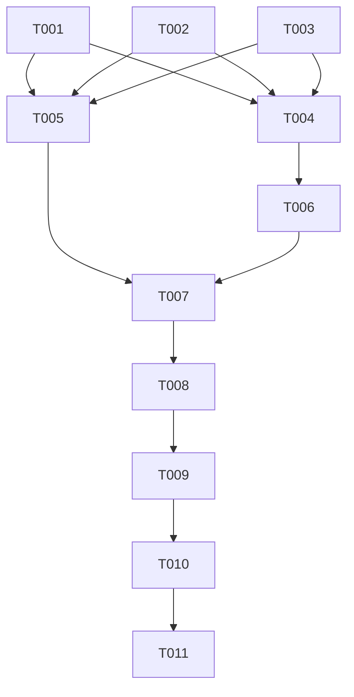

# Tasks: Import PNG Illustrations

**Input**: Design documents from `specs/056-import-png-illustrations/`

**Prerequisites**: `plan.md`, `spec.md`, `research.md`, `data-model.md`, and `quickstart.md` are available. No external contracts apply.

**Tests**: Included because this feature specification defines independently verifiable acceptance criteria and the repository constitution requires focused tests for frontend behavior changes.

**Organization**: Tasks are grouped by the two prioritized user stories in the specification.

## Phase 1: Setup

**Purpose**: The static application, message catalog, test suites, and image assets already exist; no project initialization or new dependencies are needed.

- No setup tasks required.

---

## Phase 2: Foundational

**Purpose**: No shared infrastructure changes are needed. The existing image element and catalog support the feature; work can proceed directly to the independently testable stories.

- No foundational tasks required.

---

## Phase 3: User Story 1 - See the supplied illustrations during import (Priority: P1) 🎯 MVP

**Goal**: Display cleaned PNGs 01–19 for messages 02–20, remove all messages without PNGs and any SVG usage, and preserve actual message text and progress behavior.

**Independent Test**: Run the focused Jest suites and verify each cleaned PNG maps to its embedded-copy message (01.png→message 2 through 19.png→message 20), no message lacks PNG backing, and a failed PNG shows no vector while keeping status content.

### Tests for User Story 1

- [X] T001 [P] [US1] Assert that catalog messages 02–20 map to PNGs 01–19 with same-message SVG fallbacks and message 1 remains SVG in `__tests__/import-experience.test.js`.
- [X] T002 [P] [US1] Validate PNG signatures/dimensions for messages 02–20 using files 01–19, check the T1 initial SVG and retain reduced-motion assertions in `__tests__/index-script-syntax.test.js`.
- [X] T003 [P] [US1] Add renderer tests for clearing stale artwork, not rendering a vector after PNG load error, and keeping message/status content visible in `__tests__/dashboard-import.test.js`.

### Implementation for User Story 1

- [X] T004 [US1] Map catalog messages 02–20 to cleaned PNGs 01–19 and remove the message without a supplied image in `src/import-experience-catalog.js`.
- [X] T005 [P] [US1] Set `01.png` and its matching message-02 copy as the import dialog's initial image/text in `index.html`.
- [X] T006 [US1] Update the illustration renderer to clear stale artwork and show no image on PNG load failure, without loading any SVG fallback, in `src/dashboard-import.js`.
- [X] T007 [US1] Run `npm test -- --runInBand __tests__/import-experience.test.js __tests__/dashboard-import.test.js __tests__/index-script-syntax.test.js` and verify PNG-only assets in `__tests__/index-script-syntax.test.js`.

**Checkpoint**: Messages 02–20 display their paired local PNG; message 1 retains its SVG and image-failure fallback behavior remains usable.

---

## Phase 4: User Story 2 - Preserve special and personalized import messaging (Priority: P2)

**Goal**: Keep only PNG-backed personal messages, remove the personal T1/SVG message, and use PNG 19 for phase-gated message 20.

**Independent Test**: With US1's mapping available, verify all personal messages use supplied PNGs, no SVG-backed personal candidate is created, and message 20 uses `19.png` only in the finalizing phase.

### Tests for User Story 2

- [X] T008 [US2] Assert that personal scenes 10, 07, 13, 05, and 16 map to PNGs 09, 06, 12, 04, and 15; no scene-01 SVG candidate is emitted; and message 20 maps to PNG 19 but remains finalization-only in `__tests__/import-experience.test.js`.

### Implementation for User Story 2

- [X] T009 [US2] Update personal-message generation to omit scenes without a supplied PNG and use the offset PNG for supported scenes in `src/import-experience-catalog.js`.
- [X] T010 [US2] Run `npm test -- --runInBand __tests__/import-experience.test.js __tests__/dashboard-import.test.js __tests__/index-script-syntax.test.js`; confirm personal mappings and message-20 gating pass in `__tests__/import-experience.test.js`.

**Checkpoint**: Personal message artwork matches its reused scene, and finalization message 20 uses the provided matching PNG without changing its phase eligibility.

---

## Phase 5: Polish & Cross-Cutting Concerns

**Purpose**: Confirm the responsive presentation and end-to-end behavior beyond automated mapping tests.

- [X] T011 [P] Perform desktop/narrow-viewport checks for PNG 01 on message 2, PNG 19 on message 20, absence of the reminder/vector graphics, and no overlap using `specs/056-import-png-illustrations/quickstart.md`.

---

## Dependencies & Execution Order

### Phase Dependencies

- Setup (Phase 1): no tasks; current application and provided assets are already in place.
- Foundational (Phase 2): no tasks; no shared infrastructure blocks story implementation.
- User Story 1 (Phase 3): may begin immediately. Tests T001–T003 can be written in parallel; after they fail as expected, T004 and T005 affect separate files and can be implemented in parallel. T006 depends on T004's fallback metadata. T007 follows the story implementation.
- User Story 2 (Phase 4): depends on User Story 1's catalog mapping/fallback convention (T004/T006); its test, implementation, and focused verification proceed in that order.
- Polish (Phase 5): after both stories are complete.

### User Story Dependencies

- User Story 1 (P1): no dependency on another story; delivers the regular-message PNG replacement.
- User Story 2 (P2): depends on the primary/fallback image mapping established by User Story 1; it preserves personal-message mappings and the special message-20 exception.

### Parallel Opportunities

- T001, T002, and T003 can run in parallel because they modify separate test files.
- After those tests are in place, T004 and T005 can run in parallel because they modify the catalog and HTML markup respectively; T006 waits for T004's fallback metadata.
- T011 is a separate manual validation task after both user-story checkpoints.

### Dependency Graph



## Parallel Example: User Story 1

```text
Parallel: T001 updates catalog unit assertions in __tests__/import-experience.test.js
Parallel: T002 updates static UI/asset assertions in __tests__/index-script-syntax.test.js
Parallel: T003 adds image-load fallback tests in __tests__/dashboard-import.test.js
After tests fail as expected, parallel: T004 updates message catalog mappings in src/import-experience-catalog.js
After tests fail as expected, parallel: T005 updates the initial image markup in index.html
Then: T006 implements same-message fallback handling in src/dashboard-import.js
Then: T007 runs the focused Jest suites
```

## Implementation Strategy

### MVP First (User Story 1)

1. Confirm offset mapping tests fail against the current SVG paths.
2. Implement PNG paths for messages 02–20, retain the T1 SVG, and add paired SVG fallbacks.
3. Run the two focused Jest suites and validate the P1 story independently.
4. Continue with User Story 2 to update personal messages and verify the message-20 exception before considering the complete feature ready.

### Incremental Delivery

1. Complete US1 and verify PNG 01–19 are paired with messages 02–20 while message 1 retains its SVG.
2. Complete US2 and verify personal messages plus message 20 independently.
3. Run the browser checks in `quickstart.md` for responsive appearance and fallback behavior.

