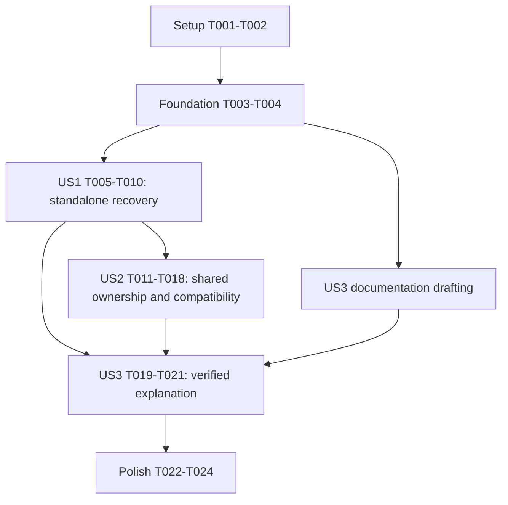

# Tasks: Restore Swim GPS Heatmap Visibility

**Input**: [spec.md](spec.md), [plan.md](plan.md), [research.md](research.md), [data-model.md](data-model.md), [contracts/import-heatmap.md](contracts/import-heatmap.md), [quickstart.md](quickstart.md).

**Prerequisites**: Approved design and TrainingPeaks complete-import failure exception. Root static app and Node/Jest only; no new runtime, framework, persistence or service.

**Tests**: Required explicitly by FR-006 and the constitution. Write regression tests before production edits, run the narrowest relevant check immediately after each substantive edit, and preserve actual red/green evidence. A compatibility test may already pass; a new failure-detection test must fail for its intended reason before correction.

**Organization**: Six phases, grouped by user story. All tasks start unchecked; generating this file does not implement the correction.

## Format: `[ID] [P?] [Story] Description`

- `[P]` identifies file-independent tasks that may run together once their stated prerequisites are complete.
- `[US1]`, `[US2]`, `[US3]` map to the specification stories, not new product features.
- Paths in task descriptions are repository-relative. Evidence belongs in the existing feature guide, not a new report file.

## Path Conventions

Production changes belong in `src/zip-importer.js`; reusable utilities retain CommonJS/browser bridges. Extend existing tests under `__tests__/`, import documentation under `docs/`, and feature evidence under `specs/062-restore-swim-heatmap/`. Do not introduce model/service layers or new dependencies for these existing in-memory entities.

## Phase 1: Setup (Shared Infrastructure)

**Purpose**: Confirm the existing environment and baseline, without scaffolding a new project.

- [X] T001 Verify the root scripts and installed dependencies against package.json and jest.config.js; use `npm ci` only if dependencies are missing, confirm the Node test environment, and preserve the independent services/api/package.json dependency boundary.
- [X] T002 Run `npm test -- --runInBand __tests__/zip-importer.test.js __tests__/dashboard-heatmap.test.js` and record the current baseline and command in specs/062-restore-swim-heatmap/quickstart.md, distinguishing this run from the previously reported 49-test baseline and the separate synthetic reproduction.

## Phase 2: Foundational (Blocking Prerequisites)

**Purpose**: Establish reusable synthetic inputs and real-decoder acceptance data before story implementation.

- [X] T003 Reuse or minimally extend the local helpers in __tests__/zip-importer.test.js for complete English/German summary headers, filename associations and independently configurable FIT timestamps/coordinates; keep these data-model constraints verbatim: activityId is an "Existing nonempty activity identity", ext uses "Existing `fit` or `gpx` format identification", sport uses "Existing normalization to Run, Bike or Swim; unknown sports are not silently converted.", and summary start/end values are "Optional summary-derived Dates." Preserve the existing filename-keyed association Map, do not add new exported helper APIs, and run the existing importer suite after helper edits.
- [X] T004 Prepare reproducible temporary synthetic FIT/ZIP inputs for a standalone swim with a two-hour summary mismatch, known-boundary shared multisport data and an equivalent TrainingPeaks swim; document generation steps and local paths in specs/062-restore-swim-heatmap/quickstart.md, include compressed and uncompressed decoding coverage, and use valid real FIT bytes rather than injected parser output for browser acceptance. Never require or commit a personal export; report a real-fixture blocker explicitly rather than substituting mocks.

**Checkpoint**: T001-T004 complete. Existing tests still pass, synthetic inputs have known expected locations, and real browser decoding can be exercised without personal data.

## Phase 3: User Story 1 - Recover Existing Swim Routes (Priority: P1, MVP)

**Goal**: A standalone recorded swim survives import and appears under All and Swim without editing its export.

**Independent Test**: Import a standalone swim with valid drawable GPS and conflicting summary timing; confirm the expected simplified route in All/Swim, absent from Bike/Run. Repeat shorter-moving-duration and missing-timestamp cases.

### Tests for User Story 1

- [X] T005 [P] [US1] Add table-driven standalone-swim regressions in __tests__/zip-importer.test.js using full summary fields: two-hour mismatch, pauses/short Moving Time, missing or invalid record timestamps, English/German headers, and `.fit`/`.fit.gz` dependency injection. Quote and enforce "Optional for standalone GPS; a valid finite Date is required for shared ownership. Existing power processing may independently require timing." and "Keep original record order." Assert existing simplified geometry/endpoints, Swim classification, one parse/decompression per file, and the existing 2,000-point cap rather than raw-point-count equality.
- [X] T006 [P] [US1] Add real combined-import-to-buildRouteSegments coverage in __tests__/heatmap-utils.test.js for swim-only and mixed-sport data: All/Swim include the swim activity and Bike/Run exclude it; cover empty, invalid/nonfinite, identical and single-point inputs, enforcing "Zero or one location does not imply a visible route; existing import shapes may retain a single point." Reuse existing synthetic helpers locally without a new test framework or exported production API.
- [X] T007 [P] [US1] Extend the existing VM harness in __tests__/dashboard-heatmap.test.js to verify Swim filter dispatch and the no-drawable-route empty state for swim-only/mixed data; keep map viewport behavior unchanged and do not treat stubbed geometry as proof that import retained GPS.
- [X] T008 [US1] Run the new focused regressions before any production correction and record failing test names, missing/truncated-route assertions and commands in specs/062-restore-swim-heatmap/quickstart.md; verify at least one intended failure in __tests__/zip-importer.test.js is caused by summary-time selection, not broken fixtures or mocks. Depends on T005-T007.

### Implementation for User Story 1

- [X] T009 [US1] Change extractGpsAndPowerFromZip in src/zip-importer.js so exactly one filename association selects all parsed FIT records before any segmentation is computed, feeding the same selection to GPS and Bike power; multiple associations remain on the existing shared path until US2. Preserve output shapes, signatures, callbacks, parser/simplification behavior and browser/CommonJS exports. Immediately run `npm test -- --runInBand __tests__/zip-importer.test.js` and repair only this slice until its singleton regressions pass. Depends on T008.
- [X] T010 [US1] Run the importer, heatmap-utils and dashboard-heatmap suites from specs/062-restore-swim-heatmap/quickstart.md and execute its standalone-swim browser check with T004's real fixture, recording actual All/Swim visibility, Bike/Run exclusion and screenshots there. Keep application markup/rendering unchanged unless a focused check proves an in-scope defect. Depends on T009.

**Checkpoint**: US1 works independently and its red/green evidence is available. This is the suggested MVP/demo scope, not completion of FR-003 or the full feature.

## Phase 4: User Story 2 - Preserve Correct Multisport Attribution (Priority: P1)

**Goal**: Recover swims without assigning ambiguous shared-file records to the wrong sport, changing TrainingPeaks semantics, or breaking export.

**Independent Test**: Import disjoint and ambiguous shared recordings and compare selected record ownership with known intervals; separately verify standalone Run/Bike, TrainingPeaks Swim and a visible Swim export.

### Tests for User Story 2

- [X] T011 [US2] Add shared-helper and combined-import ownership regressions in __tests__/zip-importer.test.js for disjoint Swim/Bike/Run windows, gaps, overlaps, exact adjacent endpoints, missing/invalid/reversed/equal bounds, duplicate IDs, absent summary timing and missing record timestamps. Quote and assert: "All associations must have distinct IDs, finite start/end Dates and `startTime < endTime`; otherwise every association in that file receives an empty record list.", "For valid windows, a record is a candidate when `startTime <= timestamp <= endTime`.", "Exactly one candidate assigns the record to that activity. Zero or multiple candidates omit it from all owners.", and "Missing/invalid timestamps are omitted from shared outputs. No nearest-neighbor, first-owner, whole-file or unbounded-window fallback is allowed." Check record identity as well as resulting GPS so simplification cannot hide leakage.
- [X] T012 [US2] Extend compatibility cases in __tests__/zip-importer.test.js after T011: standalone Run/Bike routes with summary mismatch, unchanged qualifying Bike power efforts using full records, supported TrainingPeaks Swim/session attribution and complete-import rejection, corrupt Strava neighbor isolation, no usable coordinates, and existing GPX behavior. Enforce "Existing finite-coordinate validation in GPS extraction; no new coordinate conversion or parser redesign." and "A record without usable coordinates contributes no GPS point even if it contains usable power data." Reuse existing TrainingPeaks helpers; do not relax transactional-error expectations.
- [X] T013 [P] [US2] Extend existing heatmap target/context tests in __tests__/export-utils.test.js for selected Swim and unchanged target registration; assert existing output/context behavior without adding a new export route or tab.
- [X] T014 [P] [US2] Extend the existing export VM harness in __tests__/dashboard-export-download.test.js for Swim capture of the current map, the local preview/download flow and no-data rejection rather than stale-map capture. Reuse current mocks and selectors; actual PNG content remains the browser acceptance check.
- [X] T015 [US2] Run shared-ownership regressions before changing segmentation, record the intended first-owner/overlap failures and passing compatibility cases in specs/062-restore-swim-heatmap/quickstart.md, and confirm T013-T014's contract assertions. Do not force a passing compatibility test to fail. Depends on T011-T014.

### Implementation for User Story 2

- [X] T016 [US2] Implement validated unique-owner segmentation in segmentFitRecordsByActivity and the shared caller path in src/zip-importer.js: initialize empty owner arrays, reject incomplete/invalid interval sets or duplicate IDs, retain each timestamped record only for exactly one inclusive matching interval, and remove the shared whole-file/first-owner fallback even when summary times are absent. Preserve order, singleton selection, one FIT parse, existing outputs and records-by-activities complexity; keep parseGpsFileEntries, GPX and the separate TrainingPeaks/getSessionRecords path unchanged. Immediately run `npm test -- --runInBand __tests__/zip-importer.test.js` and resolve only in-scope failures. Depends on T015 and US1 completion.
- [X] T017 [US2] Run both focused route and export/script command groups in specs/062-restore-swim-heatmap/quickstart.md, record results there, and confirm US1 remains green, shared ambiguity never triggers whole-file attribution, Bike power is preserved, and TrainingPeaks still rejects corrupt input completely. Depends on T016.
- [ ] T018 [US2] Execute the remaining real-browser scenarios in specs/062-restore-swim-heatmap/quickstart.md with T004's fixtures: known/ambiguous multisport ownership, equivalent TrainingPeaks Swim, and selected-Swim preview/download on desktop and mobile. Inspect screenshots and actual PNG route pixels/framing, record fixture/viewports/results and decoder/gzip outcomes, and stop the temporary server afterward. Mark any unavailable browser/fixture check as unverified, never passed. Depends on T017.

**Checkpoint**: US1 and US2 have independently reproducible route scenarios; shared-owner and source-specific error contracts are verified. T018 remains blocked only on native downloaded-file delivery/inspection in the integrated browser; desktop/mobile route and PNG-preview checks passed. See quickstart.md for the exact evidence and regular-browser follow-up. Do not claim full export acceptance yet.

## Phase 5: User Story 3 - Explain and Prevent Recurrence (Priority: P2)

**Goal**: Explain the demonstrated cause and missing coverage, and preserve repeatable evidence that the regression cannot silently return.

**Independent Test**: A maintainer can follow the guide to reproduce the pre-correction failure, run the corrected focused checks and map every claim in the delivery explanation to evidence, without a personal export.

### Tests and Evidence for User Story 3

- [X] T019 [P] [US3] Update docs/IMPORT_FEATURE.md with the demonstrated standalone summary-time truncation cause, why old comparison tests without time fields and aligned multisport fixtures missed it, recovered behavior, ambiguous shared-boundary omission, and the user-approved TrainingPeaks complete-failure exception. State that synthetic evidence does not confirm the exact contents of the user's unexamined export; distinguish function provenance from a proven incident-introducing commit.
- [X] T020 [P] [US3] Consolidate the actual baseline, intended red failures from T008/T015, subsequent green commands and browser evidence in specs/062-restore-swim-heatmap/quickstart.md; link the exact regression test names and synthetic generation steps so another maintainer can repeat them. Confirm the failed assertions exercise route loss and ambiguous ownership rather than unrelated parser/mock failures; do not add a duplicate mutation test framework or permanently reintroduce the bug.

### Delivery Explanation for User Story 3

- [X] T021 [US3] Cross-check docs/IMPORT_FEATURE.md against the evidence in specs/062-restore-swim-heatmap/quickstart.md and the existing regression tests, then prepare the concise delivery explanation covering cause, coverage gap, focused results and remaining unverified personal-data applicability; correct unsupported claims without changing unrelated import behavior. Depends on T019-T020.

**Checkpoint**: Root-cause and test-gap explanations are independently auditable. US3 reuses US1/US2 regression tests and does not duplicate their production changes.

## Phase 6: Polish & Cross-Cutting Concerns

**Purpose**: Final scope, privacy and acceptance review; no unrelated refactoring or reassurance-only test runs.

- [X] T022 Review the final changes to src/zip-importer.js, existing __tests__/ files and docs/IMPORT_FEATURE.md for preserved signatures/globals, 2,000-point simplification limit, unchanged network/storage/API/CLI boundaries and absence of personal exports/new dependencies; resolve only feature-related deviations and record the review in specs/062-restore-swim-heatmap/quickstart.md.
- [X] T023 Check editor diagnostics for touched code and tests and complete the evidence-to-requirements review in specs/062-restore-swim-heatmap/quickstart.md, covering FR-001 through FR-009 and SC-001 through SC-005. Keep specs/062-restore-swim-heatmap/checklists/requirements.md read-only as required by the implementation skill. Rerun only checks invalidated by a subsequent edit; do not infer implementation success from the earlier 16-item specification-readiness checklist.
- [X] T024 Reconcile completion status in specs/062-restore-swim-heatmap/tasks.md with the actual command/browser evidence in specs/062-restore-swim-heatmap/quickstart.md and report the result, any remaining blocked acceptance item and personal-export caveat; do not mark a blocked or unexecuted requirement complete.

## Dependencies & Execution Order

### Phase Dependencies

- Setup T001-T002 precedes Foundation T003-T004; Foundation blocks all story work.
- US1 is the first runnable product increment. US2 production edits follow US1 because both touch `src/zip-importer.js` and its tests.
- US3 documentation can be drafted from existing research after Foundation, but completion depends on actual US1/US2 evidence.
- Polish starts only after the story acceptance checks are complete or an explicit blocked item is documented; blocked mandatory checks prevent a full completion claim.

### User Story Completion Graph

### Within Each User Story

- US1: T005/T006/T007 can run concurrently; all precede T008; then T009 and T010 sequentially.
- US2: after US1, T011/T013/T014 can run concurrently; T012 follows T011 because they modify the same test file. T015 waits for all four test tasks, followed by T016, T017 and T018.
- US3: once US1/US2 evidence exists, T019 and T020 run concurrently in different documentation files; T021 joins them.
- Every production edit is immediately followed by the narrowest relevant executable check inside that implementation task. Adding tests is likewise followed by a focused run, with expected red results recorded before proceeding.
- Separate story scenarios remain independently testable even though implementation is sequenced to avoid conflicting edits to the shared importer. Do not duplicate the importer into story-specific modules.

## Parallel Example: User Story 1

After T004, execute T005 in `__tests__/zip-importer.test.js`, T006 in `__tests__/heatmap-utils.test.js` and T007 in `__tests__/dashboard-heatmap.test.js` concurrently. Each uses synthetic inputs and touches a different file. Join at T008 before changing production code.

## Parallel Example: User Story 2

After US1, execute T011 in `__tests__/zip-importer.test.js`, T013 in `__tests__/export-utils.test.js` and T014 in `__tests__/dashboard-export-download.test.js` concurrently. Run T012 only after T011; join at T015. T016 must not overlap another importer edit.

## Parallel Example: User Story 3

After T018, execute T019 in `docs/IMPORT_FEATURE.md` and T020 in `specs/062-restore-swim-heatmap/quickstart.md` concurrently, then perform T021. Earlier drafting is permissible, but evidence consolidation must wait for real results.

## Requirement Coverage

| Requirement / Outcome | Task coverage |
|-----------------------|---------------|
| FR-001, SC-001 | T005-T010 |
| FR-002 | T006-T007, T010 |
| FR-003, SC-002 | T011, T015-T018 |
| FR-004, SC-003 | T005, T012, T016-T018 |
| FR-005 | T006-T007, T012, T017 |
| FR-006, SC-004 | T005-T008, T011, T015, T020 |
| FR-007 | T019-T021 |
| FR-008, SC-005 | T013-T014, T018 |
| FR-009 | T001, T003-T004, T022 |

## Implementation Strategy

### MVP First (User Story 1 Only)

1. Complete Setup and Foundation without creating a new project or changing dependencies.
2. Write and run US1 regressions, capture the intended failure, implement singleton selection and immediately rerun focused checks.
3. Validate US1's route behavior in isolation. This is the MVP/demo checkpoint; do not claim the full feature complete before shared ownership, export and documentation work.

### Incremental Delivery

1. Complete US1 recovery and its own test/browser evidence.
2. Complete US2 shared ownership, source compatibility and export acceptance without changing the singleton or TrainingPeaks contracts.
3. Complete US3's evidence-backed explanation and cross-cutting review; retain all relevant checks from earlier increments.

### Parallel Work Strategy

Use only the file-separated groups above. The `[P]` marker permits concurrent work after prerequisites, not concurrent writes to a shared importer/test file or automatic agent delegation. Do not commit changes or create branches as part of this checklist unless separately requested.

## Notes

- Counts: 24 tasks; Setup 2, Foundation 2, US1 6, US2 8, US3 3, Polish 3. Seven tasks have `[P]` markers across the explicitly documented groups.
- No new visualization tab, schema, endpoint, model layer or service is required; do not expand scope to add them.
- CSV-derived shared boundaries remain imperfect evidence; do not promise reconstruction of unknown true session transitions.
- Browser screenshots and downloaded PNG inspection are required acceptance evidence, not replaced by green mocked export tests.