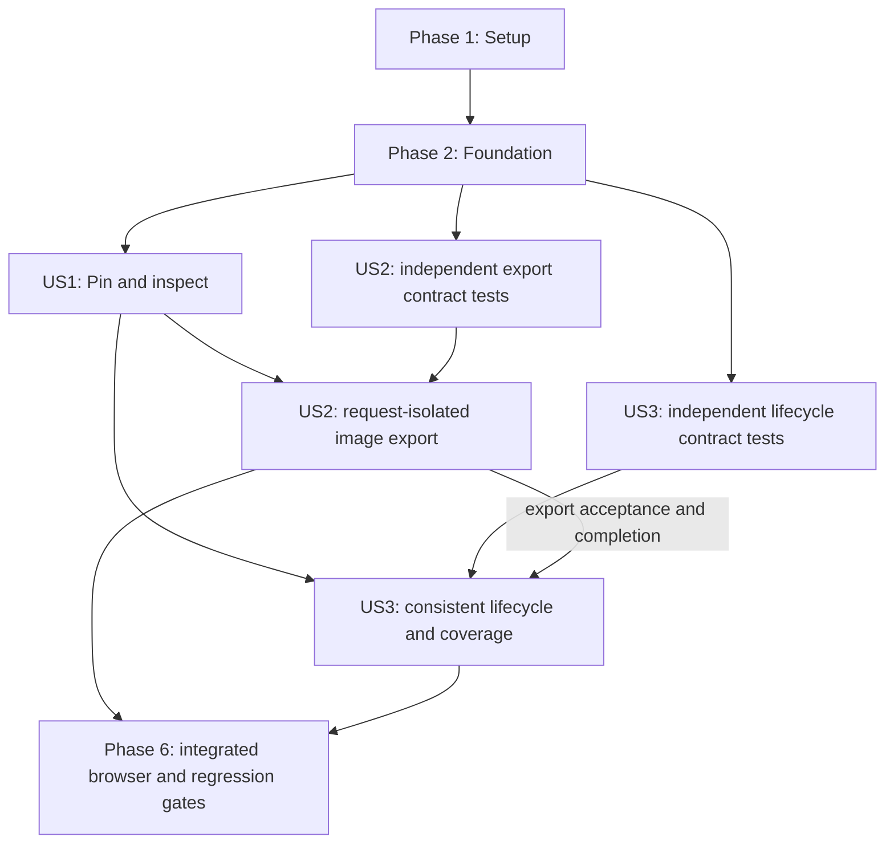

# Tasks: Pin Visualization Tooltips and Include Them in Exports

**Input**: Design documents from `specs/073-pin-visualization-tooltips/`.

**Prerequisites**: [plan.md](plan.md), [spec.md](spec.md), [research.md](research.md), [data-model.md](data-model.md), [interaction/export contract](contracts/tooltip-interaction-export.md), and [quickstart.md](quickstart.md).

**Tests**: Included because the feature acceptance scenarios require thirteen-view verification, the design contract explicitly requires contract tests, and the repository constitution mandates focused verification of dashboard changes. Reuse existing renderer, VM, export and lifecycle test homes; add only the two shared test files already identified in the plan.

**Organization**: Tasks are grouped by user story. This file authorizes no automatic commits, branch changes, new packages, API changes, or private-data fixtures.

## Format: `[ID] [P?] [Story] Description`

- Every task uses an unchecked checkbox, sequential ID, optional parallel marker, story label only within story phases, and exact repository-relative file paths.
- `[P]` means independent file ownership after the explicitly stated prerequisites have completed; it does not authorize parallel edits to shared helpers or test harnesses.
- Immediately after each substantive implementation edit, run the narrowest applicable Jest test before further edits. Tests introduced for new behavior must fail for the intended missing behavior, not merely a missing import, before the corresponding implementation is completed.

## Path Conventions

Static root application: `index.html`, `src/`, and `__tests__/`. All documentation paths below are repository-relative unless a Markdown link explicitly resolves relative to this feature directory. Keep CommonJS/browser utility bridges and existing tab IDs/order. No backend endpoint or database task is applicable.

## Phase 1: Setup (Shared Infrastructure)

**Purpose**: Establish a synthetic, reproducible baseline without changing runtime behavior.

- [X] T001 Run the existing baseline `npm test -- --runInBand __tests__/dashboard-export-download.test.js __tests__/export-utils.test.js __tests__/index-script-syntax.test.js __tests__/tab-navigation.test.js` and record results or pre-existing failures in specs/073-pin-visualization-tooltips/quickstart.md; inspect package.json and jest.config.js without introducing a bundler, dependency upgrade or service coupling.
- [X] T002 Prepare reusable synthetic item/content/context builders and injected-document/VM adapter stubs within __tests__/dashboard-tooltips.test.js, reusing existing helpers from __tests__/dashboard-export-download.test.js where suitable; cover grouped values, missing data, notes, long detail, title-free content, routes and media without copying private-data/ files or adding thirteen separate fixture/test files.

## Phase 2: Foundational (Blocking Prerequisites)

**Purpose**: Define shared contracts before integrating individual renderer behavior. Complete T001-T002 first; this phase blocks all story implementation.

- [X] T003 Add pure model/placement contract cases in __tests__/tooltip-selection-utils.test.js for context mismatch, safe plain content, immutable copies, idle/transient/pinned transitions, complete grouped data, finite anchors and outside-view placement; quote and exercise the data-model rule "Reject stale-context events, invalid item identities and non-finite geometry."
- [X] T004 Implement context/content copying and validation in src/tooltip-selection-utils.js with CommonJS and window.tooltipSelectionUtils exports: tabId is "One of the thirteen existing visualization IDs; never infer a tab from a DOM label."; datasetRevision is "Monotonic identity changed before replacing imported data."; viewRevision is "Monotonic identity changed before displayed-data settings change, including legend visibility."; settings are "Copied plain selection values needed to interpret the view, including mode and active series; no functions or DOM references."; renderGeneration is "Identity of the renderer output represented by the context, used to reject incompatible pending work." Preserve title "Full existing title; never read back an ellipsized visual label.", ordered sections/footerLines/notes, and itemLabel "Unambiguous description for accessibility and association when no visible anchor exists."
- [X] T005 Implement transitionSelection and resolveTooltipPlacement in src/tooltip-selection-utils.js: selectionKey is "Stable compound identity: tab, item kind, item/group ID; chart array indices alone are insufficient across changed contexts."; mode is "`transient` or `pinned`; absent selection represents `idle`."; enforce "There is at most one pinned selection per tab." Anchor kind is "`chart-item`, `svg-item`, `calendar-day`, `word`, `map-location`, `statistic`, or `media-item`."; itemId is "stable renderer-owned identity matching the selection key."; normalizedPoint is "finite x/y relative to the capture area when the selected item has a visible position."; geoPoint is "geographic coordinates for heatmap reprojection, when applicable."; visibility is "`visible`, `outside-view`, or `not-in-export`; a visible point must remain inside the associated capture geometry."; associationLabel is "copied item identity used when no valid visual anchor can be drawn." Run __tests__/tooltip-selection-utils.test.js.
- [X] T006 Establish the lazy adapter registry, injected-document boundary, context-invalidation entry point and disposal ownership in src/dashboard-tooltips.js with contract checks in __tests__/dashboard-tooltips.test.js; expose readContext, resolveItem, describeItem, inspectItem, projectAnchor, snapshotCapture and dispose capabilities without eager references to renderer globals loaded later.
- [X] T007 Wire the utility before src/export-utils.js and the orchestrator immediately after src/dashboard-state.js and before src/dashboard-core.js in index.html; update specs/022-modularize-inline-script/contracts/script-load-order.md and exact-order assertions in __tests__/index-script-syntax.test.js, then run that suite before continuing.

**Checkpoint**: Shared contracts and script wiring pass their focused tests; no adapter is presumed implemented merely because it is registered.

## Phase 3: User Story 1 - Keep a Selected Tooltip Visible (Priority: P1)

**Goal**: In all thirteen views, pin complete existing detail, retain it after pointer departure, replace it, and deliberately release it using pointer, touch or keyboard.

**Independent Test**: Populate each view, reveal and select an item, leave the visualization and hover other items, then replace and release the selection. The original pin remains unchanged for 30 seconds unless deliberately released. No export enhancement is needed to demonstrate this story.

### Tests for User Story 1

- [X] T008 [US1] Extend __tests__/dashboard-tooltips.test.js with shared hover/pin/leave/replace/same-item/dismiss/Escape/tap tests, empty-space behavior, safe text, complete grouped notes, fake-timer 30-second stability and focus/ARIA assertions; verify unpinned hover still works and no duplicate overlay appears.
- [X] T009 [US1] Extend existing renderer tests in __tests__/dashboard-core.test.js, __tests__/dashboard-equipment.test.js, __tests__/dashboard-scatter-years.test.js and __tests__/pie-charts-dashboard.test.js for exact formatted model/hit identity, grouped series, timeline spacer exclusion and zero-radius rectangle hits; keep tests isolated from unrelated analytics.
- [X] T010 [US1] Add shared SVG/DOM/map/wordcloud adapter contract cases in __tests__/dashboard-tooltips.test.js and extend __tests__/dashboard-heatmap.test.js, __tests__/wordcloud-dashboard.test.js, __tests__/lifetime-statistics-dashboard.test.js and __tests__/dashboard-media.test.js for sampled detail, ranked-word counts, existing KPI notes, media primary actions and hover-free touch selection.

### Implementation for User Story 1

- [X] T011 [US1] Implement the complete accessible pinned overlay, normal transient behavior, one-pin replacement, explicit dismiss, focus restoration, safe text rendering and roving canvas inspector in src/dashboard-tooltips.js, with stable responsive overlay styles in index.html; never use outside-click dismissal that loses a pin while approaching Share/Export, and do not recompute analytical datasets on inspection.
- [X] T012 [P] [US1] Integrate the totalDistance adapter in src/dashboard-core.js using actual Chart.js hit targets and full formatted period/sport/km/footer content; retain normal unpinned tooltips and expose pointer/touch/roving keyboard item activation (depends on T011).
- [X] T013 [P] [US1] Integrate equipment and equipmentTimeline adapters in src/dashboard-equipment.js for both continuous and activities modes; preserve displayValues, interval/activity detail, exact rectangle hit areas and spacer exclusions (depends on T011).
- [X] T014 [P] [US1] Integrate the paceMetrics adapter in src/dashboard-scatter.js, distinguishing activity bubbles from regression targets and preserving all formatted metric, pace/speed, activity, date and missing-value detail (depends on T011).
- [X] T015 [P] [US1] Integrate the distributions adapter in src/dashboard-distributions.js, capturing the actual existing tooltip title and all grouped series instead of inventing new value formatting (depends on T011).
- [X] T016 [P] [US1] Integrate the workoutTime adapter in src/dashboard-workout-time.js using current group labels and workout counts, including keyboard/tap hit resolution without hover (depends on T011).
- [X] T017 [P] [US1] Integrate the pieCharts adapter in src/dashboard-pie-charts.js with slice identity, formatted measure, percentage and count, using accessible legend selection without disrupting existing controls (depends on T011).
- [X] T018 [P] [US1] Integrate focusable SVG personalBests targets in src/dashboard-power-pb.js for overview and detail dialog; preserve rank, interval, estimation/source and unavailable-value content, keeping maximization separate from pinning (depends on T011).
- [X] T019 [P] [US1] Integrate trainingCalendar day-button activation in src/dashboard-training-calendar.js using dateKey identity and the complete activity list; leave/blur must not dismiss a pin, and existing focus behavior must remain available (depends on T011).
- [X] T020 [P] [US1] Integrate the heatmap adapter in src/dashboard-heatmap.js using existing screen-segment hit logic, a retained geographic anchor, pointer/touch click discrimination and the displayed activity sample; never resample on pin or let map drag become selection (depends on T011).
- [X] T021 [P] [US1] Add word/count tooltips and pin activation in src/dashboard-wordcloud.js using Wordcloud2 hit callbacks plus accessible existing word-list actions; read frequencies from rankedWords rather than shrink-to-fit callback weights (depends on T011).
- [X] T022 [P] [US1] Add item-level tooltip selection to KPI, sport-row and milestone outputs in src/dashboard-lifetime-statistics.js, preserving existing labels, values, coverage, country and missing-data notes without new analytic measures (depends on T011).
- [X] T023 [P] [US1] Add independent per-asset pin actions in src/dashboard-media.js using asset.key and existing descriptive/activity information; do not nest interactive controls or replace opening and collage checkbox behavior (depends on T011).
- [X] T024 [US1] Coordinate inspector arrow ownership in src/dashboard-tabs.js and Escape ownership in index.html with src/dashboard-tooltips.js; verify tab IDs/constants remain consistent with src/tab-navigation.js and extend __tests__/tab-navigation.test.js so arrows inspect data rather than switch filters/tabs, and Escape releases a PB pin before closing its dialog. Run shared utility/orchestration and touched renderer suites.

**Checkpoint**: US1 is demonstrable across all thirteen views and both special PB/timeline modes. Native hover remains transient when no pin exists; full detail remains accessible on small screens.

## Phase 4: User Story 2 - Export the Selected Detail (Priority: P1)

**Goal**: Export exactly the selected request-time detail into the existing PNG, compacting to its headline when necessary without altering complete live content.

**Independent Test**: Pin, export, change the live selection while export work is delayed, then compare preview and downloaded image: same original context, exactly one full or compact annotation, no live-state mutation. A no-pin request contains no transient tooltip.

### Tests for User Story 2

- [X] T025 [P] [US2] Add deep target-copy and annotation-layout tests in __tests__/export-utils.test.js for full versus headline modes, 18-pixel minimum, complete wrapping, title-free item/group-label fallback, long multi-row successful compaction, off-screen/not-in-export association, and failure only when even the compact presentation cannot fit (after Phase 2; independent of T026).
- [X] T026 [P] [US2] Extend __tests__/dashboard-export-download.test.js with deferred asset/render/capture cases that mutate pin, filters, dataset, palette, map and wordcloud generation after request acceptance; assert original source/context, identical preview/download PNG, no-pin tooltip suppression, no live hide/restore, error cleanup and existing picker/fallback/preview ownership. Include a real synthetic ZIP media library and replacement import, with mocked URL validity/revocation: assert live URLs are revoked and old readers cleared, capture rejects revoked sources, request-owned sources preserve A's image/thumbnail/context, and replacement B's resources are untouched. Exercise retained-reader as well as ready-pixel sources (after Phase 2; use synthetic request fixtures until US1 integration).

### Implementation for User Story 2

- [X] T027 [US2] Implement copyPinnedSelection in src/tooltip-selection-utils.js with focused tests in __tests__/tooltip-selection-utils.test.js, honoring "Deep-copied pinned selection or null; no transient selection included." and "The description is deeply immutable; private mutable resources are exclusively owned by this request, not part of the selection state." Reject context mismatch instead of copying stale detail (depends on US1 state contract).
- [X] T028 [US2] Add request snapshot/owned-source coordination in src/dashboard-tooltips.js: requestId is "Unique identity for cleanup and preview ownership."; target is "Deep-copied tab, capture target, title, legend, filter/control context, palette and existing output configuration."; context is "Request-time VisualizationContext; never subsequently read live settings for this request."; captureGeometry is "Source dimensions and copied transforms needed for annotation projection."; captureRecipe is "Snapshot-owned renderer inputs, tooltip-free canvas pixels or isolated chart recipe, DOM/SVG source, independently owned media sources, current tile URLs, and render-generation identity."; resources are "Private nodes, canvases, object URLs, image references, and any generation-bound promises; cleaned up on every terminal path." Enforce "Create the plain description and isolate source resources synchronously before any await." Include request-owned MediaSourceLease resources, never aliases of live cache URLs, with state "`acquired`, `preparing`, `capturing`, `png-ready`, or `released`; failures/cancellation transition to released."
- [X] T029 [US2] Add tooltip-disabled private Chart.js capture recipes in src/dashboard-core.js, src/dashboard-equipment.js, src/dashboard-scatter.js, src/dashboard-distributions.js, src/dashboard-workout-time.js and src/dashboard-pie-charts.js; copy chart data, visible series and resolved presentation at request time, never retain formatting closures over live globals or temporarily clear the live chart tooltip (depends on respective US1 adapters and T028).
- [X] T030 [US2] Add private SVG/DOM capture recipes in src/dashboard-power-pb.js, src/dashboard-training-calendar.js, src/dashboard-lifetime-statistics.js and src/dashboard-media.js; copy dimensions/content, omit transient overlay/control nodes, and describe selected items absent from specialized export summaries/collages without false anchors. Add acquireExportSources(assetKeys) to the media library in src/zip-importer.js: synchronously retain ready Blob/pixels or independent reader functions/read promises before the first await, then create request-owned URLs without later live asset/cache reads. Preserve the displayed video thumbnail/fallback, not a regenerated frame. Extend __tests__/zip-importer.test.js and __tests__/dashboard-media.test.js for lease validity across real library release/cache eviction and idempotent cleanup; do not retain the entire old library or change ordinary live release (depends on respective US1 adapters and T028).
- [X] T031 [US2] Add the heatmap capture recipe in src/dashboard-heatmap.js that freezes current route pixels, tile sources/transforms, palette, geographic association, outside-view state and displayed sample before any await, preserving existing Black + Fire clone presentation without later live palette reads (depends on T020 and T028).
- [X] T032 [US2] Add request-generation-owned wordcloud capture in src/dashboard-wordcloud.js, explicitly copying ready canvas pixels and binding pending work to the captured generation; fail when that original output cannot be recovered rather than exporting a newer render (depends on T021 and T028).
- [X] T033 [US2] Refactor exportVisualizationTarget in src/dashboard-export.js to validate existing no-data/concurrency guards, freeze full request description/source before its first await, capture only layout-capable private staging content, and remove calendar/live-tooltip hide/restore workarounds; explicitly transfer canvas pixels rather than relying on cloneNode (depends on T027-T032).
- [X] T034 [US2] Extend computeExportContentLayout and copied target metadata in src/export-utils.js with an optional annotation region: preserve 1080 x 1080 and no-pin layout; try full content at minimum 18 pixels, then complete wrapped title/itemLabel plus necessary association in headline mode; never truncate the live model or fail just because detail rows overflow. Run __tests__/export-utils.test.js (depends on T025).
- [X] T035 [US2] Extend drawExportComposition in src/dashboard-export.js to draw exactly one full/headline annotation, selected-item marker where visible and explicit outside-view/not-in-export identification otherwise; protect branding/title/context/legend, exclude interactive-only pin/dismiss UI and use only request-time content (depends on T033-T034).
- [X] T036 [US2] Preserve prepareExportImage/downloadExportedImage result ownership in src/dashboard-export.js with deeply copied request metadata and one validated/decoded PNG Blob/data URL for preview/download; release staging nodes/canvases and media source leases after PNG readiness, failure or cancellation, idempotently revoking each owned URL exactly once and dropping retained readers/Blobs or closing owned bitmaps. Never revoke live/replacement URLs or the published PNG's own resources through source cleanup. Report genuine capture/compact-fit failures, and never write an old selection back over new live state (depends on T035).
- [X] T037 [US2] Replace legacy live-tooltip-hiding assertions in __tests__/index-script-syntax.test.js with private-source capture expectations while retaining calendar expansion and Black + Fire clone checks; complete deferred race, repeated export, decode/capture/asset failure and cancellation assertions in __tests__/dashboard-export-download.test.js (depends on T036).
- [X] T038 [US2] Run `npm test -- --runInBand __tests__/tooltip-selection-utils.test.js __tests__/dashboard-tooltips.test.js __tests__/export-utils.test.js __tests__/dashboard-export-download.test.js __tests__/index-script-syntax.test.js __tests__/zip-importer.test.js __tests__/dashboard-import.test.js __tests__/dashboard-media.test.js` and record US2 full/headline/no-pin/race and actual-media-release acceptance results in specs/073-pin-visualization-tooltips/quickstart.md; correct only defects in the touched export/adapter slice before proceeding.

**Checkpoint**: US2 works with all registered US1 adapters; long multi-row tooltips export successfully as headlines, while complete live detail and snapshot data stay unchanged. Preview/download image identity and request-time isolation are verified.

## Phase 5: User Story 3 - Use the Same Interaction Across Views (Priority: P2)

**Goal**: Enforce complete cross-view coverage and clear stale detail before data/context changes while retaining valid pins during pure layout/map movement.

**Independent Test**: Exercise every populated view, change each data-affecting control, switch tabs, replace imported data and reload. Zero old selections reappear. Resize and map pan/zoom retain selected content and update association correctly.

### Tests for User Story 3

- [X] T039 [P] [US3] Extend lifecycle tests in __tests__/dashboard-core.test.js, __tests__/dashboard-import.test.js and __tests__/tab-navigation.test.js for reset-before-commit, tab/landing transitions, replacement imports and no restored pins; keep dataset replacement and layout-only events distinct (after Phase 2; can run alongside T040 test authoring).
- [X] T040 [P] [US3] Extend __tests__/dashboard-tooltips.test.js to require registry equality with all thirteen IDs from src/tab-navigation.js and cover nonstandard controls, empty/unavailable views, stale events, adapter disposal, resize preservation and no duplicate handlers; extend __tests__/dashboard-heatmap.test.js for pan/zoom off-screen identity and preserved sample membership (after Phase 2; separate files from T039).

### Implementation for User Story 3

- [X] T041 [US3] Wire reset-before-context-commit through advanceDashboardRevision in src/dashboard-state.js and applyImportedDataset in src/dashboard-import.js; clear before replacing imported data or releasing old live media resources, without introducing persistence or changing import/parsing semantics. Keep normal library.release behavior, but never release an accepted export's independent MediaSourceLease; verify the distinction in __tests__/dashboard-import.test.js (depends on US1 and T039; integrated lease/export verification also requires T030 and T036).
- [X] T042 [US3] Wire reset-before-panel-transition in setVisualizationTab and goToLanding in src/dashboard-tabs.js; preserve existing tab constants/IDs from src/tab-navigation.js, ensure browser reload starts idle and extend navigation assertions as needed in __tests__/tab-navigation.test.js (depends on US1 and T039).
- [X] T043 [US3] Audit and wire all direct displayed-data commits in src/dashboard-core.js, src/dashboard-equipment.js, src/dashboard-scatter.js, src/dashboard-power-pb.js, src/dashboard-distributions.js, src/dashboard-workout-time.js, src/dashboard-training-calendar.js, src/dashboard-wordcloud.js, src/dashboard-pie-charts.js, src/dashboard-lifetime-statistics.js, src/dashboard-media.js and src/dashboard-heatmap.js: clear for sport/metric/range/aggregation/mode, series legend, excluded words, media filters/collage selection; preserve only palette/layout changes that leave detail and membership unchanged (depends on T041-T042).
- [X] T044 [US3] Preserve pinned state on resize and map pan/zoom in src/dashboard-tooltips.js and src/dashboard-heatmap.js; reproject the same geographic item, keep sampled content unchanged, and expose explicit outside-view identity rather than a pointer to unrelated data. Extend __tests__/dashboard-heatmap.test.js and shared placement cases (depends on T020, T040 and T043).
- [X] T045 [US3] Verify empty/unavailable adapter paths in src/dashboard-tooltips.js and existing capture flags in src/dashboard-export.js cannot fabricate detail or bypass no-data export guards; add parameterized no-data cases for all thirteen views in __tests__/dashboard-tooltips.test.js and __tests__/dashboard-export-download.test.js (depends on US2 and T040).
- [X] T046 [US3] Complete adapter teardown/re-registration ownership in src/dashboard-tooltips.js and its renderer call sites so redraws remove superseded listeners without clearing valid presentation-only pins; cover repeated render, release, context change and export cleanup in __tests__/dashboard-tooltips.test.js (depends on T043-T045).
- [X] T047 [US3] Run touched lifecycle/renderer suites using the focused commands in specs/073-pin-visualization-tooltips/quickstart.md and record the thirteen-view coverage, stale-pin reset, missing-data and resize/pan acceptance results there; verify every named renderer and mode is covered by a real adapter test rather than registry presence alone (depends on T041-T046).

**Checkpoint**: All story acceptance cases are independently demonstrable against their own criteria; US2/US3 use the US1 selection contract and do not redefine or duplicate it.

## Phase 6: Polish & Cross-Cutting Concerns

**Purpose**: Validate the integrated feature and document user-visible behavior after all three stories pass.

- [X] T048 [P] Update README.md with pin/replace/dismiss, keyboard/touch operation, full/headline export behavior and local-processing privacy wording; cross-check index.html script wiring against specs/022-modularize-inline-script/contracts/script-load-order.md without adding unrelated UI help copy or changing tab IDs (depends on all stories; independent documentation file ownership from T049).
- [X] T049 Use browser automation against index.html served by `python -m http.server` on a free port to execute specs/073-pin-visualization-tooltips/quickstart.md across all thirteen views, PB detail and timeline modes at 360/1440 pixels using pointer, touch and keyboard; inspect actual PNG/canvas/route pixels, full/headline/no-pin exports, complete live detail, focus, clipping, off-screen association, primary media/map behavior and delayed-request races. Record results and screenshot/artifact references in specs/073-pin-visualization-tooltips/quickstart.md without committing personal data (depends on all stories).
- [X] T050 Inspect pin/export network activity and root-only dependencies for FR-016 using index.html, src/dashboard-tooltips.js and src/dashboard-export.js; verify no tooltip/imported content transmission is introduced, distinguish existing CDN/tiles/counter traffic, check request resources are released on every terminal path, and record findings in specs/073-pin-visualization-tooltips/quickstart.md (after T049; same evidence file).
- [X] T051 Run `npm test -- --runInBand` and `git diff --check` from the root, reconcile all FR-001 through FR-016 and SC-001 through SC-006 against actual evidence in specs/073-pin-visualization-tooltips/quickstart.md, and mark only verified completed tasks in specs/073-pin-visualization-tooltips/tasks.md; disclose unresolved failures rather than silently skipping required gates (after T048-T050).

## Dependencies & Execution Order

### Phase Dependencies

### User Story Dependencies

- US1 is the first independently useful increment after foundations; T012-T023 begin only after T008-T011 establish the shared behavior and tests. Complete T024 before declaring it accepted.
- US2 contract tests T025-T026 can be authored against synthetic contexts after foundations. Runtime integration T027-T038 needs US1 adapter/model ownership; T033 must not run ahead of snapshot recipes T028-T032. T034 can be prepared independently of private-source integration after T025.
- US3 contract tests T039-T040 can be authored after foundations. Reset/anchor runtime work depends on US1; T045 and final export assertions require US2. A sequential implementation should finish US1, then US2, then US3 to avoid same-file edits.
- T029-T032 touch distinct renderer groups but share adapter semantics established by T028; no parallel marker is used because their implementation may expose shared recipe-contract changes. Stabilize that contract before splitting work.
- Tests precede implementation within each slice. Run the focused check immediately after each substantive edit, not only at a phase checkpoint. Full root regression and browser evidence are required before final completion.

### Parallel Opportunities

- After T011, T012-T023 are independent renderer-owner files; no task may edit the shared orchestrator or another renderer's test file while executing this wave. Use existing scoped tests or the prepared shared contract harness.
- T025 and T026 own different export test files and can be authored concurrently once the foundational model exists.
- T039 and T040 own disjoint lifecycle/shared-map test groups and can be authored concurrently after foundations.
- T048 README authoring can overlap T049 browser verification because they write different files. T049-T051 serialize updates to the shared quickstart evidence.

## Parallel Example: User Story 1

After T011, run T012 (`src/dashboard-core.js`), T013 (`src/dashboard-equipment.js`) and T020 (`src/dashboard-heatmap.js`) concurrently. Each uses the frozen shared adapter contract and its own existing focused suite; integrate shared changes serially outside this wave. The remaining T014-T023 renderer owners follow the same rule.

## Parallel Example: User Story 2

After Phase 2, author T025 (`__tests__/export-utils.test.js`) alongside T026 (`__tests__/dashboard-export-download.test.js`). Do not run T033, T035 or T036 concurrently: each changes `src/dashboard-export.js` and depends on the preceding pipeline stage. T034's isolated layout work can overlap T029-T032 once T025 and the common recipe contract are stable.

## Parallel Example: User Story 3

After Phase 2, author T039 (core/import/navigation tests) alongside T040 (shared tooltip and heatmap tests). After US1, T041 and T042 have distinct runtime file owners, but serialize any edits to their shared test coverage. Do not overlap T043's renderer audit with US2 renderer recipe edits.

## Implementation Strategy

### MVP First (User Story 1 Only)

1. Complete setup and foundations; prove the pure model, adapter contract and wiring.
2. Deliver T008-T024 as a coherent pin-and-inspect increment across the thirteen existing views. A first totalDistance adapter can be a development probe but is not completion of the all-visualization MVP.
3. Validate US1 independently before expanding export behavior. This is an inspection MVP only; the user's complete request still requires US2 and US3.

### Incremental Delivery

1. Add US2 without changing the selection contract: request isolation, complete/compact annotation and immutable PNG preview/download.
2. Add US3 as the lifecycle/coverage hardening increment, including all direct controls, stale events, map/resize preservation and no-data boundaries.
3. Complete browser, privacy, documentation and root regression gates. Reuse existing analytical outputs and public helper APIs; add no unrelated refactors or dependency churn.

## Requirement Coverage

| Requirement | Primary tasks |
| --- | --- |
| FR-001 | T010, T012-T023, T040, T047, T049 |
| FR-002, FR-003, FR-004 | T003-T005, T008, T011-T023 |
| FR-005, FR-015 | T008, T011, T018, T024, T049 |
| FR-006 | T004, T008-T023 |
| FR-007, FR-008 | T025-T033, T035-T038 |
| FR-009 | T025, T030-T035, T049 |
| FR-010 | T026, T029-T033, T037, T045 |
| FR-011 | T026, T034-T038, T049 |
| FR-012 | T039-T043, T046-T047 |
| FR-013 | T005, T020, T025, T031, T044, T049 |
| FR-014 | T018, T020, T023-T024, T049 |
| FR-016 | T002, T028-T036, T050 |
| SC-001, SC-004 | T040-T047, T049, T051 |
| SC-002 | T008, T049 |
| SC-003 | T025-T038, T049 |
| SC-005, SC-006 | T011-T024, T034-T035, T049 |

## Notes

There are 51 tasks: 2 setup, 5 foundation, 17 US1, 14 US2, 9 US3, and 4 polish. Seventeen tasks carry `[P]`, conditional on the dependencies described above. No checkbox represents implementation already completed by task generation. The confirmed fallback is headline compaction, not failure on long detail, and never modifies complete live content.