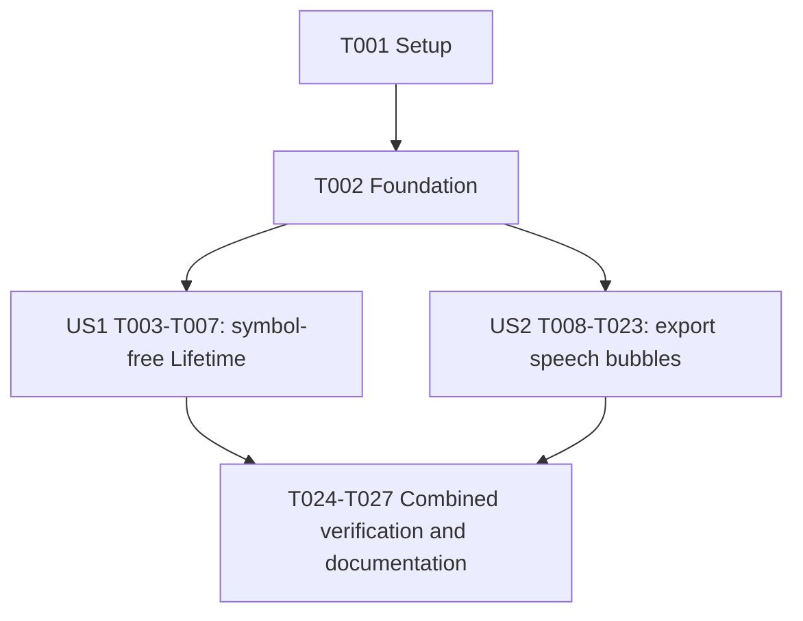

# Tasks: Pinned Tooltip Callouts and Lifetime Statistics Cleanup

**Input**: Design documents from `specs/074-pinned-tooltip-callouts/`

**Prerequisites**: [plan.md](plan.md), [spec.md](spec.md), [research.md](research.md), [data-model.md](data-model.md), [contracts/pinned-callouts.md](contracts/pinned-callouts.md), [quickstart.md](quickstart.md).

**Tests**: Verification is mandatory under constitution principle III and the design's test contract. Integrate focused regression checks into each behavior task using existing suites; no new test framework or standalone speculative test work. Run the narrowest applicable suite immediately after an implementation change, repair local failures before expanding scope, and do not mark a task complete with unverified required behavior.

**Organization**: Two independently testable P1 stories. US1 is the MVP. US2 changes all existing pinned exports and can be verified without requiring US1's new live affordance; the final integrated Lifetime scenario requires both.

## Format: `[ID] [P?] [Story] Description`

- All tasks start unchecked with sequential IDs. Story labels appear only in story phases.
- `[P]` identifies disjoint-file work eligible to run concurrently after the stated prerequisites; it does not waive dependencies or permit simultaneous edits to shared suites.
- Paths are repository-relative. Reuse root Node-environment Jest and existing VM/fake-document helpers. Preserve CommonJS/window utility bridges and classic-script ordering.

## Phase 1: Setup (Shared Infrastructure)

**Purpose**: Verify the existing environment without scaffolding a new project or adding dependencies.

- [X] T001 Verify the existing root test command and installed dependencies in package.json and jest.config.js; run the baseline focused suites listed in specs/074-pinned-tooltip-callouts/quickstart.md for lifetime-statistics-dashboard, export-utils, dashboard-export-download, dashboard-tooltips, tooltip-selection-utils, and tab-navigation, and record results in that guide without fixing unrelated failures or installing a new framework.

## Phase 2: Foundational (Blocking Prerequisites)

**Purpose**: Fix the shared verification baseline and capture contract before either story, without prematurely implementing US2.

- [X] T002 Verify the 13 IDs/order in src/tab-navigation.js against index.html markup/dispatch, src/dashboard-export.js capture mappings, and specs/074-pinned-tooltip-callouts/contracts/pinned-callouts.md; identify the request-owned capture boundary and stable selection keys in src/dashboard-tooltips.js and src/tooltip-selection-utils.js, and record the confirmed target/variant baseline in specs/074-pinned-tooltip-callouts/quickstart.md. Preserve IDs and public signatures; run __tests__/tab-navigation.test.js for any affected assertions.

**Checkpoint**: Baseline and contracts verified. No new tab, import/parser change, backend dependency, or persisted annotation is introduced.

## Phase 3: User Story 1 - Inspect Lifetime Statistics Without Pin Symbols (Priority: P1, MVP)

**Goal**: Remove separate Lifetime pin symbols while retaining statistic-level pointer, touch, and accessible keyboard pinning.

**Independent Test**: Populated and empty Lifetime Statistics have zero separate Pin data symbols; statistic click/tap and Enter/Space can pin, replace, toggle, and dismiss without scrolling, double activation, broken table semantics, or stale selected states. Other visualization controls remain unchanged.

### Implementation And Focused Verification

- [X] T003 [P] [US1] Replace pinMarkup() output across every Lifetime KPI/card/sport-row renderer in src/dashboard-lifetime-statistics.js with keyed content inspection targets; preserve the model constraint "selectionKey remains lifetimeStatistics:<key>" and "no inspection targets for empty/nonexistent statistics; no nested interactive controls or changed table-row semantics." Extend and run __tests__/lifetime-statistics-dashboard.test.js to assert no separate Pin data buttons, unchanged detail/values, stable keys, valid table structure, and empty-state behavior.
- [X] T004 [US1] Update bindStatisticDetails() in src/dashboard-lifetime-statistics.js to activate data-statistic-key content via delegated click/tap and Enter/Space, visible focus, accessible name/pressed state, same-item toggle, and replacement; avoid duplicate synthesized clicks and prevent Space scrolling. Extend and run __tests__/lifetime-statistics-dashboard.test.js using the existing harness; retain existing detail content and context invalidation. Depends on T003.
- [X] T005 [P] [US1] Synchronize old/new origin pressed state and connected-target focus restoration in src/dashboard-tooltips.js without changing its public API or other views' primary actions; implement the model transition "another item -> replacement pin with old origin cleared" and clear stale origin state on dismiss/context invalidation/rerender. Extend and run __tests__/dashboard-tooltips.test.js and __tests__/tooltip-selection-utils.test.js for replace, toggle, Escape, detached origin, and unchanged transient/pinned lifecycle behavior. This task can run beside T003, not beside US2 chart-adapter work in the same file.
- [X] T006 [US1] Verify new Lifetime content targets receive the existing data-tooltip-inspector focus treatment in index.html and work with document Escape handling in src/dashboard-tooltips.js; make only any necessary local styling/attribute correction, preserve tab IDs/order, and run __tests__/lifetime-statistics-dashboard.test.js, __tests__/dashboard-tooltips.test.js, and __tests__/tab-navigation.test.js. Depends on T004 and T005; do not modify unchanged navigation simply to touch it. Serialize with T010 if this task requires controller changes in src/dashboard-tooltips.js or changes to their shared test suite.
- [X] T007 [US1] Execute the Lifetime interaction guide at 360 px and 1440 px, including 30-second pin retention, touch/keyboard activation, sports rows, empty data, filter replacement, and connected focus restoration; record synthetic-data screenshot locations and SC-001 evidence in specs/074-pinned-tooltip-callouts/quickstart.md. Verify controls in other views were not removed. Depends on T006.

**Checkpoint**: US1 is usable and deliverable without speech-bubble export work.

## Phase 4: User Story 2 - Share Pinned Details as Cartoon Speech Bubbles (Priority: P1)

**Goal**: All existing pinned exports show one correctly associated compact speech bubble, not a bottom annotation bar, while preserving content fallback, request isolation, and live pins.

**Independent Test**: In all 13 capture targets and the PB-detail variant, preview/download show the same selected bubble, accurate visible-item tail or truthful non-visible note, no clipping/protected-region overlap, and unchanged no-pin/no-data behavior. Complete, cancel, and fail exports without unintended changes to the live pin or resource leaks.

### Implementation And Focused Verification

- [X] T008 [P] [US2] Add pure computeTooltipCalloutLayout() through the existing CommonJS/window bridge in src/export-utils.js while preserving existing helper signatures. Implement model constraints "mode: full or headline", "side: above, below, left, right, or unanchored", "tail: either null or base endpoints and tip in final-image pixels", and "finite geometry; body/tail inside image bounds; no body/tail collision with protected rectangles or anchor clearance; one layout per selection; deterministic output for identical measured inputs." Reuse full/headline text fitting with 360 px preferred/480 px maximum body width, 18 px minimum text size, 280 px text-layout height cap, four side candidates, and approximately 10 px anchor clearance. Extend and run __tests__/export-utils.test.js for side/edge/corner geometry, wrapping, grouped/missing values, and impossible-fit RangeError. Add deterministic operation-count assertions that side-candidate evaluation is bounded by four per full/headline placement pass and consumes only selected content/anchor/layout inputs, not an activity collection; use counters rather than wall-clock thresholds to guard activity-count-independent placement.
- [X] T009 [P] [US2] Establish request-owned resolveExportAnchor(selection, captureContext) orchestration in src/dashboard-export.js without changing existing adapter signatures: acquire immutable selection, source identity/layout inputs, canvas pixels, and independent media resources before the first await; resolve only from the prepared isolated capture and attach plain anchor metadata to composition inputs. Enforce "No live DOM nodes or resource handles enter deeply frozen plain composition data" and "Missing projection is an error, not a visibility category." Extend and run __tests__/dashboard-export-download.test.js for capture ownership and mutation-after-request while preserving release-on-failure and no-pin preparation.
- [X] T010 [US2] Implement shared Chart.js export projection in src/dashboard-tooltips.js using request-owned selected element/group identity and the final nested canvas-to-capture transform for totalDistance, paceMetrics, equipment, equipmentTimeline, distributions, and workoutTime; do not use viewport normalizedPoint as an export position. Enforce "capturePoint: finite normalized {x, y} relative to the complete final captured image; required for visible, absent for other states" and "visibility: visible, outside-view, or not-in-export." Extend and run __tests__/dashboard-tooltips.test.js for nested wrapper offsets, centering, DPR, grouped identity, and immutable chart state. Depends on T009; serialize with T005 if US1 is still in progress, and with T006 when it requires controller or shared-test changes.
- [X] T011 [P] [US2] Resolve pieCharts selected arc/group identity in the actual resized export chart in src/dashboard-pie-charts.js, including the 560 px export renderer and legend/wrapper offsets rather than the live canvas geometry; integrate with the T009/T010 contract, retain existing capture ownership, and run __tests__/pie-charts-dashboard.test.js. Central cross-target projection assertions are added in T018.
- [X] T012 [P] [US2] Resolve heatmap geoPoint against the same export map state used for pixels in src/dashboard-heatmap.js before restoration; classify off-screen items as outside-view and retain an explicit selection label/note with no false tail. Preserve captureAtExportSize() live map restoration, run __tests__/dashboard-heatmap.test.js, and leave cross-target projection assertions to T018. Depends on T009 and T010.
- [X] T013 [P] [US2] Add stable selected-day export resolution in src/dashboard-training-calendar.js against the isolated trainingCalendarYears capture layout, preserving existing calendar tooltip/content/navigation behavior; run __tests__/dashboard-tooltips.test.js and __tests__/training-calendar-utils.test.js and verify the day-key contract without editing those shared suites concurrently. Cross-target offset/selection assertions belong to T018. Depends on T009 and T010.
- [X] T014 [P] [US2] Resolve selected wordcloud identity to its actual rendered word in src/dashboard-wordcloud.js instead of its inspection-list position; classify genuinely omitted words as not-in-export with the model's "explicit item-identifying note explaining outside-view or omitted-from-capture status; required for non-visible states and retained in headline fallback." Preserve word visibility controls, run __tests__/wordcloud-dashboard.test.js, and leave central projection assertions to T018. Depends on T009 and T010.
- [X] T015 [P] [US2] Resolve personalBests selection in captured PB columns and the pb-tile/pbDetailCaptureTarget variant in src/dashboard-power-pb.js using isolated request identity; preserve primary detail-opening behavior and separate inspection actions, run __tests__/dashboard-tooltips.test.js and __tests__/dashboard-export-download.test.js without concurrent shared-suite edits, and leave new cross-target assertions to T018. Depends on T009 and T010.
- [X] T016 [P] [US2] Resolve selected Lifetime KPI identity inside lifetimeStatisticsExportArea in src/dashboard-lifetime-statistics.js, classifying excluded sport rows as not-in-export with an explicit identity/explanation rather than pointing to another KPI; preserve live item behavior, run __tests__/lifetime-statistics-dashboard.test.js, and leave central projection assertions to T018. Depends on T009 and T010; serialize with T003/T004 if US1 is unfinished and support either old or new live affordances via stable selection keys.
- [X] T017 [P] [US2] Resolve mediaGallery selected image against the exported collage in src/dashboard-media.js, including not-in-export for genuinely omitted items; preserve independently owned acquireExportCapture()/acquireExportSources() leases, preview opening, and live URL lifetime. Run __tests__/dashboard-media.test.js; central omission/projection/race assertions belong to T018. Depends on T009 and T010.
- [X] T018 [US2] Integrate the complete target/variant anchor matrix in src/dashboard-export.js and extend __tests__/dashboard-export-download.test.js using the existing VM/fake-document harness for all 13 contract mappings plus PB detail: finite visible coordinates within the full capture, nested chart offsets/DPR, resized pies, map-state/restoration, selected calendar days/rendered words/KPIs/collage images, and truthful omitted/off-screen notes. Correct local integration gaps without substituting generic centers or fabricated absence; run that suite after each repair. Depends on T010 through T017.
- [X] T019 [US2] Replace pinned annotationHeight reservation and full-width fillRect in drawExportComposition() in src/dashboard-export.js with the exact no-pin visualization fit and final-image anchor transform, variant-specific protected header/legend/branding rectangles, and one 8 px-radius light bubble body with dark outline/text and tapered tail from T008. Extend and run __tests__/dashboard-export-download.test.js against the actual compositor, not a mock, checking correct tail tip, zero bottom bar, selected-anchor clearance, and unchanged no-pin/Lifetime/PB layouts. Depends on T008 and T018.
- [X] T020 [US2] Complete placement-aware full-to-headline fallback and non-visible note retention in src/export-utils.js and its call site in src/dashboard-export.js: retry the complete wrapped headline when full text fits dimensionally but has no valid collision-free placement; retain full live detail, return null tail for non-visible selections, and report failure if headline plus required note cannot fit. Extend and run __tests__/export-utils.test.js and __tests__/dashboard-export-download.test.js for long words, notes, missing values, dense/edge layouts, and impossible compact fit. Depends on T019.
- [X] T021 [US2] Verify and locally repair request isolation and cleanup across prepareExportImage(), export completion/cancellation/failure, and media preparation in src/dashboard-export.js; extend and run __tests__/dashboard-export-download.test.js with deferred capture, live selection/context changes, repeated exports, independent media URL revocation, release-on-failure, and stable prepared PNG reuse for preview/download. Add call-count spies against the existing capture baseline to assert that bubble placement adds no chart render, image composition, or activity-dataset scan, that composition occurs once per export request, and that preview/download reuse the same prepared PNG without recapture or recomposition. Enforce "do not change the live pin unless independent user/context actions already did so." Depends on T020.
- [X] T022 [US2] Verify src/dashboard-export.js capture exclusion removes pin/dismiss UI without removing the inspected statistic/content and preserves existing no-pin/no-data/export-format behavior; extend and run __tests__/dashboard-export-download.test.js for exactly one bubble, zero duplicate content/control glyphs, unchanged no-pin fit, and existing error feedback. Depends on T021.
- [X] T023 [US2] Execute the full 13-target plus PB-detail browser export matrix in specs/074-pinned-tooltip-callouts/quickstart.md at 360 px and 1440 px interaction viewports and native 1080 x 1080 PNG size; inspect/download actual images with center/edge/corner anchors and at least two valid bubble sides, full/compact detail, absent/off-screen items, no-pin cases, and request-time selection stability. Record synthetic screenshot locations, target/variant results, and SC-002 through SC-006 evidence in that guide. Depends on T022; US1's new Lifetime activation is required only for the final combined Lifetime scenario.

**Checkpoint**: US2 independently satisfies the export contract; integration with US1 retains symbol-free Lifetime activation and the same bubble export.

## Phase 5: Polish & Cross-Cutting Concerns

**Purpose**: Verify the combined behavior and document only the user-visible changes.

- [X] T024 Verify unchanged tab constants/order, index.html markup/dispatch, and export mappings in src/tab-navigation.js and src/dashboard-export.js; extend only relevant behavior assertions in __tests__/tab-navigation.test.js and __tests__/index-script-syntax.test.js, then run both suites. Do not rename IDs, reorder scripts, or edit unrelated markup. Depends on both story checkpoints.
- [X] T025 [P] Update README.md with a concise note on statistic-level Lifetime pinning and pinned-export speech bubbles, including unchanged local preview/download and accurate privacy boundaries; avoid claims that the whole app makes no network requests. Depends on both stories, but can run beside T024.
- [X] T026 Run the combined affected suites from specs/074-pinned-tooltip-callouts/quickstart.md plus the owner suites touched by projection changes and __tests__/index-script-syntax.test.js; record exact commands/results and any pre-existing unrelated failures in that guide. Confirm no services/api dependency or test run is required because the service was not changed. Depends on T024 and completed story verification.
- [X] T027 Reconcile specs/074-pinned-tooltip-callouts/quickstart.md evidence against every acceptance scenario and SC-001 through SC-006 in specs/074-pinned-tooltip-callouts/spec.md, including the final symbol-free Lifetime-to-bubble workflow and both viewport sizes; confirm no private input/images entered version control, no new tooltip transmission, and no unchecked required scenario remains before reporting implementation complete. Depends on T023, T025, and T026; record blockers explicitly instead of claiming unperformed checks passed.

## Dependencies & Execution Order

### Phase Dependencies

1. Setup T001 -> foundational T002 -> both story entry points.
2. US1: T003 -> T004; T005 can run beside T003/T004; T004 + T005 -> T006 -> T007.
3. US2: T008 and T009 are independent entry points; T009 -> T010 -> projection wave T011 through T017 -> T018; T008 + T018 -> T019 -> T020 -> T021 -> T022 -> T023.
4. Both story checkpoints -> T024 and T025; T024 -> T026; T023 + T025 + T026 -> T027.

T011 has the same T009/T010 prerequisites as every other projection-wave task. Shared-file exceptions override story parallelism: T005 and T010 both edit dashboard-tooltips.js; T006 must also be serialized with T010 if it requires controller changes or edits to their shared test suite; T003/T004 and T016 both edit dashboard-lifetime-statistics.js; T007/T023/T026/T027 update quickstart.md and must be serialized or merged by one owner.

### User Story Completion Graph



US2 does not depend on US1's new markup: stable selection identity is the integration boundary. The combined Lifetime acceptance scenario is a final integration gate, not a reason to block all export work on US1.

### Parallel Opportunities

- US1: T003 Lifetime renderer work and T005 controller-origin work use disjoint source/test files after T002. T004 waits for T003, and T006 joins both branches.
- US2: T008 utility geometry and T009 capture orchestration use disjoint source/test files after T002.
- US2: After T010, T011 through T017 touch distinct adapter source files. Keep new cross-target projection assertions owned by T018; these tasks may run existing suites but must not concurrently rewrite shared test files.
- Cross-cutting: T025 README changes may proceed alongside T024 navigation verification.
- Do not parallelize tasks merely because their IDs differ. Apply explicit prerequisites and file ownership first.

## Parallel Example: User Story 1

```text
After T002:
  T003: Lifetime item markup + lifetime-statistics-dashboard.test.js
  T005: Controller origin state + dashboard-tooltips.test.js/tooltip-selection-utils.test.js
Then:
  T004 follows T003; T006 waits for T004 and T005; T007 validates the story.
```

## Parallel Example: User Story 2

```text
After T002:
  T008: export-utils.js + export-utils.test.js
  T009: dashboard-export.js + dashboard-export-download.test.js
After T009 and T010:
  T011: pie chart adapter
  T012: heatmap adapter
  T013: calendar adapter
  T014: wordcloud adapter
  T015: personal-best adapter
  T016: Lifetime export adapter (serialize with unfinished US1 renderer edits)
  T017: media collage adapter
Then:
  T018 owns the shared projection test matrix before T019 composition integration.
```

## Requirement And Outcome Coverage

| Scope | Tasks |
|-------|-------|
| FR-001, FR-002; SC-001 | T003-T007 |
| FR-003, FR-012 | T002, T005-T007, T024-T027 |
| FR-004, FR-005; SC-002 | T008-T019, T022-T023 |
| FR-006, FR-007; SC-003 | T008, T019-T020, T023 |
| FR-008; SC-004 | T012-T018, T020, T023 |
| FR-009, FR-011; SC-006 | T009, T018, T021, T023 |
| FR-010 | T019, T022-T023 |
| SC-005 and combined acceptance | T007, T023, T027 |

## Implementation Strategy

### MVP First

Complete T001-T002, deliver US1 through T007, and validate it independently. This is the smallest user-visible increment; it does not complete the entire requested feature.

### Incremental Delivery

Develop US2 with geometry and request isolation first, then accurate per-target projections, actual Canvas drawing, placement fallback, and lifecycle/no-pin regression checks. Do not report export completion after a single chart screenshot: all 13 mappings and PB detail are required. Complete final combined verification only when both stories and recorded browser evidence pass.

### Guardrails

- Preserve existing APIs, tab IDs/order, no-data behavior, metric values, imports, and independent media resource ownership.
- Reuse existing helpers/tests; add no framework, bundler, server endpoint, saved state, manual bubble dragging, or multiple annotations.
- Each task's first post-edit action is a focused behavior check; repair that slice before proceeding.
- Only mark a task checked when its stated implementation and verification are complete. Do not commit or create branches unless the user separately requests it.