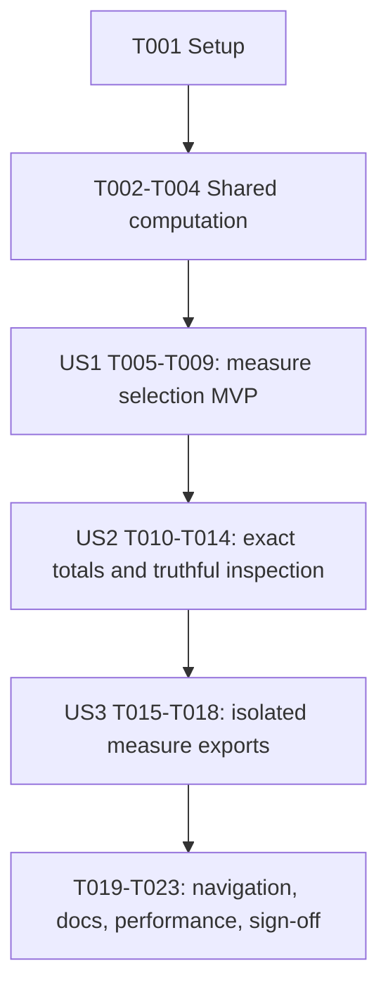

# Tasks: Workout Time Count, Duration, and Distance

**Input**: Design documents from `specs/075-workout-time-measures/`.

**Prerequisites**: [plan.md](plan.md), [spec.md](spec.md), [research.md](research.md), [data-model.md](data-model.md), [contracts/workout-time-measures.md](contracts/workout-time-measures.md), [quickstart.md](quickstart.md).

**Tests**: The constitution requires focused verification for every behavior change, and the feature defines exact data, interaction, export, and performance acceptance checks. Use existing Node-environment Jest/VM/fake-document/chart harnesses. Add the relevant failing assertions before implementing each contract change, immediately run the narrowest applicable suite after editing, and repair that slice before widening scope. No new framework, fixture file, runtime module, or standalone benchmark script is required.

**Organization**: Shared data computation supports both P1 stories. US1 delivers a usable selector with correct populated charts; US2 completes detailed coverage/zero/null inspection and exhaustive data validation; US3 validates measure-aware exports and request isolation. Each story has its own acceptance checkpoint; US2/US3 build on the preceding live view rather than introducing a second implementation of it.

## Format: `[ID] [P?] [Story] Description`

- Every task begins unchecked and has a sequential ID and exact repository-relative file paths.
- `[P]` means disjoint-file work can proceed concurrently after its prerequisites. It does not override phase gates or allow concurrent edits to shared files.
- Story labels appear only in story phases. Setup/foundation/final tasks have no story label.
- Preserve existing CommonJS/window utility bridges, classic script order, tab IDs/order, source parsing, and independent export resources.

## Phase 1: Setup (Shared Infrastructure)

**Purpose**: Verify the existing project and establish a reproducible baseline without scaffolding or dependency changes.

- [X] T001 Verify the existing root commands and Node-environment configuration in package.json and jest.config.js, then run the focused baseline suites listed in specs/075-workout-time-measures/quickstart.md. Record exact commands/results and existing browser/Chart.js versions in that guide; reuse installed dependencies, do not add a framework, and do not fix unrelated failures.

## Phase 2: Foundational (Blocking Prerequisites)

**Purpose**: Establish the shared measure/data contracts needed by the selector, truthful detail, and export, without changing source parsing.

- [X] T002 Verify the current Workout Time contracts in src/workout-time-utils.js, src/dashboard-workout-time.js, src/dashboard-tooltips.js, src/dashboard-export.js, index.html, and src/tab-navigation.js against specs/075-workout-time-measures/contracts/workout-time-measures.md; record baseline count behavior, date/startTime eligibility, durationAvailable/distanceAvailable handling, existing IDs/order, and the request-time capture boundary in specs/075-workout-time-measures/quickstart.md. Preserve the existing tab and workoutTimeChartWrapper mapping; run __tests__/tab-navigation.test.js for any updated assertions. Depends on T001.
- [X] T003 Extend buildWorkoutTimeDataset() and the dual CommonJS/window exports in src/workout-time-utils.js with MEASURES and optional filters.measure while retaining existing signatures, group count, root activityCount, and copied filters. Implement the model constraints "measure: count, duration, or distance; default count when omitted", "date and startTime: valid Date objects; both remain required", "count: integer >= 0 counting all eligible workouts assigned to the field, independent of selected measure", "durationAvailableCount, distanceAvailableCount: integers from 0 through count; available zero measurements are included", and "status: empty, complete, partial, or unavailable, determined by the table below." Accumulate durationSeconds/distanceKm once per eligible start-time field with finite nonnegative numbers and flags !== false; selected value is zero for empty, null for unavailable nonempty, and the usable raw total otherwise, at group and dataset levels. Preserve group keys/order and 12/7/31/12 fields, never mutate inputs or round sums, and reject invalid explicit measures. Extend and run __tests__/workout-time-utils.test.js for defaults, public compatibility, flags, null/zero states, and reference totals. Depends on T002.
- [X] T004 Add getMeasureDefinition() and formatWorkoutTimeValue() through both exports in src/workout-time-utils.js, preserving the model constraints "axis conversion: count and distance unchanged; duration raw seconds divided by 3600" and "detail format: whole counts, cumulative hours/minutes/seconds without day wrap, or localized fractional kilometers. Sum before rounding; keep available zeros valid." Use Workouts, Duration (h), Distance (km) axis titles; format null as Not available and invalid explicit measures as errors. Extend and run __tests__/workout-time-utils.test.js for 4500 seconds -> 1h 15m/1.25 hours, >24h totals, fractional kilometer sums, available zero, and no input mutation. Depends on T003.

**Checkpoint**: Shared data results distinguish empty, complete, partial, and unavailable without changing count eligibility, imports, or other consumers. No story starts before T004 passes.

## Phase 3: User Story 1 - Choose What Workout Time Measures (Priority: P1, MVP)

**Goal**: Deliver the three-option measure selector with count as default, correct populated charts, accessible keyboard integration, and retained existing filters.

**Independent Test**: On a fresh session select each measure with one activation, verify correct values/axis units and exactly one pressed choice, retain grouping/sport/date settings and session measure across tab visits/import replacement, and confirm keyboard cycling uses valid dependent date ranges.

### Implementation And Focused Verification

- [X] T005 [P] [US1] Add the Measure segmented group workoutTimeMeasure and buttons workoutTimeMeasureBtnCount/workoutTimeMeasureBtnDuration/workoutTimeMeasureBtnDistance in index.html, with visible Workout number/Duration/Distance labels, count initially active/pressed, accessible naming, and existing focus styling. Preserve existing Workout Time tab/control/capture IDs and script order; wire the buttons to the agreed setter without new explanatory UI text. Extend and run __tests__/index-script-syntax.test.js for IDs, labels, accessibility, and preserved wiring. Depends on T004; can run alongside T006.
- [X] T006 [P] [US1] Introduce selectedWorkoutTimeMeasure and validated setWorkoutTimeMeasure() in src/dashboard-workout-time.js. Enforce "Invalid explicit measure values are rejected by the pure builder and ignored by the UI setter without state changes" and "Valid different measure -> invalidate current pin -> commit measure -> derive/display current filtered result." Count is the fresh-page default; a no-op/invalid choice must not clear a pin. Preserve measure across other filters, tab visits, and replacement import, with no persistent preference. Extend and run __tests__/dashboard-core.test.js for state, pre-change invalidation, no-op/invalid input, and session lifecycle. Depends on T004; can run alongside T005.
- [X] T007 [US1] Pass the selected measure into the builder and update renderWorkoutTimeChart() in src/dashboard-workout-time.js to plot count, duration seconds / 3600, or kilometers with the shared definitions/formatter. Keep the eligible activity summary independent of availableCount, preserve null unavailable fields and zero empty/measured-zero fields, and use distinct empty versus all-unavailable explanations through workoutTimeEmptyState while leaving controls operable. Do not equate value > 0 with availability. Extend and run __tests__/dashboard-core.test.js for all three numeric datasets, axis/tick units, filter retention, no stale chart, and valid all-zero rendering. Depends on T005 and T006.
- [X] T008 [US1] Extend getWorkoutTimeKeyboardAdapter() in src/dashboard-workout-time.js to granularity -> sport -> measure -> start -> end and synchronize the measure button pressed states on atomic selection application. Preserve "0 <= start <= end <= maxIndex" and update end.min to prefix[3].value without intermediate partial renders. Extend and run __tests__/index-script-syntax.test.js and __tests__/tab-navigation.test.js for the three-value domain, dependent ranges, wraparound, manual/keyboard synchronization, unchanged tab IDs/order, and text/native input boundaries. Depends on T007.
- [X] T009 [US1] Execute the selector/session acceptance checks from specs/075-workout-time-measures/quickstart.md at 360 px and 1440 px using synthetic populated data, pointer, native touch/emulation, Tab/Enter/Space, and existing filter cycling. Verify one-activation changes, default count, filter retention, tab/import retention, reload reset, readable units, and no new horizontal page overflow; record exact results and ignored/local screenshot paths in that guide. Depends on T008.

**Checkpoint**: US1 is a usable count/duration/distance selector for populated histories. It is the MVP, not completion of the full feature; detailed unavailable-field inspection and final export isolation remain explicit next increments.

## Phase 4: User Story 2 - Read Correct Totals For Each Time Field (Priority: P1)

**Goal**: Verify all measure/group combinations and make every existing field truthfully inspectable, including empty, available zero, partial, and unavailable measurements.

**Independent Test**: A hand-calculated history gives correct totals across all 48 combinations. The 06:00-07:59 example yields 3 workouts, 4500 seconds/1h 15m, and 17 km; zero/null fields can be inspected without fabricated volume or neighboring-field selection.

### Implementation And Focused Verification

- [X] T010 [P] [US2] Expand the reference history and assertions within __tests__/workout-time-utils.test.js for all 4 groupings x 4 sport selections x 3 measures, inclusive date subsets, invalid timestamps, unknown-sport preservation, and whole-workout assignment across midnight/day/month boundaries. Assert unchanged count parity, exact unrounded raw sums, explicit false-flag placeholders, absent flags with available zero, true flags with invalid numbers, missing/negative/non-finite values, mixed coverage, and >24h duration. Enforce "A usable selected measurement is a finite number greater than or equal to zero and not explicitly unavailable" and "An absent flag plus numeric zero remains available." Run the suite, repair only local defects in src/workout-time-utils.js, then rerun it before proceeding. Depends on T004 and the US1 checkpoint; can run alongside T011.
- [X] T011 [P] [US2] Extend attachChart(tabId, chart, inspection = {}) in src/dashboard-tooltips.js with opt-in resolveHits/describeContent/anchorPoint hooks while preserving existing two-argument callers. Support category hover/leave, click/tap, keyboard traversal of null/skipped fields, and the same finite anchor resolver against private snapshot scales; never require native tooltip rows for opted-in content. Preserve "Visible selected anchors are finite chart category/value coordinates; zero or null fields use the real category's zero baseline" and forbid epsilon/dummy volume. Extend and run __tests__/dashboard-tooltips.test.js for zero/null fields, missing native metadata, outside-chart rejection, private-chart dimensions/DPR, lifecycle, and a non-Workout two-argument regression. Depends on T004 and the US1 checkpoint; can run alongside T010.
- [X] T012 [US2] Supply Workout-Time-only category hit resolution, semantic content, and anchor hooks from src/dashboard-workout-time.js using immutable render-local group metadata, real X categories, and selected-value/zero-baseline scale coordinates. Build selection identity from grouping, measure, and field key; preserve actual chartElements indices. Enforce "Snapshot metadata is plain immutable data; no live chart, DOM element, or later global measure read is stored in the frozen selection." Show field/measure/value/unit and No activities/coverage/unavailable detail through the shared overlay; disable duplicate native hover content only for this chart. Extend and run __tests__/dashboard-core.test.js and __tests__/dashboard-tooltips.test.js for pointer/keyboard descriptions and finite zero/null live/private anchors. Depends on T010 and T011.
- [X] T013 [US2] Verify and locally repair coverage-state presentation in src/dashboard-workout-time.js without changing src/visualization-availability.js semantics: empty fields stay ordered, available zero remains measured, partial fields identify X of Y coverage, unavailable nonempty fields have no false positive-volume bar, and an all-unavailable measure leaves the tab/selector available while clearing stale chart detail. Extend and run __tests__/dashboard-core.test.js and __tests__/visualization-availability.test.js for empty/all-unavailable/all-zero/partial cases and recovery by switching to count. Reuse T007 state handling instead of adding a second path. Depends on T012.
- [X] T014 [US2] Perform browser pointer/touch/keyboard inspection of empty, measured-zero, unavailable, and partial fields at both viewports from specs/075-workout-time-measures/quickstart.md, including the 3-workout reference example and boundary-spanning history. Confirm correct labels/coverage, all fields reachable, one transient/pinned detail, no neighboring anchors or fake bars, and unchanged unrelated chart inspection. Record SC-002/SC-003 results and screenshot locations in that guide. Depends on T013.

**Checkpoint**: US2 completes correct field totals and coverage-aware live inspection on top of the usable selector. Its data and adapter tests are independently rerunnable; no export implementation is required to prove those checks.

## Phase 5: User Story 3 - Export And Inspect The Selected Measure (Priority: P2)

**Goal**: Preserve measure, units, field detail, and request-time selection across the existing preview/download flow, including valid zero and unavailable states.

**Independent Test**: Export count/duration/distance with and without a pin; preview/download retain the same original values/units after live changes. Empty/all-unavailable states block misleading exports, valid all-zero data exports normally, and completion/cancellation/failure does not mutate live state.

### Implementation And Focused Verification

- [X] T015 [P] [US3] Add Measure and its selected value/options to getExportContext() and getAvailableControlContext() for workoutTime in src/dashboard-export.js, retaining workoutTimeChartWrapper and existing composition without a new metadata bar. Preserve exportability based on correctly maintained workoutTimeEmptyState visibility, not positive totals. Extend and run __tests__/dashboard-export-download.test.js for all three measure contexts, pinned/unpinned values/units, valid zero export, blocked empty/all-unavailable export, recovery, and unchanged other-tab mappings. Depends on the US2 checkpoint; can run alongside T016.
- [X] T016 [P] [US3] Verify and locally repair the opt-in private snapshot path in src/dashboard-tooltips.js so group identity, measure-dependent descriptions, axis units, and zero/null anchor geometry come from request-owned model/options, never later global state. Reuse T011 hooks rather than duplicate renderers; preserve copied pixels, disabled native tooltip UI, and other charts' default capture behavior. Extend and run __tests__/dashboard-tooltips.test.js with chart destruction/replacement, changed measure/model after snapshot, resized private charts, and finite category-baseline anchor cases. Depends on the US2 checkpoint; can run alongside T015 without editing its shared export suite.
- [X] T017 [US3] Extend __tests__/dashboard-export-download.test.js and locally repair src/dashboard-export.js only if required for delayed measure/filter/tab/data changes after an export request: retain original pixels/labels/units/pin, one full-or-headline bubble, correct selected-field association, and the same prepared PNG for preview/download without recapture or recomposition. Test cancellation/failure/repeated exports, independent resource release, and no restoration of obsolete live state. Preserve "Preview and download share the same prepared PNG" and prohibit later global measure reads by callbacks. Run that suite after each local repair. Depends on T015 and T016.
- [X] T018 [US3] Execute the three-measure pinned/unpinned browser export matrix in specs/075-workout-time-measures/quickstart.md at 360 px and 1440 px, including measured-zero, partial/unavailable fields in an otherwise exportable dataset, compact/full detail, request-time measure changes, empty/all-unavailable rejection, and switching back to count. Inspect actual native PNG pixels, readable units and correct tails; verify prepared-image/download handoff consistency and disclose any browser limitation on OS-level saving. Record SC-006 evidence and ignored/local image paths in that guide. Depends on T017.

**Checkpoint**: All three measures work end to end through existing inspection and export; request isolation and real-zero versus unavailable behavior are proven.

## Phase 6: Polish & Cross-Cutting Concerns

**Purpose**: Validate unchanged contracts, meet the explicit performance gate, and document the completed behavior.

- [X] T019 [P] Verify final consistency between src/tab-navigation.js constants/order, index.html markup/dispatch, src/dashboard-workout-time.js keyboard domain, and src/dashboard-export.js capture mapping; extend only relevant assertions in __tests__/tab-navigation.test.js and __tests__/index-script-syntax.test.js and run both suites. Preserve IDs and script load order; no artificial renaming or unrelated refactor. Depends on all story checkpoints; can run alongside T020.
- [X] T020 [P] Update README.md with a concise Workout Time note covering default count, duration/distance selection, whole-workout start-time assignment, units, missing-value coverage, and unchanged local export/privacy boundaries. Do not add a claim that the entire app makes no network requests. Depends on all story checkpoints; can run alongside T019.
- [X] T021 Execute and record the 10,000-activity performance gate in specs/075-workout-time-measures/quickstart.md: warm count once, then make 20 actual different-measure activations cycling duration -> distance -> count with fixed filters and known expected values. Measure activation to correct visible rendering including animation; record all samples, browser/actual Chart.js/machine/CPU/viewport, dataset recipe, and configuration. At least 19 of 20 must finish within 1000 ms, without reimport or a second action. Confirm one aggregation pass and at most 31 ordered chart fields in src/workout-time-utils.js and src/dashboard-workout-time.js; if the gate fails, repair only that slice, rerun focused tests, and repeat without weakening the threshold. Depends on T019 and completed story verification.
- [X] T022 Run the combined affected suites listed in specs/075-workout-time-measures/quickstart.md and record exact results in that guide after final fixes. Include __tests__/workout-time-utils.test.js, __tests__/dashboard-core.test.js, __tests__/dashboard-tooltips.test.js, __tests__/tooltip-selection-utils.test.js, __tests__/dashboard-export-download.test.js, __tests__/index-script-syntax.test.js, __tests__/tab-navigation.test.js, and __tests__/visualization-availability.test.js; report unrelated baseline failures rather than fixing them. No API test run is required because services/api remains unchanged. Depends on T021.
- [X] T023 Reconcile every acceptance scenario and SC-001 through SC-006 in specs/075-workout-time-measures/spec.md against the evidence in specs/075-workout-time-measures/quickstart.md, including 48 data combinations, both viewports, session lifecycle, null-field inspection, all export states, and 20 timing samples. Verify generated images/private inputs remain ignored under .gitignore, checklist quality markers were not changed during implementation, and no parser/API/network/dependency scope was expanded. Record remaining blockers honestly before reporting completion. Depends on T018, T020, and T022.

## Dependencies & Execution Order

### Phase Dependencies

1. T001 -> T002 -> T003 -> T004: establish environment and common measure model/formatting.
2. US1: T005 and T006 may run together after T004; both -> T007 -> T008 -> T009.
3. US2: after the US1 checkpoint, T010 and T011 may run together; both -> T012 -> T013 -> T014.
4. US3: after the US2 checkpoint, T015 and T016 may run together; both -> T017 -> T018.
5. Final: after all stories, T019 and T020 may run together; T019 -> T021 -> T022; T018 + T020 + T022 -> T023.

Shared-file ownership overrides any generic parallel marker: T003/T004/T010 share workout-time-utils source/tests; T006/T007/T008/T012/T013 share dashboard-workout-time.js and related harnesses; T011/T012/T016 share tooltip source/tests; T005/T008/T019 share index-script-syntax.test.js; T015/T017 share export source/tests. Serialize guide-writing tasks T001/T002/T009/T014/T018/T021/T022/T023 or merge through one owner.

### User Story Completion Graph



US1 can be accepted before advanced edge-field inspection/export sign-off. US2 is tested using that selector and can be verified without completing US3. US3 depends on both earlier live-view contracts. The dependency is explicit; do not claim that all stories can be implemented concurrently.

## Parallel Example: User Story 1

```text
After T004:
  T005: index.html + index-script-syntax.test.js, selector markup/ARIA
  T006: dashboard-workout-time.js + dashboard-core.test.js, validated state
Join at T007, then T008 keyboard integration and T009 browser acceptance.
```

## Parallel Example: User Story 2

```text
After T009:
  T010: workout-time-utils.test.js (+ local utility repair), 48-case data matrix
  T011: dashboard-tooltips.js + dashboard-tooltips.test.js, opt-in field inspection
Join at T012 before coverage presentation and browser checks.
```

## Parallel Example: User Story 3

```text
After T014:
  T015: dashboard-export.js + dashboard-export-download.test.js, measure contexts/gates
  T016: dashboard-tooltips.js + dashboard-tooltips.test.js, immutable private anchors
Join at T017 for delayed-export integration and T018 actual image validation.
```

## Requirement And Outcome Coverage

| Scope | Tasks |
|-------|-------|
| FR-001; SC-001 | T003-T007, T009-T010 |
| FR-002, FR-003, FR-006; SC-002 | T002-T003, T007, T010, T014 |
| FR-004, FR-005, FR-007; SC-003 | T003-T004, T010, T012-T014 |
| FR-008 | T003, T007, T012-T015, T018 |
| FR-009 | T004, T007, T010, T012, T015, T018 |
| FR-010 | T006, T008-T009, T012, T017-T018 |
| FR-011; SC-004 | T005-T009, T011-T014 |
| FR-012; SC-006 | T011-T012, T015-T018 |
| FR-013 | T001-T002, T019-T020, T023 |
| SC-005 | T003, T007, T021-T023 |

## Implementation Strategy

### MVP First

Complete shared setup/computation T001-T004, then US1 T005-T009. The result is a working three-measure selector with preserved count behavior and filters, not a placeholder control. Do not call the entire feature complete at this checkpoint.

### Incremental Delivery

Complete US2 next to prove exhaustive sums and truthful inspection for zero/null/partial fields, then US3 for preview/download and delayed-export isolation. Finish navigation regression, documentation, the unchanged 19-of-20 performance threshold, and the final evidence audit. Keep each story's checks independently rerunnable.

### Guardrails

- Add failing focused assertions before behavior implementation and run the narrowest matching checks immediately after each substantive edit.
- Reuse existing helpers/tests. Do not add synthetic positive bars, a second pin controller, new parsers, saved preferences, a new tab, packages, or server endpoints.
- Preserve recorded duration seconds, kilometer semantics, availability flags, old public APIs, and request-owned export resources.
- Mark tasks complete only after both implementation and stated verification pass. Do not commit or create a branch without a separate user request.
- No application code is changed by generating this task list; the next workflow executes it.