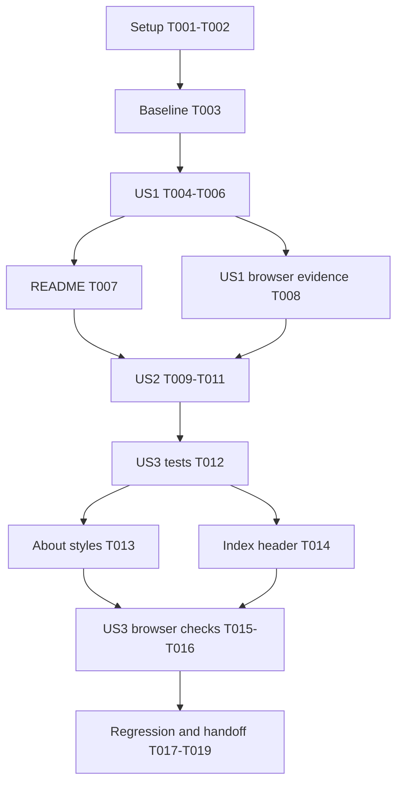

# Tasks: Personal About Page

**Input**: Design documents from `specs/076-about-page/`

**Prerequisites**: [plan.md](plan.md), [spec.md](spec.md), [research.md](research.md), [data-model.md](data-model.md), [UI contract](contracts/about-page.md), and [quickstart.md](quickstart.md).

**Tests**: Include the focused Jest and browser checks required by the approved plan, specification acceptance scenarios, and repository constitution. Use the existing Node `fs`/`path` test pattern; no jsdom, new parser dependency, extra fixture file, or browser-runner installation is required.

**Organization**: Tasks are grouped by user story. This is a static informational page, not a dashboard tab. No models, services, endpoints, authentication, build tooling, or new application JavaScript are needed.

## Format: `[ID] [P?] [Story] Description`

- Every task uses a checkbox, sequential task ID, exact repository-relative file paths, and a story label only within story phases. `[X]` records completed implementation and validation.
- `[P]` identifies tasks that can run concurrently with the specifically paired task after their shared prerequisites are complete, with no overlapping files being edited.
- After each substantive code edit, immediately run the specified focused check before reading or editing another surface. Repair failures within the same slice before proceeding, except for the deliberately failing discovery test while its index integration is pending.
- Do not mark implementation tasks complete merely because this document or another planning artifact exists. Record actual test/browser evidence during implementation.

## Path Conventions

- Root static pages: `about.html` (new), `index.html` (header integration), and `news.html` (unchanged reference).
- Focused suite: `__tests__/about-page.test.js` (new). Existing regressions: `__tests__/news-page.test.js` and `__tests__/legal-footer.test.js`.
- Documentation: `README.md` and `specs/076-about-page/quickstart.md` for discovery and actual validation evidence.
- All npm commands run at repository root; the API service and its dependencies are outside scope.

## Phase 1: Setup (Shared Infrastructure)

**Purpose**: Verify the existing project environment without scaffolding a new application.

- [X] T001 Verify the root test toolchain from `package.json` and `jest.config.js`, confirm the Node Jest environment and static-server prerequisites from `specs/076-about-page/quickstart.md`, and run `npm install` only if root dependencies are absent; do not introduce new dependencies or change API manifests.
- [X] T002 Review `specs/076-about-page/checklists/requirements.md`, `specs/076-about-page/spec.md`, and `specs/076-about-page/contracts/about-page.md` as the implementation gate; confirm all requirements-quality items are complete and preserve the approved copy, existing main analysis destination, and exclusions without inventing scope.

**Checkpoint**: Existing environment and approved feature scope are understood; no project initialization is necessary.

## Phase 2: Foundational (Blocking Prerequisites)

**Purpose**: Establish the baseline and the directly affected integration boundaries before story implementation.

- [X] T003 Inspect the header in `index.html`, the static page and relative links in `news.html`, and the source-reading patterns in `__tests__/news-page.test.js` and `__tests__/legal-footer.test.js`; run `npm test -- --runTestsByPath __tests__/news-page.test.js __tests__/legal-footer.test.js --runInBand` and record results plus the protected `goToLanding()`, `statusBadge`, and `statusText` contracts in `specs/076-about-page/quickstart.md`, distinguishing any pre-existing failures without fixing unrelated code.

**Checkpoint**: All stories share a known static-page/test baseline. No runtime model, content service, database, or shared-component extraction is introduced.

## Phase 3: User Story 1 - Meet the Person Behind TriAnalytica (Priority: P1, MVP)

**Goal**: Visitors can find About and read Dennis's complete personal introduction without an account or training import.

**Independent Test**: From a fresh index visit, activate About once; compare the rendered introduction and every ordered section with the approved content. Direct access must show the same complete copy.

### Tests for User Story 1

- [X] T004 [US1] Create `__tests__/about-page.test.js` with a `US1` describe group using Node `fs`/`path`: assert the index header's About link follows News, metadata and `main#aboutContent` exist, the exact greeting is the single h1, the three supplied h2 titles and all approved paragraphs/sign-off/action label appear in order, and no extra main copy, form, biographical image, or application/counter script is introduced. Use independent literal expectations from `specs/076-about-page/spec.md`, not text read back from `about.html`; retain the data-model rule "HTML character escaping and presentation whitespace may differ, but decoded text, punctuation, and the greeting symbol must match." Run `npm test -- --runTestsByPath __tests__/about-page.test.js --runInBand` immediately and confirm the expected missing-page/discovery failure.

### Implementation for User Story 1

- [X] T005 [US1] Create `about.html` as complete initial HTML with UTF-8, document language `en`, responsive viewport, title `About TriAnalytica`, factual metadata, the existing `assets/logo.png`, a normal-flow header with labelled native navigation, and `main#aboutContent`; include every approved paragraph and the supplied closing/action in order, without a new visible About title. Enforce "Exactly one h1 and three h2 headings, in content order. A document title does not add another visible heading.", "The bracketed action notation becomes an anchor without visible square brackets.", and "Body copy includes no new testimonials, counters, signup fields, or biographical imagery." Include valid same-tab header/logo/News and final-action anchors from the UI contract as part of the complete static document, a basic unframed reading layout, and no application scripts. Immediately rerun `__tests__/about-page.test.js`; all page/content assertions must pass, with only the pending index-discovery assertion allowed to remain red.
- [X] T006 [US1] Add the native About anchor with `href="./about.html"` immediately after News in the header of `index.html`, outside all dashboard panels and available before and after import; preserve the logo's `goToLanding()` action, News destination, `statusBadge`, and `statusText`, and give the right-hand link/status group basic internal wrapping and gaps. Immediately run `npm test -- --runTestsByPath __tests__/about-page.test.js --runInBand` and require the complete US1 slice to pass without changing tab constants, IDs, order, dispatch, or analysis behaviour.
- [X] T007 [P] [US1] Add a concise About discovery section beside the existing News documentation in `README.md`, linking relatively to `about.html` and describing Dennis's personal project introduction without new biographical details or product/privacy promises; verify the link target exists. This task can run alongside T008 after T006 passes.
- [X] T008 [P] [US1] Serve the site using the existing static-server command and verify `index.html` to `about.html` in one activation, a fresh direct About load, full rendered copy/order, introductory prominence, and the absence of unsupported claims or excluded elements; record the URL and actual editorial/navigation outcomes in `specs/076-about-page/quickstart.md`. Use no personal data. This task can run alongside the README-only T007 after T006 passes.

**Checkpoint**: US1 is a demonstrable MVP: discoverable, directly accessible, and faithful to the supplied introduction. The complete static page already contains valid navigation; dedicated return-route and accessibility verification follow below.

## Phase 4: User Story 2 - Continue to My Own Training (Priority: P2)

**Goal**: Both the header return navigation and the final action independently open the existing analysis entry point, including on first visits.

**Independent Test**: Open About directly with fresh history, activate Back to dashboard, then repeat from a new direct load for Explore your training. Both must open the existing main analysis/import entry point in the same tab.

### Tests for User Story 2

- [X] T009 [US2] Extend `__tests__/about-page.test.js` with a `US2` group that scopes the visible Back to dashboard link and linked brand to the About header, scopes `#exploreTrainingLink` to `main#aboutContent` after Dennis's sign-off, and separately asserts their `href="./index.html"` targets and the final action's exact label. Also assert the About header's News link targets `./news.html`, no new-tab/history-handler routing is used, and the index logo action remains unchanged. Enforce "Native same-tab links, non-empty accessible names, keyboard activation, visible focus, and no training-import/account prerequisite." Run the focused suite immediately; existing correct anchors may already pass and must not be deliberately broken to manufacture a red test.

### Implementation for User Story 2

- [X] T010 [US2] Verify and, only where the new assertions expose a gap, correct native anchors in `about.html`: linked logo named Back to TriAnalytica dashboard, visible News and Back to dashboard links, and final `a#exploreTrainingLink` labelled Explore your training after the sign-off; preserve `./news.html` for News and `./index.html` for all analysis return routes. Keep the final action as the last editorial content with no visible brackets or extra onboarding/signup; do not add history-based routing or imported-data persistence. Immediately rerun `npm test -- --runTestsByPath __tests__/about-page.test.js --runInBand` after any correction and require US1 and US2 to pass.
- [X] T011 [US2] Validate `about.html` in fresh direct visits using each return route independently, then the brand and News links; confirm `index.html` opens the current analysis/import entry point without prior history/account/data, the same tab is used, News returns normally, and the existing index logo still reaches its landing view. Record separate outcomes and URLs in `specs/076-about-page/quickstart.md`; do not infer one link's correctness from another link's result or promise retained in-memory workouts.

**Checkpoint**: US2 is independently verified through direct visits; the introduction connects back to analysis without a new route or flow.

## Phase 5: User Story 3 - Read Comfortably on My Device (Priority: P2)

**Goal**: The complete page and affected main header remain readable, recognizably TriAnalytica, and keyboard operable on mobile and desktop, including enlarged text.

**Independent Test**: Inspect index-header reflow and the whole About page at 320, 375, 768, and 1440 CSS pixels, repeat at 200% text enlargement, then verify heading navigation, keyboard operation, visible focus, and text contrast.

### Tests for User Story 3

- [X] T012 [US3] Extend `__tests__/about-page.test.js` with separate `US3 About` and `US3 header` groups for semantic landmarks, exact heading levels/order, meaningful native-link names, explicit focus-visible styling, the About page's constrained normal-flow header and readable CSS sizing, and retained index News/status/logo contracts with internally wrapping navigation. Run the focused suite before style corrections; source assertions are supporting evidence only and must not assert that class names alone prove rendered fit, focus, or contrast.

### Implementation for User Story 3

- [X] T013 [P] [US3] Refine page-local styles in `about.html` to reuse existing sans-serif typography, slate base, light/muted text, amber accents, and constrained logo; use an unframed approximately 65-character reading column, generous spacing, bounded rem-based greeting/body sizes, zero letter spacing, a normal-flow wrapping header, and visible focus on every link. Meet the 4.5:1 normal-text and 3:1 large-text contrast thresholds without cards, decorative gradients, photos, new fonts, viewport-scaled text, or hidden content. Immediately run `npm test -- --runTestsByPath __tests__/about-page.test.js --runInBand --testNamePattern="US3 About"`. After T012, this task may run alongside index-only T014.
- [X] T014 [P] [US3] Refine only the affected header styles/markup in `index.html` so the News/About/status group has internal row/column gaps, wrapping, and suitable min-width constraints; allow the status text to wrap at 320 pixels and enlarged text, retain all existing controls and status IDs, and provide visible keyboard focus for header navigation without changing dashboard tabs or hiding overflow. Immediately run `npm test -- --runTestsByPath __tests__/about-page.test.js --runInBand --testNamePattern="US3 header"`. After T012, this task may run alongside About-only T013.
- [X] T015 [US3] Browser-check the full `about.html` page and affected `index.html` header at 320, 375, 768, and 1440 CSS pixel widths; repeat the matrix with 200% text enlargement using the method in `specs/076-about-page/quickstart.md` and also check 200% browser zoom. Check visual fit and document scroll widths, logo constraints, long-heading wrapping, no clipped/overlapping text, and final-action usability. Record viewport/text-size results and representative mobile/desktop screenshots in `specs/076-about-page/quickstart.md`; repair only affected `about.html` or index-header defects and rerun the corresponding focused tests immediately after each code edit before repeating the failed browser case.
- [X] T016 [US3] Use Tab, Shift+Tab, Enter, and heading navigation to verify `about.html` and the affected `index.html` header: logical order, visible focus, meaningful names, no traps, and independent activation of both analysis return paths. Measure computed normal/large-text contrast, including action/navigation hover/focus states; confirm `assets/logo.png` renders, hidden images do not remove narrative meaning, no feature-related console/local-resource errors occur, and About loads no application/counter/newsletter scripts or new storage/service flows. Record actual outcomes, ratios, and enlargement/focus methods in `specs/076-about-page/quickstart.md`; immediately rerun focused checks after any local repair.

**Checkpoint**: US3 has browser evidence, not just source assertions. All stories retain the approved content and navigation contracts.

## Phase 6: Polish & Cross-Cutting Concerns

**Purpose**: Close the narrow regression and evidence gates without unrelated refactoring.

- [X] T017 Run `npm test -- --runTestsByPath __tests__/about-page.test.js __tests__/news-page.test.js __tests__/legal-footer.test.js --runInBand` and record actual results in `specs/076-about-page/quickstart.md`; fix only feature-caused failures, rerun the same narrow group after repairs, and follow any additional repository gates discovered during implementation rather than modifying unrelated tests.
- [X] T018 Review the scoped diff for `about.html`, `index.html`, `__tests__/about-page.test.js`, and `README.md` against `specs/076-about-page/contracts/about-page.md`; confirm no dashboard tab/constants/dispatch, imports, exports, API/CLI code, dependencies, storage, unsupported copy, portraits, counters, or signup behaviour changed, and that News/legal navigation remains intact.
- [X] T019 Consolidate completed US1/US2/US3 outcomes and SC-001 through SC-005 evidence in `specs/076-about-page/quickstart.md`, accurately mark completed work in `specs/076-about-page/tasks.md`, and hand off the working page URL if a review server remains running. Distinguish any unavailable browser check or pre-existing failure explicitly; do not claim unverified acceptance criteria pass and do not commit or create a branch unless requested.

## Dependencies & Execution Order

### Phase Dependencies

- T001 and T002 precede T003; foundational T003 blocks story implementation.
- US1: T004 tests first, then T005 page, T006 discovery integration, then T007 and T008. Each code edit is followed immediately by the specified focused check.
- US2 follows the US1 page integration to avoid editing the same page/tests concurrently: T009, T010, T011. Its acceptance test remains independent of the earlier browser session.
- US3 follows US2: T012 first, then independent file edits T013 and T014, then T015 and T016 serially because both record evidence in the same quickstart document.
- T017 follows all story work; T018 follows regression results, then T019 closes the evidence and task status.
- US2/US3 are independently verifiable user outcomes, not independent code branches: they intentionally reuse the same static page and suite. No duplicate page or test file is created to force parallelism.

### Dependency Graph



### Parallel Opportunities and Examples

**US1**: After T006 passes, T007 edits only `README.md` while T008 validates the site read-only and records evidence only in `specs/076-about-page/quickstart.md`. Their prerequisites are complete and their write targets do not overlap.

```text
T007: Document the About destination in README.md.
T008: Validate US1 navigation/copy and record results in specs/076-about-page/quickstart.md.
```

**US2**: No parallel implementation tasks. T009 and T010 share the page/test contract and must preserve test-before-correction ordering; T011 records evidence only after both are complete. Do not mark them [P] or run concurrent edits on `about.html` or the focused suite.

```text
T009 -> T010 -> T011: tests, conditional anchor corrections, independent direct-visit checks.
```

**US3**: After T012, T013 edits only `about.html` while T014 edits only `index.html`. Each runs its own named test group. Join both changes before the combined browser matrix; T015 and T016 must not concurrently edit the shared quickstart evidence.

```text
T013: Refine about.html and run the US3 About group.
T014: Refine index.html header and run the US3 header group.
```

## Requirement Coverage

| Requirement | Primary tasks |
| --- | --- |
| FR-001, FR-002: discovery and direct availability | T004-T006, T008, T011 |
| FR-003, FR-004: exact copy and semantic hierarchy | T004-T005, T008, T012, T016 |
| FR-005, FR-006: existing visual language and responsive reading | T005-T006, T012-T015 |
| FR-007: keyboard access, focus, contrast | T009, T012-T016 |
| FR-008, FR-009: final action and independent return navigation | T005, T009-T011, T016 |
| FR-010, FR-011: personal voice and excluded additions | T004-T005, T007-T008, T016, T018 |
| FR-012: preserve existing analysis/navigation contracts | T003-T006, T009, T014, T017-T018 |
| SC-001 through SC-005: measurable acceptance outcomes | T008, T011, T015-T017, T019 |

## Implementation Strategy

### MVP First (User Story 1)

1. Complete setup and baseline T001-T003.
2. Add and run failing US1 tests, implement the page, then add main-header discovery in T004-T006.
3. Finish the independent documentation and editorial/browser checks T007-T008. Demonstrate the complete personal introduction as the MVP; this is not yet a claim that all feature accessibility/return-path gates have been verified.

### Incremental Delivery

1. Verify both return paths independently in US2 without weakening the earlier content tests or deliberately breaking already-working anchors.
2. Complete US3's source checks, bounded style edits, viewport/text-enlargement matrix, keyboard/contrast tests, and resource review.
3. Run the selected regression suites, inspect scope, and consolidate real evidence. The feature is complete only when all required story and cross-cutting gates are satisfied.

### Shared-File Discipline

Keep one owner at a time for `about.html`, `index.html`, `__tests__/about-page.test.js`, and the quickstart evidence. Parallelism is optional and limited to the explicit US1 and US3 pairs. This tasks-generation command does not itself implement tasks, start a server, change task checkboxes, commit, or create a branch.