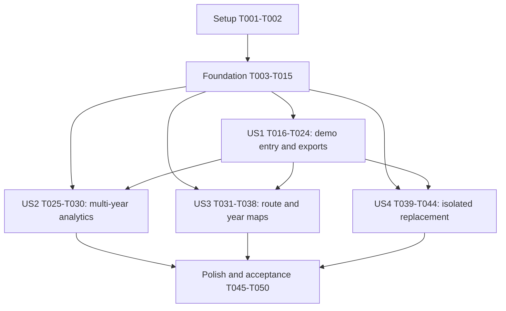

# Tasks: Silicon Valley Sample Training Data

**Input**: [plan.md](plan.md), [spec.md](spec.md), [research.md](research.md), [data-model.md](data-model.md), [data interface](contracts/sample-data-contract.md), [interaction interface](contracts/demo-interaction-contract.md), and [quickstart.md](quickstart.md).

**Organization**: Setup, blocking shared prerequisites, one phase per user story in specification order, then cross-cutting acceptance. No application implementation is performed by task generation.

**Tests**: Required by constitution principle III and the plan's verification gates. Add focused regression cases before the implementation they exercise, observe the expected failure, then run the narrowest relevant Jest suite immediately after each substantive edit. Reuse existing Node/VM/injected-document harnesses; do not introduce jsdom or a parallel browser framework.

## Format and Path Conventions

Every executable task uses `- [ ] Tnnn [P?] [USn?] Description with exact file paths`. Paths are repository-relative. `[P]` means different-file work can overlap with the explicitly named peer after their shared prerequisites; it does not waive dependencies. Shared-file work is serial even across stories. All tasks remain unchecked until actually executed and verified. Do not commit or create a branch without an explicit request.

## Phase 1: Setup (Shared Infrastructure)

**Purpose**: Establish public synthetic-data boundaries and reusable synthetic test inputs without scaffolding a new application.

- [X] T001 Create `sample-data/README.md` describing one fictional Silicon Valley triathlete, fixed years 2021-2025, deterministic generation, public-data distribution, source/license/access-review fields, and the prohibition on real exports, credentials, private locations, and inputs from `private-data` or `test-data`; leave unverified sources explicitly unapproved rather than inventing provenance.
- [X] T002 [P] Extend the existing synthetic fixture builders in `__tests__/dashboard-import.test.js` and establish local builders in `__tests__/sample-data-utils.test.js` for complete valid histories, malformed payloads, delayed promises, and personal-import candidates; positive hydration tests must use complete valid histories, and reduced fixtures must be rejection cases only (parallel with T001).

## Phase 2: Foundational (Blocking Prerequisites)

**Purpose**: Supply the complete reusable data substrate and safe import transaction before exposing any sample entry. This shared data serves US1-US3, while activation safety serves US1 and US4.

**Critical**: Complete T003-T015 before story integration. Public geometry acquisition is a real prerequisite: never replace it with arbitrary polygons or undocumented routes.

- [X] T003 [P] Add failing pure-contract tests in `__tests__/sample-data-utils.test.js` for envelope/activity constraints, unsupported versions, invalid/null values, associations, route continuity, effort intervals, immutable inputs, and timezone hydration; test CommonJS and browser-global exposure without DOM access (parallel with T008 and T012, after the sample-fixture part of T002).
- [X] T004 Implement `validateSamplePayload` in `src/sample-data-utils.js` with `module.exports` and `window.sampleDataUtils`; enforce `schemaVersion`: "Integer `1`; reject unsupported versions", `datasetId`: "Stable versioned string such as `silicon-valley-triathlete-v1`", `synthetic`: "Boolean `true`, required", `label`: "`Synthetic sample training data`", `years`: "Ordered unique integers `[2021, 2022, 2023, 2024, 2025]`", and `generation`: "Fixed seed and generator version; no generation-time timestamp that defeats reproducibility"; require the fictional athlete's region `Silicon Valley`, sport profile `triathlon`, nonempty display name, and no contact details or private addresses; always enforce the complete activity/year/month/sport/track/effort/equipment minimums at runtime without a bypass option (after T003).
- [X] T005 Extend activity validation in `src/sample-data-utils.js`: `id`: "Unique string prefixed `sample-`; all associations must reference existing IDs"; `name`: "Nonempty varied training title"; `sport`, `sportRaw`: "Canonical `Run`, `Bike`, or `Swim`; sample raw label is consistent with that sport"; `calendarDate`: "Valid `YYYY-MM-DD` in 2021-2025, checked by calendar round-trip"; `localStartTime`: "Valid `HH:mm:ss` wall time; stable across visitor time zones"; `distance`, `duration`: "Finite positive kilometers and seconds"; availability flags: "`true` for bundled sample activities"; `equipment`: "Fictional equipment name or existing no-equipment convention"; `environment`: "`outdoor`, `indoor`, or `pool`; pool only for Swim"; `routeId`: "Matching pattern ID for tracked outdoor sessions; `null` otherwise" (after T004).
- [X] T006 Complete metric, route, and effort validation in `src/sample-data-utils.js`: heart rate is "Positive bpm when supplied, otherwise `null`", cadence is "Run spm, Bike rpm, otherwise `null`; no cadence-doubling during hydration", watts are "Positive watts for measured cycling sessions, otherwise `null`", elevation is "Nonnegative meters when meaningful, otherwise `null`", and steps are "Optional positive running step count, otherwise `null`"; enforce the inclusive sample-only average ranges in `sample-data/README.md` and the data model, <= 1% explicit speed inconsistency, "at least two distinct points, finite in-range coordinates, <= 2,000 points, successive segment distance <= 60 m", `[latitude, longitude]` order, route/activity length agreement "within 5%", no indoor/pool tracks, reviewed source URL/retrieval date/license/attribution and swim-access evidence, Bike-only efforts, "`endSec - startSec === targetSeconds`", "`0 <= startSec < endSec <= duration`", "`0 <= startKm <= endKm <= distance`", and "finite positive watts" with durations 5, 30, 60, 120, 300, 600, 1200, 3600 seconds (after T005).
- [X] T007 Implement `hydrateSampleDataset` in `src/sample-data-utils.js`: return fresh `kind: 'tri-activities-v1'` objects, `rawCsvData: []`, local `date`/`startTime`/`monday` Date instances using calendar arithmetic, activity-keyed GPS/effort dictionaries, `sourceType: 'sample'`, and copied `sampleProvenance: { datasetId, synthetic: true, label }`; keep optional measurements null, use elapsed effort seconds, leave statistics accumulation to orchestration, and share geometry only if consumers are verified read-only; run UTC, America/Los_Angeles, and Europe/Berlin subprocess cases including DST/year boundaries in `__tests__/sample-data-utils.test.js` (after T006).
- [X] T008 [P] Acquire and curate at least 12 distinct Run/Bike route patterns and two permitted open-water Swim patterns into `sample-data/routes.json`; use redistributable public road/trail/water geometry, verify swim access with authoritative sources, record actual source URL/retrieval date/license/attribution/access evidence in `sample-data/README.md`, and satisfy <= 2,000 points, <= 60 m segment/closure spacing and preferably < 100 km routes without crossing land or introducing off-path jitter (parallel with T003 and T012, after T001; block publication if licensing/access cannot be verified).
- [X] T009 Implement deterministic calendar/activity generation in `scripts/generate-sample-data.js` from committed `sample-data/routes.json`: target 1,600 unique activities and at least 700 tracked sessions across 2021-2025, enforce acceptance floors "At least 1,500 unique activities, 250 per year, all 60 months populated, three sports per year, real rest days each year, non-identical yearly totals, and varied monthly workloads" and "At least 600 tracked activities, 100 per year, and all three outdoor sports tracked every year"; include three Run/Bike patterns each used at least 20 times, indoor/pool sessions without routes, varied titles/start times, and at least two shoes and two bicycles over distinct periods (after T007 and T008).
- [X] T010 Implement coherent synthetic measurements and power profiles in `scripts/generate-sample-data.js`, deriving outdoor distance from route length and plausible duration/pace/elevation from the same session, supplying Run/Bike heart rate/cadence and Bike watts, computing mean power and all eight best-effort durations from the same deterministic underlying profile, and serializing only required aggregates/intervals and shared route geometry; add default generation, read-only `--check`, unsupported-argument errors, and count/byte reporting without runtime network or private input (after T009).
- [X] T011 Generate and commit-ready stage `sample-data/silicon-valley-training.json` from T010 without making a Git commit; enforce all envelope and whole-history checks, payload <= 4 MiB uncompressed, a single self-contained runtime resource, deterministic byte output, nonzero `--check` on corruption, and no writes in `--check`; run `node scripts/generate-sample-data.js --check` and `npm test -- --runInBand __tests__/sample-data-utils.test.js` (after T010).
- [X] T012 [P] Add failing shared-operation tests to `__tests__/dashboard-import.test.js` for monotonic generations, cancelled/empty selections, nested token reuse, staged preparation, stale result rejection, stale progress/errors, newest failure not reviving older work, pre-commit versus rendering errors, and candidate-resource disposal; capture observations outside callbacks production catches (parallel with T003 and T008, after T002; delayed-modal code is guarded by the same token, with full handler race-matrix verification retained in T039).
- [X] T013 Implement shared import-operation state and staged activation in `src/dashboard-import.js` (state is scoped to the owning orchestration script; no additional state-file change is needed) for Strava, TrainingPeaks, and standalone CSV: start at confirmed nonempty selection, pass optional context through nested helpers without breaking public signatures, prepare/validate before a final token check, commit full references synchronously, invalidate stale renders/PB selections, and token-bind all progress/error/timer/cleanup effects; keep the prior committed dataset on preparation failure and distinguish post-commit rendering errors (after T012).
- [X] T014 Bind completed-analysis counting to each committed personal operation in `src/dashboard-import.js`, adjusting `src/dashboard-tabs.js` only if required; preserve the initial counter read, count a committed personal import exactly once, and never count failed/superseded/sample operations; add operation/counting assertions to `__tests__/dashboard-import.test.js` and run it together with the existing `__tests__/analysis-counter.test.js` (after T013).
- [X] T015 Verify the shared prerequisites by running the focused data/import/counter suites and generator check, inspect `sample-data/README.md` for completed source/access/license evidence, and record results plus any actual blockers in `specs/076-sample-training-data/quickstart.md`; do not open the demo entry until the complete payload and activation contract pass (after T011 and T014).

**Checkpoint**: Complete public data exists, hydration is validated, and all import sources have safe activation. Story phases can now integrate against stable contracts rather than waiting on another story's dataset.

## Phase 3: User Story 1 - Explore Without Preparing an Export (Priority: P1, MVP)

**Goal**: One landing action opens the real dashboard without files/accounts, with reliable loading/error behavior and synthetic identification in UI and images.

**Independent Test**: From a fresh desktop/mobile session, activate the button once, use sport/year controls and existing available tabs, export a normal chart and PB detail, and verify synthetic context without file selection or personal information. Inject load failures and retry without destroying the last valid history.

### Tests for User Story 1

- [X] T016 [P] [US1] Add failing loader/interaction contract cases to `__tests__/dashboard-import.test.js` for one complete same-origin fetch, no file prompt/account, duplicate sample clicks, HTTP/JSON/schema/invariant failures, retry, preservation of existing data, sample statistics and dashboard opening, zero sample increments, and accessible loading/error control restoration (parallel with T017).
- [X] T017 [P] [US1] Add failing export provenance snapshot/clone tests to `__tests__/export-utils.test.js` and composition/download tests to `__tests__/dashboard-export-download.test.js` for normal targets, PB detail, every supported aspect/presentation mode, recomposition, and a synthetic line independent of optional context truncation (parallel with T016).

### Implementation for User Story 1

- [X] T018 [US1] Implement `handleSampleDataIngest` in `src/dashboard-import.js` using the shared operation, one fetch of `./sample-data/silicon-valley-training.json`, pure hydration, existing statistics accumulator and prepared indices, duplicate-click suppression, current-token-only feedback, and recoverable failure/retry; activate only a complete valid candidate with `openDashboard: true` and no counter call (after T016).
- [X] T019 [US1] Add the exact `type="button"` text "Use exemplary data", appropriate existing Lucide icon, keyboard/focus behavior and accessible busy/error feedback beside personal-import choices in `index.html`; load `src/sample-data-utils.js` before `src/dashboard-import.js` and update `specs/022-modularize-inline-script/contracts/script-load-order.md` without a bundler or global name collisions (after T018).
- [X] T020 [US1] Add explicit synthetic source handling in `src/dashboard-import.js` and visible dataset context in `index.html`, displaying "Synthetic sample training data" instead of the Strava fallback for samples and clearing sample-only context for personal datasets; keep the existing media-free availability behavior (after T019).
- [X] T021 [US1] Preserve copied `sampleProvenance` or null explicitly in normal and PB-detail export target construction/cloning in `src/export-utils.js` and `src/dashboard-export.js`; capture it before asynchronous work, never from later current globals (after T017 and T020).
- [X] T022 [US1] Reserve and draw a readable synthetic-data line in the common composition path in `src/dashboard-export.js` for every sample image, including pace/PB special context, aspect ratios, humor changes and recomposition, without replacing normal preview/download behavior (after T021).
- [X] T023 [US1] Extend and run wiring/availability regressions in `__tests__/index-script-syntax.test.js`, `__tests__/tab-navigation.test.js`, and `__tests__/visualization-availability.test.js`; verify existing IDs/order/dispatch remain consistent, no media tab is falsely enabled, and new classic-script wiring is valid (after T022).
- [X] T024 [US1] Run the US1 independent desktop/mobile/keyboard and actual-image checks from `specs/076-sample-training-data/quickstart.md` at 1440x900 and 390x844, inspect console/global collisions, and record entry/error/export outcomes; run the focused import/export suites before marking the MVP checkpoint (after T023).

**Checkpoint**: US1 is demonstrable using the complete shared dataset. Later stories deepen analytic/route verification and replacement ownership without being prerequisites for a fresh-session demo.

## Phase 4: User Story 2 - Inspect Meaningful Multi-Year Training (Priority: P1)

**Goal**: Prove and refine the fictional athlete's coherent, varied five-year history across all non-media analyses, not merely its record counts.

**Independent Test**: Hydrate the shared payload directly and compare every represented year and sport through existing aggregators; confirm populated analyses, coherent metrics, rest/recovery/progression, equipment periods, and all cycling PB durations. Browser validation uses the US1 entry once available.

### Tests for User Story 2

- [X] T025 [P] [US2] Extend `__tests__/sample-data-utils.test.js` with full-payload audits for counts by year/month/sport, real rest days, non-copied totals, varied start times/titles, distinct equipment periods, optional null semantics, route-length/pace consistency, and physiological bounds; exercise deliberate corruption rather than only testing the happy generated file (parallel with T026).
- [X] T026 [P] [US2] Add shared-payload consumer assertions in `__tests__/sample-data-utils.test.js` using the existing equipment, power and visualization-availability utilities, proving all required non-media analyses are available, at least four shoe/bike equipment entries and timelines exist, optional swimming measurements stay null, and every supported PB duration has eligible data annually; reuse this suite rather than duplicate bundled-data fixtures across existing suites (serialize with T025 in the same file).

### Implementation for User Story 2

- [X] T027 [US2] Refine calendar, seasonal loading/recovery, training progression and equipment replacement in `scripts/generate-sample-data.js` where T025/T026 expose gaps; preserve the fixed seed, target counts, varied monthly totals and realistic sport mix rather than patching chart logic or copying identical annual schedules (after T025 and T026).
- [X] T028 [US2] Refine the same-profile physiological and cycling-effort generation in `scripts/generate-sample-data.js` where coverage/consistency tests expose gaps; retain all eight durations, per-year eligible rides, valid relative interval positions, no effort longer than its workout, and consistent averages without adding raw power series to the public payload (after T027).
- [X] T029 [US2] Regenerate `sample-data/silicon-valley-training.json`, run deterministic `--check` and the touched sample/processing/equipment/PB/availability suites, and record annual totals, equipment periods and PB coverage in `sample-data/README.md`; keep optional measurements null and total payload <= 4 MiB (after T028).
- [X] T030 [US2] Verify distance, pace/physiological, equipment/timelines, cycling PB, distributions, workout-time, training calendar, word cloud, pie charts and lifetime statistics with sport/year changes and applicable exports; record SC-002/SC-003 evidence in `specs/076-sample-training-data/quickstart.md`, not an assumption that utility audits prove rendered usability (after T029; browser entry requires T024).

**Checkpoint**: US2's data/consumer tests can run without the demo UI; rendered validation depends only on the already working entry, not on US3 or US4.

## Phase 5: User Story 3 - Explore Recognizable Silicon Valley Routes (Priority: P1)

**Goal**: Deliver convincing repeated public corridors and usable sport/year heatmaps with matching hover/export context.

**Independent Test**: Render the shared dataset's GPS tracks through the existing heatmap owner, select each year and sport, zoom from region to neighborhood, and verify continuity, repeated-use intensity, swim legality/location, empty states and export context. No personal import is needed.

### Tests for User Story 3

- [X] T031 [P] [US3] Add failing heatmap year/sport/All years selection tests to `__tests__/dashboard-heatmap.test.js`, covering represented-year options, empty combinations, matching hover summaries, stale asynchronous render rejection, invalid year reset on replacement and existing zoom preservation (parallel with T032).
- [X] T032 [P] [US3] Extend route audits in `__tests__/sample-data-utils.test.js` for 600+ tracked activities, 100+ per year, all three outdoor sports annually, 12+ distinct Run/Bike and two Swim patterns, three corridors each repeated by 20+ unique activity IDs, no indoor/pool tracks, coordinate/length/spacing failures, and required provenance metadata (parallel with T031; serialize after US2 writes to this file).

### Implementation for User Story 3

- [X] T033 [US3] Add heatmap-year state (`null` for All years or a represented integer year) in its existing owner `src/dashboard-heatmap.js` and a compact accessible selector in `index.html`; refresh its domain from the active dataset and reset an unavailable year on replacement in `src/dashboard-import.js` without changing tab IDs/order or existing sport controls (after T031).
- [X] T034 [US3] Combine selected year and sport before segment and hover-data preparation in `src/dashboard-heatmap.js`, include dataset revision/year/sport in asynchronous identity, and reject stale renders/hover updates while preserving map view/zoom behavior for filter changes (after T033).
- [X] T035 [US3] Snapshot selected heatmap year/sport into capture context in `src/dashboard-export.js` and extend `__tests__/dashboard-export-download.test.js` to prove the exported map/context agree even when filters change during asynchronous capture; preserve synthetic identity (after T034; export integration requires T022).
- [X] T036 [US3] Review `sample-data/routes.json` against its recorded public road/trail/water sources at regional and neighborhood scales, verify actual swim access and no cross-land routes, correct geometry only from approved sources, regenerate `sample-data/silicon-valley-training.json` if needed and rerun generator/route audits; document location-specific findings in `sample-data/README.md` (after T032; serialize with US2 generator/payload work).
- [X] T037 [US3] Verify unchanged tab constants/IDs in `src/tab-navigation.js`, markup/dispatch in `index.html` and existing dashboard owners, and export mappings; extend and run `__tests__/tab-navigation.test.js`, `__tests__/dashboard-heatmap.test.js`, and `__tests__/dashboard-export-download.test.js` for the enhanced existing heatmap without artificial ID renaming or a new tab (after T035 and T036).
- [X] T038 [US3] Execute desktop/mobile All years and every year/sport map checks, rapid filter changes, repeated-corridor frequency, swim views, empty states, hover counts, zoom preservation and actual map export; record SC-004 screenshots/outcomes in `specs/076-sample-training-data/quickstart.md` and rerun the touched focused suites (after T037; browser entry requires T024).

**Checkpoint**: US3 proves both numeric route coverage and visual geographic quality; neither is substituted for the other.

## Phase 6: User Story 4 - Replace Examples With Personal Data Safely (Priority: P2)

**Goal**: Prove isolation, recovery and resource ownership when users move between sample and personal histories, including pending media exports.

**Independent Test**: Start with a synthetic personal dataset, load examples, replace with synthetic Strava/TrainingPeaks/CSV candidates in both completion orders, inject failures, and verify only the accepted history appears while exports retain their own captured identity/resources.

### Tests for User Story 4

- [X] T039 [P] [US4] Extend `__tests__/dashboard-import.test.js` for the complete race matrix across sample, Strava, TrainingPeaks and standalone CSV in both completion orders: superseded results/errors/progress/timers, newest failure, cancelled selection, duplicate clicks, complete activities/GPS/equipment/PB isolation, sample-label removal and committed-personal exactly-once counting (parallel with T040).
- [X] T040 [P] [US4] Add lifecycle tests in `__tests__/dashboard-media.test.js` with deferred gallery/collage reads and synthetic media fixtures, proving accepted replacement clears old dashboard media, stale reads create no late URLs/DOM, discarded candidate resources release once, and independently leased pending exports stay usable (parallel with T039).

### Implementation for User Story 4

- [X] T041 [US4] Harden candidate disposal, synchronous acceptance, old dataset release ordering, PB/cache reset and UI/error/timer guards in `src/dashboard-import.js` where T039 exposes gaps; retain the last committed history on preparation/validation failure, keep older requests superseded after newest failure, distinguish post-commit rendering errors, and preserve existing personal CSV/GPX semantics (after T039).
- [X] T042 [US4] Guard stale gallery/collage work and old dataset ownership release in `src/dashboard-media.js`, coordinating only necessary lifetime hooks in `src/dashboard-import.js`; preserve separately acquired export media leases until their own consumers finish, and ensure the media-free sample does not retain prior gallery state or generate late URLs (after T040 and T041).
- [X] T043 [US4] Extend `__tests__/dashboard-export-download.test.js` and repair only necessary paths in `src/dashboard-export.js` for sample-to-personal and personal-to-sample switches during capture, PB detail and recomposition: old target identity/media remain usable, new personal exports are unlabelled, and sample exports retain the reserved synthetic line (after T042 and T022).
- [X] T044 [US4] Run the focused import/counter/media/export suites and browser replacement/failure scenarios with synthetic fixtures, confirm 100% data isolation and no sample increments, and record SC-005 results in `specs/076-sample-training-data/quickstart.md` (after T043 and T024).

**Checkpoint**: US4 verifies the foundation's transaction contract end-to-end including resources owned by in-flight exports; it does not postpone basic activation safety until after the MVP.

## Phase 7: Polish & Cross-Cutting Concerns

**Purpose**: Complete release evidence and documentation without treating human or legal gates as automatically passed.

- [X] T045 [P] Update `README.md` and `docs/IMPORT_FEATURE.md` with the exact example button, fixed five-year synthetic history, public `sample-data` resources, normal personal-import replacement, media exclusion and accurate local-processing/network wording; do not imply the entire app is offline or network-free (parallel with T046, after story behavior is stable).
- [X] T046 [P] Finalize `sample-data/README.md` with verified route source/license/attribution/swimming-access evidence, actual generation seed/version/counts/size, reproducible commands, and synthetic disclaimer; ensure every distributed geometry's obligations are satisfied before publication and retain any unresolved gate as blocked (parallel with T045, after T029 and T036).
- [X] T047 Execute the combined focused suites and all non-human regression scenarios specified in `specs/076-sample-training-data/quickstart.md`, verify classic-script load order and real image downloads on desktop/mobile, and record pass/fail evidence without private inputs; do not run API tests or change API code for this root-only feature (after T030, T038, T044, T045 and T046).
- [X] T048 Measure SC-001 using 10 cold loads at 20 Mbps per recorded desktop/mobile setup with cache disabled, browser/device/latency recorded, and >= 9/10 loads <= 15 seconds per setup; record timings in `specs/076-sample-training-data/quickstart.md`, and if failing, make only measured loading/payload/heatmap fixes in `src/sample-data-utils.js`, `src/dashboard-import.js`, `src/dashboard-heatmap.js` or `scripts/generate-sample-data.js` with corresponding focused revalidation (after T047).
- [ ] T049 Conduct SC-006 with five first-time visitors and record anonymized outcomes in `specs/076-sample-training-data/quickstart.md`: >= 4/5 independently open examples, compare two years, explore the heatmap and locate personal import within three minutes; 5/5 recognize synthetic data; if participants are unavailable, leave this task unchecked and report the human acceptance gate as unverified, never replace it with an agent walkthrough (after T048).
- [X] T050 Review all FR-001 through FR-017 and SC-001 through SC-006 against evidence in `specs/076-sample-training-data/quickstart.md`, rerun affected focused checks after any necessary in-scope correction, and report missing evidence/legal/human gates explicitly rather than marking release complete; preserve all unchecked tasks until their actual criteria pass (after T049 or an explicitly recorded human-gate blocker).

## Dependencies & Execution Order

### Phase Dependencies

- Setup T001-T002 has no feature implementation prerequisites. T001 and T002 touch separate files.
- Foundation gates are T003 -> T004 -> T005 -> T006 -> T007; T008 can overlap T003/T012 after Setup. T009 waits for T007/T008; T010 -> T011 supplies the complete public payload. Separately T012 -> T013 -> T014 supplies safe transactions. T015 joins both paths and blocks all story phases.
- US1 T016-T024 is the first demonstrable increment. Loader and export tests can overlap; implementation and shared-file integration are sequenced explicitly.
- US2 T025-T030, US3 T031-T038, and US4 T039-T044 each start from the foundation and can run their independent data/owner tests without another story's UI. Their rendered checks use US1's completed entry T024; map export also reuses T022.
- Finish the chosen stories before polish. Licensing and timing are mandatory gates; human evaluation remains explicit if blocked.

### User Story Completion Graph

US1-to-other-story arrows mean browser entry/export integration prerequisites, not that isolated unit/data checks must wait. Default single-agent execution follows ascending task IDs. US2/US3/US4 do not depend on one another functionally; overlapping file ownership still imposes serialization.

### Shared-File Serialization

- `__tests__/sample-data-utils.test.js`: T002/T003, then T025, then T032; never edit these concurrently. T032 may pair with T031 after US2's write completes.
- `__tests__/dashboard-import.test.js` and `src/dashboard-import.js`: foundation, US1, then US4 in order; T033 also touches import reset and must not overlap those writers.
- `scripts/generate-sample-data.js`, `sample-data/routes.json`, `sample-data/silicon-valley-training.json`, and `sample-data/README.md`: finish T027-T029 before T036 corrections and T046 final review.
- `index.html`, dashboard state and export files: US1 wiring/snapshot work precedes US3 year integration and US4 capture-race fixes. No cross-story parallel write to these files.
- Evidence edits to `specs/076-sample-training-data/quickstart.md` are merged serially. Parallel browser runs may collect independent artifacts but do not write the guide concurrently.

### Parallel Execution Examples per User Story

| Story | Parallel tasks | Preconditions / boundary |
|---|---|---|
| US1 | T016 loader tests and T017 export tests | After T015; different import/export test files; implementation waits for its own failing tests. |
| US2 | T025 dataset audits and T026 analytic consumer assertions | After T015; different test files; do not overlap US3 writes to sample tests or availability tests already owned by US1. |
| US3 | T031 heatmap selection tests and T032 route audits | After T015 and previous sample-test edits; separate files; export integration waits for T022. |
| US4 | T039 source-race tests and T040 media-lifetime tests | After T015 and prior import-test writes; distinct import/media suites; implementation joins at T041/T042. |

Additional parallel waves: T001/T002, then T003/T008/T012, and later T045/T046. `[P]` describes available scheduling, not automatic permission to spawn agents.

## Requirements and Acceptance Coverage

| Requirement | Primary tasks |
|---|---|
| FR-001 landing button | T019, T023-T024 |
| FR-002 normal dashboard without files | T007, T018-T024 |
| FR-003 loading, duplicates, recovery | T012-T018, T039-T044 |
| FR-004 five-year history and sports | T004-T011, T025-T030 |
| FR-005 varied training history | T009-T010, T025-T030 |
| FR-006 coherent measurements | T005-T010, T025-T029 |
| FR-007 physiology, power, equipment | T006, T009-T010, T025-T030 |
| FR-008 analytic views and exports | T021-T024, T026-T030, T035-T038 |
| FR-009 tracked coverage | T008-T011, T032, T036-T038 |
| FR-010 route variety and plausibility | T008-T011, T032, T036, T046 |
| FR-011 continuity and no indoor routes | T006, T008-T011, T032, T036-T038 |
| FR-012 synthetic UI/image identity | T017, T020-T022, T035, T043 |
| FR-013 atomic isolated replacement | T012-T015, T018, T039-T044 |
| FR-014 public synthetic folder | T001, T008-T011, T046 |
| FR-015 privacy boundaries | T001, T018, T039-T046 |
| FR-016 sample excluded from counter | T012-T016, T018, T039, T044 |
| FR-017 static delivery | T007-T011, T018-T019, T023-T024, T047 |
| SC-001 load timing | T048 |
| SC-002 history coverage | T011, T025-T030 |
| SC-003 usable views/exports | T024, T026-T030, T035-T038, T047 |
| SC-004 map coverage/quality | T032, T036-T038, T046 |
| SC-005 no cross-dataset leakage | T039-T044 |
| SC-006 first-time comprehension | T049 |

## Implementation Strategy

### MVP First

Complete Setup + Foundation + US1 (T001-T024). This delivers the exact landing button, complete prebuilt synthetic history, normal dashboard exploration, sample labelling and working image exports with basic race-safe activation already in place. Validate US1 before expanding. Do not advertise all feature acceptance as complete: the enhanced heatmap-year interaction, richer analytic validation, full resource-lifetime verification, timing trials and five-person study still need their own tasks.

### Incremental Delivery

1. Establish reusable data, hydration and safe transactions; stop if route licensing or required sources cannot be verified.
2. Deliver US1's working entry/export experience and verify it independently.
3. Execute US2's analytic coherence and coverage checks/refinements.
4. Deliver US3's bounded year-map enhancement and geographic inspection.
5. Execute US4's complete replacement/race/resource-ownership checks.
6. Finish documentation, focused cross-boundary validation, actual timing and human acceptance; report external blockers without fabricating evidence.

### Validation Discipline

Tests precede their implementation slice. Run the cheapest behavior-scoped check immediately after editing; only then proceed to adjacent work. Positive validation/hydration tests use complete valid histories; small fixtures are negative cases, never a bypass of production minimums. Later story tasks refine and validate already working foundations, not reimplement a second loader or generator. Preserve personal import semantics, tab contracts, independent export leases, privacy wording and API dependency boundaries throughout.

## Execution Status: 2026-11-02

Technical work is complete: 1,600 activities / 923 GPS tracks, the working landing action, every non-media analytic view, heatmap year/sport controls, source-labelled normal/PB-detail/portrait PNGs, safe import replacement, zero sample increments and protected media export ownership. The official OSM route catalogue, offline generator and source/license documentation are present. Browser checks cover desktop/mobile, keyboard entry, all 24 map combinations, all twelve analytic exports and synthetic personal-data replacement. Cache-disabled 20 Mbps trials passed 10/10 desktop and 10/10 mobile viewport loads. T049 alone remains unchecked because five real first-time visitors were not available; no human results are fabricated. See `quickstart.md` for exact evidence, environment caveats and final regression output.