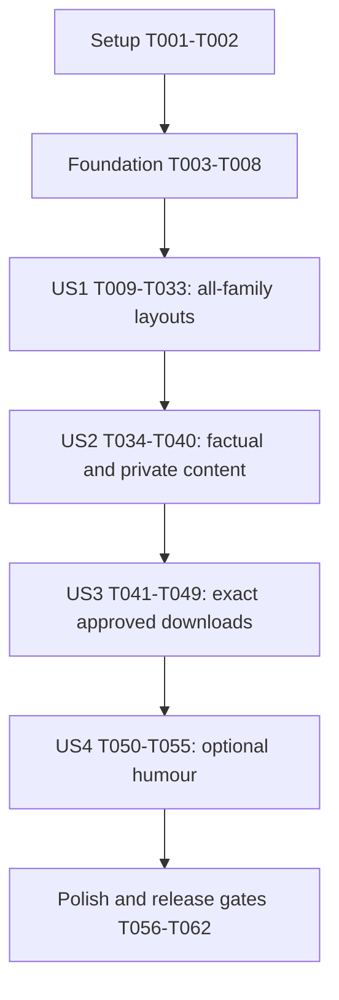

# Tasks: Reel / Story Export Layouts

**Input**: [spec.md](spec.md), [plan.md](plan.md), [research.md](research.md), [data-model.md](data-model.md), [contracts/export-contracts.md](contracts/export-contracts.md), [export-inventory.md](export-inventory.md), and [quickstart.md](quickstart.md).

**Prerequisites**: Approved feature context `077-reel-story-exports`; existing static application and root Jest environment. No project scaffolding, new package, backend service, branch creation, or commit is part of these tasks.

**Tests**: Included because the specification requires verifiable data/layout/revision behaviour and full image review, and the constitution requires narrow post-edit tests. Extend existing suites and their VM/injected-document helpers; keep the Jest environment `node`. Write regression cases first, demonstrate the intended failure, then run the narrowest relevant check immediately after each implementation edit. Assertions must not live inside callbacks whose exceptions production catches.

**Organization**: Setup, shared foundation, four prioritized user-story phases, then cross-cutting acceptance. Tasks are initially unchecked. A requirements-quality checklist pass is not implementation or browser acceptance.

## Format and Path Conventions

- Every task uses `- [ ] Tnnn [P?] [USn?] description with exact paths`.
- `[P]` identifies disjoint-file work within the explicitly gated parallel waves below; it does not override prerequisites or authorize simultaneous edits to shared files.
- Paths are repository-relative. Reuse existing production modules and test files. The only planned additional feature documentation is `specs/077-reel-story-exports/review-matrix.md`, created during implementation to record actual acceptance evidence, not fabricated now.
- Reuse existing synthetic fixture helpers where suitable, but T002 must also provide browser-importable files under __tests__/fixtures/reel-story-exports/ rather than only Node mocks. Store large downloaded PNGs and any authorized personal fixtures locally outside version control; record their local references and review results without uploading them.

## Phase 1: Setup (Shared Infrastructure)

**Purpose**: Establish a reproducible baseline and a complete, initially unverified review inventory.

- [X] T001 Run the existing export baseline `npm test -- --runInBand --runTestsByPath __tests__/export-utils.test.js __tests__/dashboard-export-download.test.js __tests__/dashboard-media.test.js`, inspect the existing VM/deferred-promise helpers in those files, and record command outcomes plus environment prerequisites in specs/077-reel-story-exports/review-matrix.md without treating baseline success as feature acceptance.
- [X] T002 Prepare browser-importable synthetic datasets and media under __tests__/fixtures/reel-story-exports/, reusing suitable existing generators/helpers; include supported CSV/archive inputs, GPX routes, readable image/video inputs that exercise still-image export, all configured PB distances/longest/elevation/power-duration/profile cases, every other export family, sparse/dense histories and privacy sentinels. Add __tests__/fixtures/reel-story-exports/README.md with deterministic regeneration/import recipes and __tests__/fixtures/reel-story-exports/expected-values.json with fixture identities, selected filters, expected values/units/dates/scales, selected media/route scope and provenance. Import each recipe in the browser to prove usability, and populate specs/077-reel-story-exports/review-matrix.md from the live target/definition inventory with fixture/reference mappings, three formats, both caption states, Chrome/Edge versions, pages and initially unverified image-review fields. Missing, non-importable or unmapped fixtures block this task and T033/T058/T059; Node-only mocks or unavailable real training exports do not satisfy it.

## Phase 2: Foundational (Blocking Prerequisites)

**Purpose**: Provide shared format, semantic-snapshot, isolated-render and resource boundaries before any story implementation.

**Blocking gate**: Complete T001-T008 before user-story implementation. Foundation tests may use representative adapter stubs; full family implementations and acceptance belong to US1.

- [X] T003 [P] Add failing pure-contract tests in __tests__/export-utils.test.js for the verbatim format constraints "Integer pixels: 1080 x 1080, 1080 x 1350, 1080 x 1920 respectively", "Unknown formats fail explicitly; no square fallback for a requested story", "Story: x=72, y=240, width=888, height=1320", and "minimum essential 36-pixel text and 4.5:1 text contrast"; preserve existing format/helper and CommonJS/browser-bridge expectations.
- [X] T004 [P] Add failing foundation tests in __tests__/dashboard-export-download.test.js for allowlisted frozen selection capture before awaiting, independent dataset/selection identity, date epochs/local calendar keys, explicit missing-versus-zero handling, registry descriptor readiness, and snapshot construction/preparation cleanup; add isolated chart source tests in __tests__/dashboard-tooltips.test.js without changing dashboard inspector behaviour.
- [X] T005 Extend src/export-utils.js with the `story` format and measured content-bound/text primitives; preserve existing `square`/`portrait` keys and public helper signatures, implement the exact T003 constraints, use injected text measurement, and keep pure helpers DOM-free with CommonJS plus window.exportUtils exports; run __tests__/export-utils.test.js immediately.
- [X] T006 Establish private adapter descriptor and snapshot validation/copying in src/dashboard-export.js, preserving public export entrypoints; enforce "Unique per new captured selection; format/caption changes reuse it", "Registered target, `tab` or `pb-tile`, and applicable record/media definition identity", "no live chart, DOM, entire activity object or mutable dashboard array", "Record timestamps as finite epoch milliseconds, calendar days as local `YYYY-MM-DD` keys", and "Missing remains missing, not zero"; retain real selected period/metric/axes/visibility/provenance/disclosure/PB-opening fields rather than late DOM fallbacks; run the foundation VM tests.
- [X] T007 Extend the isolated chart snapshot boundary in src/dashboard-tooltips.js to render frozen chart inputs at requested source dimensions with frozen dataset visibility, export-sized labels and inspection explicitly disabled; prevent exported plugin/formatter closures from reading live owners, preserve existing dashboard tooltip methods, and destroy isolated instances after consumption; run __tests__/dashboard-tooltips.test.js and the foundation export VM cases.
- [X] T008 Make request-owned preparation/cleanup in src/dashboard-export.js and src/dashboard-media.js exception-safe, with independent source leases, idempotent release and consumer-aware disposal: "actual source disposal waits for any already-started consumer to finish" and "Prepared PNG blobs retained by a save remain valid independently of source cleanup"; do not revoke sources on mere format change or mutate ZIP/import APIs; add focused cases to __tests__/dashboard-media.test.js before the edit and run that suite plus the foundation VM tests.

**Checkpoint**: Existing exports still work; semantic snapshots and isolated render/resource primitives are available, without claiming story layouts or revision-safe publication are finished.

## Phase 3: User Story 1 - Share Any Visualization as a Reel / Story Image (Priority: P1)

**Goal**: Deliver deliberate 1080 x 1920 compositions across the entire export inventory while retaining square and 4:5.

**Independent Test**: From every current target/detail/generated variant, export sparse/dense content with humour off in all formats. Verify exact dimensions, content-specific layout, safe bounds, phone readability, complete selected content or explicit subset scope, and continuation access. Exercise the registered PB overview through a local harness without adding a new overview button. Final both-browser/both-caption release coverage is in Phase 7.

### Tests for User Story 1

- [X] T009 [P] [US1] Add failing family-layout and full-registry tests in __tests__/export-utils.test.js and __tests__/dashboard-export-download.test.js: all 13 capture/display/filename/adapter keys support all formats, PB/media variants are discovered rather than sampled, measured pages contain required content and global scales, final effective fonts stay at least 36 pixels, and sparse/dense layouts do not fall back to a desktop screenshot on tall background; distinguish forbidden layout-induced occlusion from valid coincident data marks without shifting, changing or dropping observations, and cover no-data/not-ready and unknown family failures.
- [X] T010 [P] [US1] Add failing owner snapshot/geometry cases in __tests__/dashboard-core.test.js, __tests__/dashboard-equipment.test.js, __tests__/dashboard-scatter-years.test.js, __tests__/heartrate-pace-visualization.test.js, __tests__/distribution-utils.test.js and __tests__/workout-time-utils.test.js for selected periods/metrics/visibility, full histories, actual timeline event mode, frozen bins and count/duration/distance pattern semantics; keep orchestration-only assertions in the existing export VM suite from T009.
- [X] T011 [P] [US1] Add failing structured-family export cases in __tests__/dashboard-heatmap.test.js, __tests__/training-calendar-utils.test.js, __tests__/wordcloud-dashboard.test.js, __tests__/pie-charts-dashboard.test.js, __tests__/lifetime-statistics-dashboard.test.js and __tests__/power-pb-utils.test.js for frozen map extent, local dates/intensity meaning, complete word placement/global weights, circular pies/unchanged denominator, summary missing values, and all PB history/profile definitions; use T009's VM suite for PB-detail orchestration rather than inventing a duplicate suite.
- [X] T012 [P] [US1] Add failing annual/collage prepared-model and vertical layout tests in __tests__/dashboard-media.test.js and __tests__/media-utils.test.js for identical selected assets after format changes, chronological annual meaning, existing selection-limit disclosure, video stills, long permitted captions and route opt-in; use synthetic readable media and existing URL-validity helpers.

### Implementation for User Story 1

**Parallel producer wave**: Start T013-T024 only after T009-T012 have established their regression cases. Each task edits its named owner only; run the matching owner suite and applicable T009 VM cases immediately afterward. Do not edit the shared exporter or utilities inside this parallel wave.

- [X] T013 [P] [US1] Extend getTotalDistanceExportData in src/dashboard-core.js with full selected ordered periods, numeric stacked sport series/totals, actual selected timeframe, aggregation and partial-period metadata, including histories longer than ten years; do not derive numeric values from formatted DOM summaries.
- [X] T014 [P] [US1] Extend export inputs in src/dashboard-scatter.js with frozen numeric points, selected year/trend visibility, X/Y domains/titles and pace/speed direction/units, frozen point-size normalization and meaning; provide isolated ratio-aware Chart.js inputs that keep all selected observations without live state callbacks or arbitrary bitmap stretching.
- [X] T015 [P] [US1] Extend both ranking and timeline adapters in src/dashboard-equipment.js with ordered IDs/names/types, actual metric/display units/ties, explicit subset totals, finite epoch endpoints, per-item activity dates and common time domain; preserve applicable year/palette settings and distinguish usage spans from activity-marker mode.
- [X] T016 [P] [US1] Extend src/dashboard-power-pb.js with full allowlisted PB detail data and an independent grouped overview model collected from existing definitions; retain sport/definition/value/unit, record chronology, source fields including effort source, and xAxisMode/durationSeconds/durationLabel for power profiles; add ratio-aware SVG/detail/overview render inputs without reducing to compact milestones or reusing an unrelated active detail, and add no overview button.
- [X] T017 [P] [US1] Extend src/dashboard-heatmap.js with an isolated export surface using frozen selected projected extent/aspect, sport/year/palette, route/frequency layer, scale meaning and attribution; wait for its own tiles/layers, keep geographic proportions and selected extent, avoid refitting to all routes or resizing/mutating the live map, and expose proportional placement for meaningful surrounding context.
- [X] T018 [P] [US1] Expose the computed selected distribution result from src/dashboard-distributions.js, including fixed bin edges/special bins, frequencies, visible sport series, units, axis direction and selected period; supply isolated Chart.js render inputs without recomputing bins or aggregation for the export format.
- [X] T019 [P] [US1] Expose the selected built temporal-pattern dataset from src/dashboard-workout-time.js with granularity, period, sport, count/duration/distance, availability and common scale; supply ratio-aware render inputs, preserve null versus zero, and retain the existing year-mode monthly-pattern meaning rather than inventing calendar-year chronology.
- [X] T020 [P] [US1] Extend src/dashboard-training-calendar.js to expose frozen local day/date keys, weekday/month/year positions, coverage status, palette, metric and original intensity scale metadata; render vertical month blocks with measured year/month continuation inputs and preserved per-year scale associations instead of a shrunken 53-column year or export-specific recolouring.
- [X] T021 [P] [US1] Expose selected terms/counts/colours and one global weight mapping in src/dashboard-wordcloud.js; render isolated tall wordcloud canvases with explicit placement accounting, truthful common-weight subset continuation if necessary, and no global stop that interrupts the dashboard; never silently drop terms or shrink essential words below the readability contract.
- [X] T022 [P] [US1] Expose frozen currentPieResult selection/slices/denominator in src/dashboard-pie-charts.js and parameterize isolated chart/percentage-label rendering at final export typography; arrange a circular chart above its measured legend, retain existing Other only, and allow legend continuation that repeats the full unchanged-percentage chart with explicit subset scope.
- [X] T023 [P] [US1] Extend src/dashboard-lifetime-statistics.js with a frozen summary/country-availability adapter and vertical export-only KPI/milestone/equipment groups; preserve "Currently exported totals, milestone values/dates, equipment counts, country-summary availability and units" and "omit incidental activity titles and dashboard-only table fields", distinguish missing from zero and allow group continuation without adding the omitted sport table.
- [X] T024 [P] [US1] Capture the prepared annual/collage model before awaits in src/dashboard-media.js, including frozen ordered readable asset keys, selected/eligible/displayed counts, filter versus explicit-selection scope, existing permitted captions, video stills and route choice; render annual chronology or vertical collage pages from the same independent sources for every format, disclosing existing N-of-M/12-item selection limits without changing the chosen set.
- [X] T025 [US1] Add pure family-aware page planning in src/export-utils.js using measured text/content bounds, actual row/group/month/legend/word capacities, shared scale references and scope labels; enforce "disjoint chronological/row ranges cover all required items exactly once", distinguish intentional repeated pie/context content, reject unfit content without silent clipping, and make format/caption changes recompute capacity without fixed square-versus-portrait assumptions; run __tests__/export-utils.test.js.
- [X] T026 [US1] Refactor composition in src/dashboard-export.js to measure truthful header/context, legend, attribution/provenance, caption allocation and branding before family rendering; keep all story essentials within x=72..960/y=240..1560, final essential text at least 36 pixels and text contrast at least 4.5:1, and use final-resolution family content rather than shrinking existing desktop captures; run the layout VM and utility cases.
- [X] T027 [US1] Update drawDistanceExportChart, drawEquipmentRanking and drawEquipmentTimeline in src/dashboard-export.js to consume T013/T015 snapshots and measured page plans: remove last-ten-year slicing, wrap names above bars/values where needed, preserve ranking/ties/explicit top scope, draw genuine activity markers versus spans, and retain common continuation domains; run __tests__/dashboard-export-download.test.js and __tests__/dashboard-equipment.test.js.
- [X] T028 [US1] Register isolated ratio-aware Chart.js rendering for paceMetrics, distributions and workoutTime in src/dashboard-export.js using T014/T018/T019 snapshots and T007's capture boundary; preserve axes, all scatter points, trend/size encodings, frozen bins and temporal groups, and prevent any final contain-fit from undersizing labels; run the export VM, scatter and applicable pattern/bin suites.
- [X] T029 [US1] Wire personalBests overview and pb-tile detail dispatch in src/dashboard-export.js to T016's independent models/renderers, maintaining history versus duration-profile axes, all definitions and source attribution; render grouped continuation instead of capturing the unchanged multi-column desktop overview, and run PB/export regression cases including a single record and the full power profile.
- [X] T030 [US1] Register heatmap, trainingCalendar, wordcloud, pieCharts, lifetimeStatistics and mediaGallery family dispatch in src/dashboard-export.js against T017/T020-T024 renderers; replace explicit square/portrait capture enumeration with requested-format page plans, await captured resources, pass only frozen inputs, preserve per-family continuation semantics and fail clearly for unregistered story support; run the export VM plus relevant structured/media suites.
- [X] T031 [US1] Add the distinct story selector and explicit ratio labels in index.html, wire selected/pressed format state through src/dashboard-export.js, preserve existing control IDs and initial square selection, and ensure the selected format always produces exact native PNG dimensions independent of screen density; run the export VM and __tests__/index-script-syntax.test.js.
- [X] T032 [US1] Run the focused owner/export suites listed in specs/077-reel-story-exports/quickstart.md, verify 13-target registry parity plus every current PB/media variant in __tests__/dashboard-export-download.test.js, and record coverage/results in specs/077-reel-story-exports/review-matrix.md; do not count mocked drawing or a reused 1 x 1 PNG as image-size evidence.
- [ ] T033 [US1] Exercise the complete target/detail/generated inventory with sparse/dense inputs, all three formats and humour off using actual Chrome downloads; inspect native files and 360-pixel-wide whole-image layouts, safe bounds, grouping/scales, first/middle/last continuation pages and a concrete taller-layout improvement per family, then record artifact references/defects in specs/077-reel-story-exports/review-matrix.md as preliminary US1 evidence, not final release certification.

**Checkpoint**: Full-inventory vertical layouts can be demonstrated and independently inspected. A three-chart subset is not US1 completion. This checkpoint does not waive pending US2-US4 safety/content work or final release gates.

## Phase 4: User Story 2 - Share the Correct Training Story (Priority: P1)

**Goal**: Make every exported headline, context, date, unit, disclosure and provenance faithful to the captured selection.

**Independent Test**: Export known reference selections with non-default metrics/filters, partial years, one-record histories, missing measurements, synthetic data and privacy sentinels. Compare visible data/copy with expected facts and confirm no incidental title/location/inspector disclosure on any page.

### Tests for User Story 2

- [ ] T034 [P] [US2] Add failing factual-copy/provenance/privacy VM cases in __tests__/dashboard-export-download.test.js and pure metadata cases in __tests__/export-utils.test.js for filtered periods, non-distance equipment metrics, inverted pace, one-record histories, duration profiles, explicit dates/units, caption-disabled metadata, synthetic notices on every continuation, and exclusion of hovering/pinned inspector content.
- [ ] T035 [P] [US2] Add failing sentinel-content and selection-boundary cases in __tests__/lifetime-statistics-dashboard.test.js, __tests__/dashboard-media.test.js and __tests__/dashboard-heatmap.test.js: no incidental activity titles/new precise labels or filenames in generic copy, selected wordcloud/map/media-route allowances remain narrow, route opt-out survives reformatting, and export does not upload data/images while existing map/asset requests remain permitted.

### Implementation for User Story 2

- [ ] T036 [US2] Make presentation generation in src/dashboard-export.js and existing metadata helpers in src/export-utils.js consume only the captured selected scope, metric, units, aggregation and visibility; eliminate dataset-wide fallback dates or mileage/all-time/improvement claims when unsupported, use neutral literal headlines for sparse/profile cases, retain required dates/units and remove redundant context; run T034's suites.
- [ ] T037 [US2] Enforce export-field allowlists in src/dashboard-power-pb.js and src/dashboard-lifetime-statistics.js and remove pinned/hover selection capture/composition from the social path in src/dashboard-export.js; preserve dashboard inspection APIs, required PB source/definition context and actual milestone values, and run the export/lifetime/tooltip regression suites.
- [ ] T038 [US2] Carry provenance and required source/map attribution through every page in src/dashboard-export.js and src/export-utils.js, enforcing the verbatim notice "Synthetic sample training data" inside measured safe bounds with essential-size/contrast typography; never remove provenance to make a dense page fit, and run T034's per-page/safe-area cases.
- [ ] T039 [US2] Constrain map/media disclosure and generic metadata in src/dashboard-heatmap.js, src/dashboard-media.js and src/dashboard-export.js to frozen existing user choices: no new precise labels, incidental titles or filenames, no unselected routes, no live-selection substitution, and no export upload path; retain intentionally selected wordcloud/map content and existing permitted media captions; run T035's suites and the export VM tests.
- [ ] T040 [US2] Run known-reference and privacy-sentinel exports across the inventory, including synthetic continuation pages, and compare selected filters/periods/values/units/aggregation and allowable disclosures against specs/077-reel-story-exports/contracts/export-contracts.md; record zero-claim/zero-leak checks, observed asset-only network behaviour and unresolved defects in specs/077-reel-story-exports/review-matrix.md without publishing private evidence.

**Checkpoint**: Content and disclosure can be validated independently of caption personality or revision stress testing; US1 layouts are retained unchanged except where accurate context requires reflow.

## Phase 5: User Story 3 - Download Exactly the Image Reviewed (Priority: P1)

**Goal**: Publish only the latest complete preview revision and save the exact approved page/bytes, with coherent errors and resource lifetime.

**Independent Test**: Use controlled out-of-order completions and real-browser format/page changes, pending downloads, close/reopen, dataset replacement and save delays. No obsolete/partial image may be approved; a started save remains tied to its approved image, with no UI effect on newer previews.

### Tests for User Story 3

- [ ] T041 [P] [US3] Extend deferred-promise VM tests in __tests__/dashboard-export-download.test.js for A->B->C requests completing C->B->A, format/caption changes during capture, mixed-page options, direct download while pending, page-reset approval, stale errors/finalizers after close/reopen, invalid PNG/decode dimensions, delayed picker/write/fallback bound to original bytes and PB opening, cancellation/permission failure/retry, and state-derived button locks; after dataset/filter replacement verify retry keeps the original selectionId, unavailable original sources leave download blocked with an explanation, and only an explicit new export captures current data under new sessionId/selectionId; assert exact identities/bytes rather than only invocation counts.
- [ ] T042 [P] [US3] Extend __tests__/dashboard-media.test.js with deterministic consumer gates and URL-validity assertions covering dataset/gallery replacement, source preparation failure, close during decode/render, superseded revisions, independent simultaneous leases, exactly-once partial cleanup and delayed disposal while a started consumer still uses its source; preserve an already prepared save blob after source release.

### Implementation for User Story 3

- [ ] T043 [US3] Implement ExportSession ownership in src/dashboard-export.js with "Monotonically changing identity for new sessions and close/invalidation; never reused by delayed callbacks", states "`capturing`, `composing`, `ready`, `failed`, or `closed`; the controller may be `idle` without a session", and one immutable selection per session; invalidate synchronously on close/new session while allowing the old frozen selection to remain coherent after dashboard changes. Retry reuses the same selectionId; if its snapshot or required sources are unavailable, retain a blocked download with an explanation, and create new sessionId/selectionId from current data only after an explicit new export request; run T041's lifecycle/retry cases.
- [ ] T044 [US3] Make composition requests in src/dashboard-export.js enforce "Increment synchronously for each requested format/caption change, including changes while capture is pending", capture immutable options once, build complete candidate series locally, validate PNG signature/header plus decoded dimensions against the format, and publish atomically only for the current session/composition revision; clear pending download approval, ignore stale success/errors and never pre-render all formats; run T041's composition/decode cases.
- [ ] T045 [US3] Tie ready-page selection and filenames in src/dashboard-export.js to viewRevision/pageIndex and "Increment view identity on page selection; valid only within the ready series. New composition starts at page 1"; disable old navigation during recomposition, retain complete ordered series and distinct page filenames, and reject direct downloads with mismatched/non-ready approvals; run T041's page/direct-call tests.
- [ ] T046 [US3] Preserve and harden save attempts in src/dashboard-export.js with outcomes "`saved`, `downloaded`, `cancelled`, `failed`" and "Only one save attempt runs at once"; bind image/blob/filename/page/PB opening before the first await, retain existing picker cancellation/write-permission/fallback behaviour without rerendering, and prevent old completion from closing/advancing/enabling newer approvals; run T041's exact-byte/save-error tests.
- [ ] T047 [US3] Connect current-session invalidation and consumer-aware cleanup in src/dashboard-export.js and src/dashboard-media.js so stale tasks release only their own resources, partial construction failure cleans up, in-flight consumers retain valid sources until completion, and superseded canvases/charts/DOM/URLs are disposed without invalidating a started save blob; run T042 plus export close/reopen tests.
- [ ] T048 [US3] Update index.html and preview state projection in src/dashboard-export.js for complete-image containment at desktop and phone-sized viewport dimensions, reachable keyboard controls, clear loading/error/retry states and state-derived download/page enablement; preserve the active dashboard selection and never show an old image as ready under new controls; run export VM, tab-navigation and script-syntax tests.
- [ ] T049 [US3] Run T041/T042 suites and exercise equivalent delayed operations in current stable Chrome and Edge, recording browser versions, exact preview/download dimensions and page/byte parity, narrow viewport containment, cancellations, retry, close/reopen and independent resource release in specs/077-reel-story-exports/review-matrix.md; mark unavailable browser cases unverified rather than claiming shared-engine certification.

**Checkpoint**: Latest-preview correctness and exact-byte saving hold regardless of completion order; every new caption/layout request will use the same guarded lifecycle.

## Phase 6: User Story 4 - Choose a Little Humour (Priority: P2)

**Goal**: Offer exactly one relevant optional line for every exporter and remove both line and reserved space when disabled.

**Independent Test**: For all target/detail/generated variants, every available sport/equipment mode and all formats, toggle humour and compare the latest ready preview with downloaded files. Enabled means one relevant readable line; disabled means none, zero caption height and balanced reflow. No joke may make an unsupported claim or disclose private details.

### Tests for User Story 4

- [ ] T050 [P] [US4] Add failing catalogue/toggle/parity cases in __tests__/dashboard-export-download.test.js for every registry/variant and filter combination, including paceMetrics and all-sport/equipment cases previously lacking humour; require exactly one friendly relevant line when enabled, none when disabled, default off, no unsupported conclusion/private disclosure and latest-revision agreement during rapid toggles.
- [ ] T051 [P] [US4] Add failing measured caption allocation cases in __tests__/export-utils.test.js for "Disabled humour has no caption field/height" and "Enabled humour has exactly one measured, relevant line", including long context/legends/provenance, sparse rebalancing, dense repagination and safe-area/minimum-font preservation in all formats.

### Implementation for User Story 4

- [ ] T052 [US4] Complete the family/variant-aware humour catalogue in getSocialExportPresentation in src/dashboard-export.js, covering every selected sport/equipment mode with one short friendly self-aware line; use neutral relevant humour rather than data claims where necessary, and remove all caption data when off; run T050's catalogue cases.
- [ ] T053 [US4] Integrate measured one-line caption space and zero-height disabled state into src/export-utils.js page planning, rebalancing sparse layouts and repaginating dense content while preserving scales/data/provenance rather than clipping or shrinking text; run T051's layout cases.
- [ ] T054 [US4] Wire the single labelled native humour checkbox in index.html through src/dashboard-export.js's immutable revision requests, preserving default off, synchronous option/pressed state, download lock and preview/save parity on rapid toggles; ensure all family renders consume the same frozen setting, and run T050 plus existing US3 races.
- [ ] T055 [US4] Run the caption/layout/race suites and review actual on/off files for every exporter in specs/077-reel-story-exports/review-matrix.md, including the formerly missing pace/all-sport/equipment cases; verify one relevant line or no line/no gap at phone size, with complete preview/download agreement, before the final two-browser matrix audit.

**Checkpoint**: All four user-story implementations and focused regression checks are complete; release is still gated by full-file, compatibility and human review below.

## Phase 7: Polish & Cross-Cutting Concerns

**Purpose**: Complete compatibility, documentation and the non-substitutable release acceptance evidence.

- [ ] T056 [P] Verify unchanged tab constants/IDs/order in src/tab-navigation.js against index.html and src/dashboard-tabs.js dispatch/openDashboardTab, check the script order documented in specs/022-modularize-inline-script/contracts/script-load-order.md, and extend/run __tests__/index-script-syntax.test.js, __tests__/tab-navigation.test.js, __tests__/dashboard-tooltips.test.js and __tests__/tooltip-selection-utils.test.js as needed; verify actual browser globals load without classic-script collisions and existing dashboard inspections still work; do not rename unchanged wiring.
- [ ] T057 [P] Update README.md with the three format labels/native dimensions, local PNG preview/download flow, optional humour, selected-data fidelity and precise privacy wording; preserve the distinction between local export processing and existing map/CDN network traffic, and do not claim video generation or guaranteed immunity to every Instagram overlay.
- [ ] T058 Complete the entire specs/077-reel-story-exports/review-matrix.md in current stable desktop Chrome using actual downloaded PNGs for every registered target/current PB definition/media kind, applicable sparse/dense inputs, all formats and both humour settings; cover all selected metrics/sports/groupings/modes across the set, full resolution and 360-pixel width, safe-area/overlay simulation, provenance/attribution, meaningful tall composition, disclosure and preview parity, and verify all continuation content including first/middle/last pages without silent loss.
- [ ] T059 Independently complete the same full actual-file matrix in current stable desktop Edge and record exact version/OS plus artifact/reviewer references in specs/077-reel-story-exports/review-matrix.md; include desktop/narrow viewport and revision/save failure scenarios, do not infer Edge success from Chrome, and do not substitute modal screenshots or mocked canvas calls for decoded file review.
- [ ] T060 Audit specs/077-reel-story-exports/review-matrix.md against the live registry/definitions and specs/077-reel-story-exports/spec.md SC-001 through SC-006: confirm exact native dimensions, zero unreadable/clipped essentials, layout-induced occlusions or safe-area defects, no unannounced omissions/duplicates or unsupported claims, complete caption/parity/privacy/provenance coverage and reviewer sign-off; allow natural coincident data marks without shifting, altering or dropping observations, and route each defect to its owning existing source/test file and rerun its narrow checks plus affected image cases before marking it resolved.
- [ ] T061 Conduct the SC-007 review with at least five amateur endurance athletes using actual phone-sized export files and record anonymized outcomes in specs/077-reel-story-exports/review-matrix.md: five-second family views, at least four correct subject/period/metric-unit/takeaway identifications and at least four clarity/shareability ratings of 4/5 or higher per family; keep missing participants/results explicitly blocked and never fabricate human sign-off.
- [ ] T062 Run the focused export/owner/integration commands in specs/077-reel-story-exports/quickstart.md on the final integrated changes, record outcomes, dense-render duration/resource-release observations and final verified/blocked disposition in specs/077-reel-story-exports/review-matrix.md, reconcile any discovered inventory changes in specs/077-reel-story-exports/export-inventory.md, and require T056-T061 with no missing/unverified release cases before declaring the feature complete.

## Dependencies & Execution Order

### Phase Dependencies

1. Setup: T001 -> T002; T002 includes browser-importable fixture preparation and reference-value validation, and blocks all later image-review gates if any required recipe is missing or unusable.
2. Foundation: after T002, T003 and T004 may run in parallel; T005 and T006 implement those contracts in order, followed by T007 and T008. All T001-T008 must complete before story implementation.
3. US1: T009-T012 are disjoint test-writing tasks; establish expected failing cases before T013-T024's disjoint owner wave. T025-T031 then integrate serially because they touch shared helpers/exporter/UI; T032 precedes T033.
4. US2: T034/T035 can be written after foundations using stubbed snapshots, but integrate T036-T040 after US1 so the privacy/reference review covers all real family renderers.
5. US3: T041/T042 can be written after foundations with deferred mocks, but integrate T043-T049 after US1/US2; this preserves shared-file ownership and verifies coherent snapshots with actual family pipelines.
6. US4: T050/T051 can be written against foundation contracts independently; integrate T052-T055 after US3 so caption switches use its guarded lifecycle.
7. Polish: T056/T057 may run concurrently after story implementation. T058 and T059 are serial as written because they update the shared matrix; T060 audits both, T061 supplies human evidence, and T062 is the final disposition.

### User Story Completion Graph

The graph is the conservative merge/completion order, not a claim that story logic cannot be unit-tested independently. Each story has its own independent test above. Shared ownership of src/dashboard-export.js, src/export-utils.js, index.html and the review matrix means whole-story implementation must not be blindly parallelized.

### Parallel Execution Examples

**Foundation**: After T002, write T003's pure utility contracts and T004's VM/isolated-chart contracts concurrently; their files do not overlap. Implement dependent production changes only after the relevant failing tests exist.

**US1**: After foundations, run the four disjoint test-writing bundles T009/T010/T011/T012 together. Once they are established, T013 (Distance owner), T014 (scatter owner), T015 (equipment owner), T016 (PB owner), T017 (map owner), T018 (distributions owner), T019 (Workout Time owner), T020 (calendar owner), T021 (wordcloud owner), T022 (pie owner), T023 (lifetime owner) and T024 (media owner) may proceed concurrently. Shared adapter/composition integration T025-T031 is serial.

**US2**: T034 owns export-utils/export-VM tests while T035 owns lifetime/media/map tests; write them concurrently after foundation. Implementation T036-T039 shares producer/export files and is serial.

**US3**: T041 owns the export VM tests; T042 owns media resource-race tests. Write them concurrently after foundation. Controller/save/UI/resource implementation T043-T048 is serial, not parallel with US2 or US4 changes in the same files.

**US4**: T050 owns export-VM caption tests; T051 owns pure layout tests. Write them concurrently after foundation. T052 and T053 have a logical catalogue/layout dependency and are intentionally not marked parallel; integrate the checkbox only after both plus US3.

**Polish**: T056's compatibility tests/browser-global checks and T057's README edits are disjoint. Browser image reviews could use separate local evidence files, but the tasks as written update one matrix and remain serial to avoid conflicting review status.

## Requirement and Model Coverage

| Requirement / record | Owning tasks |
| --- | --- |
| FR-001, FR-003; ExportAdapterDescriptor and future additions | T002, T006, T009, T013-T032, T060, T062 |
| FR-002; ExportFormat keys, exact dimensions, unsupported combinations | T003, T005, T031, T044, T058-T060 |
| FR-004-FR-010; ExportPresentation/LayoutPlan, measured bounds, fonts, collisions, sparse/dense pages | T009, T025-T030, T033, T051, T053, T058-T060 |
| FR-011; Distance family data | T010, T013, T025, T027 |
| FR-012; Pace metrics family data | T010, T014, T028 |
| FR-013-FR-014; ranking/timeline family data | T010, T015, T025, T027 |
| FR-015; PB history, profile and overview data | T009, T011, T016, T029, T036-T037 |
| FR-016; heatmap selection/resources | T011, T017, T030, T035, T039 |
| FR-017; distributions and temporal patterns | T010, T018-T019, T028 |
| FR-018; local calendar dates/intensity/coverage | T011, T020, T025, T030 |
| FR-019; frozen wordcloud weights/placement | T011, T021, T030 |
| FR-020; frozen pie slices/denominator/legend | T011, T022, T025, T030 |
| FR-021; lifetime summary/export scope | T011, T023, T030, T035, T037 |
| FR-022; media prepared selection/route/stills | T012, T024-T025, T030, T035, T039 |
| FR-023-FR-026; ExportSelectionSnapshot facts/disclosure/provenance | T004, T006, T013-T024, T034-T040 |
| FR-027; ExportPresentation caption field/height/default | T050-T055, T058-T060 |
| FR-028; local processing and privacy/network boundary | T006, T008, T035, T039-T040, T057 |
| FR-029; contained preview/browser scope | T031, T048-T049, T058-T059 |
| FR-030-FR-031; ExportSession/CompositionRequest/PreparedExportImage/SaveAttempt | T041, T043-T046, T048-T049 |
| FR-032; ordered series/pages, approvals and filenames | T009, T025-T030, T041, T044-T045, T058-T060 |
| FR-033; readiness/error/retry and ExportResourceLease | T004, T006-T008, T009, T041-T049 |
| SC-001-SC-006 | T032-T033, T040, T049, T055, T058-T060, T062 |
| SC-007 | T061; missing human evidence blocks T062 |

Quoted constraints in the implementation tasks are normative excerpts from the data model; consult [data-model.md](data-model.md) for all accompanying field relationships. The owner-specific tasks carry the family attributes rather than deferring metric/date/scale decisions to implementation.

## Implementation Strategy

### MVP First

Complete Setup, Foundation and US1 for a local, full-inventory layout demonstration. It includes all 13 target keys, current PB details/profile/overview registration, both media generators and continuation pages, not only Distance/Equipment/PB. Keep humour off during that initial layout review. This is a demonstration checkpoint, not permission to release before the P1 integrity/download work or the feature's remaining acceptance gates.

### Incremental Delivery

1. Prove format/snapshot/resource primitives with focused tests while preserving existing exports.
2. Deliver every family through US1 and validate useful vertical composition at native/phone size.
3. Add US2 factual copy, per-page provenance and disclosure checks without changing analytical definitions.
4. Complete US3 revision-safe previews, exact-byte saves, failure recovery and lifecycle cleanup.
5. Add US4 universally consistent optional humour using those same revision/layout contracts.
6. Complete both-browser actual-file review, compatibility checks, documentation and SC-007 human sign-off. An unavailable gate stays unverified/blocked; do not weaken the spec to mark tasks complete.

## Execution Notes

- Run the narrow executable check immediately after each substantive source edit; a later broad pass does not replace that feedback loop. Use the commands in [quickstart.md](quickstart.md) and add applicable test names without changing root/API dependency boundaries.
- All browser/data/image work remains local. CDN/map requests are existing asset dependencies, not justification to upload training data or acceptance images.
- Never mark a task complete based solely on a mock if it requires actual exported files, a second browser, or human responses. Do not invent timing thresholds or claim mobile end-to-end certification beyond the clarified Chrome/Edge desktop scope.
- Preserve existing public APIs, navigation IDs/order and script loading; no unrelated parser/import/counter changes, refactors or dependency churn.
- If a later-discovered defect demands an additional production file or a changed contract, justify and update the design before expanding scope. Do not automatically create branches or commits while executing this list.