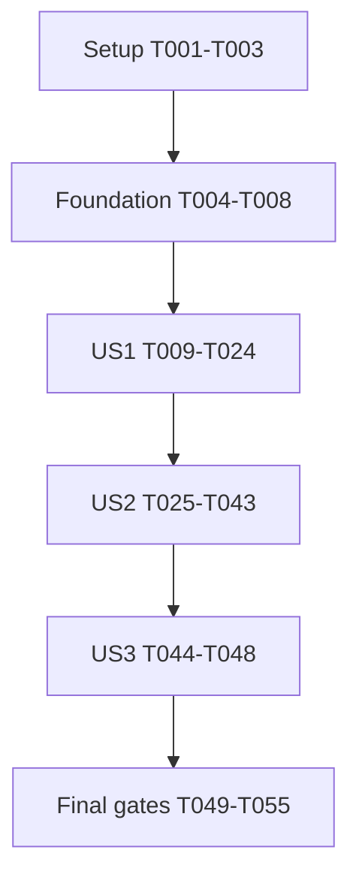

# Tasks: Apple Health Import

**Input**: [spec.md](spec.md), [plan.md](plan.md), [research.md](research.md), [data-model.md](data-model.md), [contract](contracts/apple-health-import.md), and [quickstart.md](quickstart.md).

**Prerequisites**: Feature 078 remains active; complete the reviewed specification and design before implementation. This file schedules work; no implementation or acceptance task is already complete.

**Tests**: Required by the constitution, plan and acceptance scenarios. Write behavior-scoped tests before their implementations, observe the relevant failure, then run the narrowest applicable suite immediately after each code edit. Do not rely on Jest's passWithNoTests as evidence of new coverage.

**Organization**: Setup, shared foundation, US1 (P1 import), US2 (P1 trustworthy visualizations), US3 (P2 private inventory), then cross-cutting acceptance.

## Format And Path Conventions

Each task has a sequential ID, an unchecked checkbox, an optional [P] marker, and a required [USn] label only inside a story phase. Paths are repository-relative. New modules are browser/worker-compatible CommonJS utilities; existing dashboard files remain classic orchestration scripts. No bundler, API-service work, new branch, commit or clinical dashboard is part of these tasks.

[P] applies only to the explicitly paired batches in Dependencies & Execution Order. Other tasks run in listed order unless their stated prerequisites and disjoint write targets permit an explicitly coordinated schedule. Never run two writers against the same test/source file.

## Phase 1: Setup (Shared Infrastructure)

**Purpose**: Establish exact dependencies, synthetic inputs and a privacy-safe baseline without changing existing providers.

- [X] T001 Add exact root devDependency pins `@zip.js/zip.js` 2.8.11 and `sax` 1.6.1 in package.json using the repository package-manager convention; update an existing lockfile if present, verify native CommonJS entry/Streams APIs under the installed Node runtime, and leave services/api/package.json and the existing JSZip provider path unchanged.
- [X] T002 Create reusable synthetic workout/XML/GPX and small real-ZIP builders in __tests__/fixtures/apple-health.js using the pinned packages; support lazy record chunks, malformed/CRC/DTD cases and deterministic expected results without personal exports or giant in-memory XML strings.
- [X] T003 Run the existing narrow import, visibility, navigation, time, heatmap and export suites listed in specs/078-apple-health-import/quickstart.md and record baseline runtime versions, failures and commands in private-data/apple-health-acceptance.md; preserve unrelated failures and verify the private archive/report are ignored before using them.

## Phase 2: Foundational (Blocking Prerequisites)

**Purpose**: Establish shared seams, resource limits and safe failures before any story work.

- [X] T004 Add foundational tests in __tests__/apple-health-import.test.js for dual CommonJS/classic namespace loading without window, injected clock/hash/ZIP/SAX/decoder/abort/yield dependencies, safe error shapes, centralized limits and cleanup; confirm the new suite exists and fails for the absent implementation.
- [X] T005 Establish src/apple-health-utils.js with an isolated appleHealthUtils namespace, CommonJS exports and globalThis/self/window bridges; provide only the strict numeric/unit/date/canonical-serialization seams needed by the data-model contract, with no DOM, analytics or raw-health logging.
- [X] T006 Establish src/apple-health-importer.js with the injectable `importAppleHealthZip(file, reportProgress, dependencies)` Promise contract and centralized limits: 8 GiB input/main-XML-per-pass, 32 MiB central directory, 100,000 entries/workouts, 1,024-byte paths, 24 GiB total extraction, 64 KiB feeds/tokens, depth 64, 128 attributes, 32 MiB GPX, 500,000 route points/activity, 2,000,000 route points/result and 128 MiB estimated wire result; copy all remaining limits from specs/078-apple-health-import/contracts/apple-health-import.md without loosening them to pass tests.
- [X] T007 Implement bounded aggregate diagnostics and enumerated safe fatal/optional errors in src/apple-health-utils.js and src/apple-health-importer.js; preserve the exact data-model counter fields, cap unknown labels at 128 with otherUnknown overflow, sanitize parser failures, and close readers/abort sinks in every failure/cancellation path.
- [X] T008 Run `npm test -- --runInBand __tests__/apple-health-import.test.js` against the foundational cases and record results in private-data/apple-health-acceptance.md; confirm no source provider, API service or public fixture contains private source data.

**Checkpoint**: Shared contracts and dependency injection pass. All story phases depend on T008.

## Phase 3: User Story 1 - Import Apple Health Training History (Priority: P1)

**Goal**: Select one original export from the landing page and commit supported workouts safely, with progress and actionable failures.

**Independent Test**: Import a synthetic ZIP containing all three supported sports, unsupported workouts, clinical/all-day records and mixed units. Verify expected supported activities, summary/skip counts, single-file selection and retry. Malformed or unsupported-only input must preserve an existing dashboard; no health content is sent to analytics.

### Tests For User Story 1

- [X] T009 [P] [US1] After T008, add failing normalization, identity, primary-entry, streamed-UTF-8/XML/DTD, CRC, resource-before-allocation, attribution, explicit-route and worker-wire cases in __tests__/apple-health-import.test.js using the synthetic builders; cover case/nested/multiple-primary inputs, absent versus zero, chunk boundaries, unknown units, every missing/invalid mandatory fingerprint field, optional missing/invalid/zero distinctions, and average power plus complete series despite complete scalar summaries (parallel only with T010).
- [X] T010 [P] [US1] After T008, add failing orchestration tests in __tests__/dashboard-import.test.js for the proposed createAppleHealthImportedDataset/executeAppleHealthZipImport seams, single ZIP, preparation/no-supported-workout failures, stale messages/results, source replacement ownership, safe diagnostics and exactly-once committed-personal counting (parallel only with T009).

### Implementation For User Story 1

- [X] T011 [US1] After T009 and T010, implement activity identity-independent classification and timestamp fields in src/apple-health-utils.js: sportRaw is "Original workoutActivityType"; sport permits "Explicit Running / Cycling / Swimming only; all other enums skipped"; startTime is "True instant from strictly parsed startDate with explicit offset"; date is "Browser-local midnight calendar carrier for the recorded source-local day"; monday is "Monday calendar carrier for date; never shift the source date via UTC conversion"; sourceLocalStart is "Apple-only year, month (1-12), day, hour (0-23), minute, second, offsetMinutes". Reject malformed core timestamps/end-before-start, never invent a shifted instant.
- [X] T012 [US1] Implement direct scalar normalization in src/apple-health-utils.js: distance uses "Compatible distance summary sum first, otherwise legacy totalDistance plus totalDistanceUnit; km, m, mi supported explicitly"; distanceAvailable follows "True only for a valid finite nonnegative source distance; missing distance uses legacy numeric sentinel 0 with false"; duration uses "Recorded duration plus durationUnit: s/sec, min, h/hr; never replace with elapsed time or subtract pauses twice"; durationAvailable follows "True only for a valid finite nonnegative active duration; missing uses 0 with false"; elevationGain is "finite nonnegative number / null, m" with "HKElevationAscended with m, cm or ft conversion; no raw-altitude substitution". Prefer compatible summaries without adding legacy duplicates; unknown units stay unavailable.
- [X] T013 [US1] Implement canonical source-scoped IDs and duplicate/conflict handling in src/apple-health-utils.js: id is "`ah-` plus deterministic SHA-256 identity digest; see identity rules below"; "Explicit external/sync IDs are scoped to their source. Canonically equal copies count once." Without a trusted scoped ID require nonempty trimmed sourceName, sportRaw, valid exact start/end instants with end >= start, and finite nonnegative recorded duration with a supported explicit durationUnit before fingerprint suppression. Compare optional device/summaries/events/routes with typed missing/invalid markers; their absence alone is not incomplete evidence. Preserve conflict-qualified distinct payloads, ordinal IDs for incomplete candidates and core-invalid-workout rejection; never deduplicate by proximity/shared route, omit differing optional content or trust an ID without source scope; inject hashing for deterministic tests.
- [X] T014 [US1] Implement the bounded ZIP reader and exact primary-entry recognizer in src/apple-health-importer.js: guard central-directory reads before allocation, recognize exactly one case-insensitive export.xml under a nested root, reject collisions/unsafe/encrypted inputs, exclude export_cda.xml/resource forks, enable checkSignature, and stream BlobReader output through one backpressured WritableStream without TextWriter, whole-file arrayBuffer or full XML strings.
- [X] T015 [US1] Implement UTF-8 streaming decode and strict SAX security in src/apple-health-importer.js with strictEntities, position tracking and token limits; accept bounded Apple inline ELEMENT/ATTLIST declarations, reject ENTITY/parameter/external SYSTEM/PUBLIC declarations using a quote/comment-aware chunk-safe scanner, validate HealthData structure and encoding, never fetch a resolver URL, resume parser errors or expose raw XML snippets.
- [X] T016 [US1] Implement first-pass candidate extraction and finalization in src/apple-health-importer.js using T011-T015: retain supported workout summaries/provenance/pause events/references only, count unsupported categories and ignored record types, record compatible power-type presence without retaining raw samples, discard unrelated record values immediately, normalize/deduplicate deterministically and reject NO_SUPPORTED_WORKOUTS before any dashboard mutation.
- [X] T017 [US1] Implement bounded attribution/reducers in src/apple-health-utils.js with measurement constraints "Allowlisted heartRate / steps / cadence / cyclingPower", "Parsed absolute interval; equal values denote a point sample", "Exact source and compatible device identity; internal only", "Strict finite numeric value in a known unit", "Explicit sample sync identity or complete canonical record fingerprint" and "unique candidate / ambiguous / excluded". Require a unique workout/device stream, half-open active windows, no boundary prorating/conflicting duplicates, point-pulse arithmetic means or nonoverlapping duration-weighted intervals without mixing estimators, and complete active-window step coverage. Enforce 50,000 samples/workout/metric and 2,000,000 total, releasing affected reducers on overflow.
- [X] T018 [US1] Implement second-pass attribution in src/apple-health-importer.js using finalized interval indexes and T017, with independent needsScalarEnrichment and needsTimedPowerSeries flags; skip only when both are false for every candidate. A Bike candidate plus compatible power-record presence requires series collection even when all scalar summaries exist. avgHeartRate is "number / null, beats/min" and "Positive compatible summary average or an unambiguous derived estimate"; avgWatts is "number / null, W" and "Bike-only positive compatible power average; no calories-to-watts conversion"; avgCadence is "number / null, counts/min" and "Compatible sport-specific cadence; derived Run cadence uses steps/min, not strides/min"; totalSteps is "positive number / null" and "Run-only complete attributable step total; swim strokes excluded". Direct-summary precedence applies to scalar reducers only, never blocks validated timed series for T034, and unsupported/ambiguous derivations remain unavailable without retaining the all-day record list.
- [X] T019 [US1] Implement explicit referenced-route extraction in src/apple-health-importer.js by injecting extractGpxTrackpoints from src/zip-importer.js, normalizing references strictly inside the selected root, deduplicating only per-activity references and preserving separate files/trkseg/invalid-point breaks. Enforce "Coordinates must be finite and within latitude [-90,90] and longitude [-180,180]" and "A renderable subpath needs at least two valid distinct points." Return points plus optional segments; skip optional route failures/budget excess without truncating geometry, guessing owners or discarding workouts.
- [X] T020 [US1] Implement src/apple-health-worker.js with pinned CDN importScripts from research.md, local reusable/helper loading, zip.configure without nested workers, generation-tagged start/cancel/progress/complete/error messages, streaming event-loop yields, monotonic phase progress with approximately one-second heartbeat, transferable Float64Array/Uint32Array route buffers and validated result-size estimates; close/abort/terminate cleanly and never post raw samples or clinical data.
- [X] T021 [US1] Implement the worker client and Apple dataset adapter in src/dashboard-import.js: structured-clone File without whole-file arrayBuffer, validate generation/wire scalars/buffer offsets, terminate worker before expanding arrays, hydrate Date/calendar fields, expose injected seams and synthesize dependency-load heartbeat/capability failures. Preserve "equipment" as "Empty unless an explicitly supported genuine gear field exists; no source/device substitution" and "name" as "Empty or generic Activity fallback without source title; no generated sport/device labels"; leave media absent and interval-power efforts empty unless validated series later qualifies.
- [X] T022 [US1] Add the lucide Apple Health import action, single .zip picker, guide link and ordered helper-script wiring in index.html and src/dashboard-import.js; create docs/apple-health-export-how-to.html matching existing guide patterns, explaining original ZIP export and local import processing without claiming the app makes no network requests. Preserve existing source actions and cancellation/retry UI.
- [X] T023 [US1] Complete transactional executeAppleHealthZipImport/applyImportedDataset integration in src/dashboard-import.js with beginImportOperation ownership, complete validation before commit, correct Apple source label, safe aggregated status text and recordImportOperation exactly once after committed personal import; preserve previous data on failure/no-data/cancellation and existing post-commit render-warning behavior, with no workout/filename analytics body.
- [X] T024 [US1] Run the focused Apple/dashboard-import/provider/counter/script-syntax suites from specs/078-apple-health-import/quickstart.md and an HTTP-served classic-worker smoke test with real pinned libraries and a small synthetic archive; record commands, initial failures/fixes, resource cleanup and success/error/retry outcomes in private-data/apple-health-acceptance.md. Do not claim production readiness before US2 and final acceptance.

**Checkpoint**: US1 is an internally demonstrable import MVP. US2 is required before releasing it because trustworthy visibility/time/export behavior is part of the feature, not optional polish.

## Phase 4: User Story 2 - Explore Only Trustworthy Visualizations (Priority: P1)

**Goal**: All existing views reflect actual current imported data, source-local time and connected route geometry; absent/stale views and exports are inaccessible.

**Independent Test**: Pass actual synthetic Apple import results through all 13 readiness rows for present/absent/invalid/zero inputs. Replace a rich source with sparse Apple data and then another source while an export is pending; verify filters, navigation, routes, media and exports contain only the current dataset.

### Tests For User Story 2

- [X] T025 [P] [US2] After T024, add actual-import-output readiness matrix tests in __tests__/visualization-availability.test.js for all 13 existing IDs from contracts/apple-health-import.md, including missing/invalid/explicit-zero data, meaningful titles versus generic fallback, device versus gear, no media, partial measurements, no routes and no power series (parallel only with T026).
- [X] T026 [P] [US2] After T024, add failing current-availability and stale-capture tests in __tests__/dashboard-export-download.test.js for revision changes at awaited preparation/render/image-decode/publication boundaries, old preview closure, failed pre-commit replacement, exact resource release and old-media export leases (parallel only with T025).
- [X] T027 [US2] After T025 and T026, add sourceLocalStart grouping tests in __tests__/workout-time-utils.test.js and caller/replacement coverage in __tests__/dashboard-import.test.js, covering UTC/Europe-Berlin midnight/DST/Monday cases, true-instant preservation, optional-context validation and unchanged two-argument legacy calls.
- [X] T028 [US2] Add disconnected-route, invalid-point, repeated-reference/shared-array, overlapping-subpath visit-count and Swim cases in __tests__/heatmap-utils.test.js and __tests__/dashboard-heatmap.test.js; assert no false bridge, one visit/activity/corridor and unchanged points-only tracks.
- [X] T029 [US2] Extend __tests__/dashboard-import.test.js and __tests__/tab-navigation.test.js with rich-to-sparse-to-other-source replacement, real initialized nonoverlapping date controls, selected sport state, active hidden tab fallback, no-visualizations and pointer/keyboard/arrow traversal; verify tab IDs/order/markup/dispatch remain consistent without renaming them.

### Implementation For User Story 2

- [X] T030 [US2] Extend src/workout-time-utils.js and its necessary dashboard caller in src/dashboard-workout-time.js with validated optional sourceLocalStart grouping; retain "getGroupIndex(startTime, granularity, sourceLocalStart)" and its documented two-argument fallback. Require calendar-valid source components whose offset-derived instant matches startTime within one second; inconsistent optional context falls back without shifting the true instant. Test UTC/Europe-Berlin DST and midnight.
- [X] T031 [US2] Add subpath-aware interpolation/aggregation to src/heatmap-utils.js: prefer segments for connected geometry, reset continuity per subpath, union matched keys per activity and include segmentation identity in shared-geometry optimizations; retain existing points-only behavior and count different activities sharing a route separately.
- [X] T032 [US2] Verify route-line consumers in src/dashboard-heatmap.js and src/country-count-utils.js against the optional segments contract and amend only actual connected-line assumptions exposed by T028; flattened points may support bounds but must never create a cross-subpath line, country crossing or extra visit. Reuse existing capture targets and sport handling.
- [X] T033 [US2] Resolve demonstrated missing-value eligibility defects from T025 in src/visualization-availability.js and only the owning existing distribution/scatter/pie/lifetime utilities whose tests fail; respect distanceAvailable/durationAvailable, null optional metrics and explicit measured zero without Number(null) coercion, provider allowlists, fabricated points or unrelated renderer changes.
- [X] T034 [US2] Integrate qualifying complete timed cycling-power series collected independently of scalar-summary availability with existing src/power-pb-utils.js via src/apple-health-importer.js and explicit worker-safe dependency injection; require unique point samples with no gap >5 seconds for timed efforts, and complete active-window coverage within 5 seconds of each boundary before deriving avgWatts. Add source-average-plus-partial-dense-series (retain summary, allow only qualified shorter efforts), source-average-plus-complete-series, fully covered series-only, absent, average-only and gapped/ambiguous cases to __tests__/apple-health-import.test.js. Emit the established powerEfforts shape with null startKm/endKm because Apple samples have no distance, and never estimate distance or derive best efforts from average watts/energy.
- [X] T035 [US2] Correct actual source-replacement state initialization in src/dashboard-import.js using setSportFilter, date/control resets and complete route/power/media replacement; preserve pre-commit old state, source-local fields and revision invalidation, and verify workout-time's array-identity refresh without manually reinitializing its slider in tests.
- [X] T036 [US2] Integrate verified eligibility through src/dashboard-tabs.js and src/tab-navigation.js while checking matching index.html markup/dispatch: recompute after commit, exclude hidden tabs from every navigation method and choose an available active tab or no-visualizations state. Preserve all IDs/order and ordinary filter-empty behavior.
- [X] T037 [US2] Guard getTabExportTarget in src/dashboard-export.js against tabs outside the current available set, regardless of surviving DOM/chart flags; keep all existing available-tab share targets and no-data behavior, and refuse stale/hidden view capture requests.
- [X] T038 [US2] Bind async capture and preview publication to the existing dataset revision in src/dashboard-export.js, checking it after each awaited preparation/render/image-decode step and before publishing; dispose stale candidate URLs/buffers without replacing a newer preview or bypassing the established download safeguards.
- [X] T039 [US2] Wire committed-source preview invalidation in src/dashboard-import.js and src/dashboard-export.js while preserving independently leased old-media export ownership in src/dashboard-media.js where needed; failed pre-commit imports leave valid old exports intact, and each resource owner releases exactly once.
- [X] T040 [US2] Verify and minimally repair missing-metric controls and per-measure coverage in src/dashboard-scatter.js, src/dashboard-distributions.js, src/dashboard-workout-time.js and src/dashboard-power-pb.js only where actual Apple-output cases fail; retain a whole view when another valid metric supports it and never present unavailable optional measurements as zero.
- [X] T041 [US2] Extend existing per-view tests in __tests__/dashboard-scatter-years.test.js, __tests__/workout-time-utils.test.js, __tests__/pie-charts-dashboard.test.js and __tests__/lifetime-statistics-dashboard.test.js only for uncovered source-output regressions, plus __tests__/dashboard-media.test.js for clinical-file exclusion/leases; reuse existing helpers and avoid duplicate new test files.
- [X] T042 [US2] Exercise every eligible existing view's filters and local image-preview/PNG download over HTTP, then repeat source replacement with an active old capture and absent gear/title/media/power/routes; record 13-view outcome evidence and any unavailable metrics in private-data/apple-health-acceptance.md without enabling hidden views for screenshots.
- [X] T043 [US2] Run the focused visibility/navigation/import/export/media/heatmap suites and UTC/Europe-Berlin time suites in specs/078-apple-health-import/quickstart.md, restoring TZ in finally; record passing test counts and confirm present/absent/invalid/zero matrix, no-view state, tab wiring and stale-export invariants in private-data/apple-health-acceptance.md.

**Checkpoint**: US1 and US2 deliver a safe functional candidate. Large-export, privacy and cross-provider release gates still remain in Phase 6.

## Phase 5: User Story 3 - Understand Additional Health Information (Priority: P2)

**Goal**: The local Markdown inventory describes observed categories, implemented compatibility and remaining additional information without leaking personal content or expanding the dashboard scope.

**Independent Test**: Compare the private archive's privacy-minimized structural inventory with all implemented fields and the 13 readiness rules. Every observed category has a disposition; clinical/all-day records create neither activities nor new tabs. Do not require the private archive for public automated tests.

### Tests And Inventory Work For User Story 3

- [X] T044 [P] [US3] After T043, add synthetic exclusion/diagnostic tests in __tests__/apple-health-import.test.js for profile, ECG, audiogram, HRV, sleep, body, energy, ring goals and arbitrary unknown categories; assert no fake workouts, no clinical payload in result/logs, no opened secondary clinical entries and capped aggregate labels (parallel only with T045).
- [X] T045 [P] [US3] After T043, reconcile private-data/apple-health-data-inventory.md with the normative version-controlled data-model/import contracts and actual aggregate importer output: retain observed record categories/units/structural counts, distinguish direct/derived/unmapped/absent sample evidence, cover every current field/view and correct provisional coverage claims without copying identifiers, readings, exact health dates or coordinates. Private-report edits must not introduce or override normative mapping/readiness rules (parallel only with T044).
- [X] T046 [US3] After T044 and T045, fix only any clinical/all-day retention or diagnostic leakage exposed by T044 in src/apple-health-importer.js and src/apple-health-utils.js; maintain "Raw beat/ECG/sleep/body data is discarded, not returned in a hidden side channel." No recovery/medical entities or new visualization tabs are introduced.
- [X] T047 [US3] Validate the local report's complete category/field/view disposition and observed-versus-possible distinctions against implemented outputs, then record the review in private-data/apple-health-acceptance.md; the runtime must never require this local report or personal archive to function.
- [X] T048 [US3] Run the synthetic exclusion tests and verify `git check-ignore -- "private-data/Apple Export.zip" "private-data/apple-health-data-inventory.md" "private-data/apple-health-acceptance.md"`; record results in private-data/apple-health-acceptance.md and do not stage private files or embed them in public fixtures.

**Checkpoint**: All three stories have independently stated acceptance outcomes. No checked boxes mean implementation or acceptance is already done.

## Phase 6: Polish & Cross-Cutting Concerns

**Purpose**: Verify the agreed large-export class, no-health-upload boundary and cross-provider compatibility before release.

- [X] T049 Update README.md and docs/IMPORT_FEATURE.md for the implemented Apple workflow, supported sports/units, conditional enrichment, hidden unavailable views, original-ZIP guide and HTTP(S)/capability/resource limitations; preserve existing source documentation and precise local-import-versus-app-network wording.
- [X] T050 Add scripts/benchmark-apple-health.js reusing __tests__/fixtures/apple-health.js for lazy synthetic ZIP generation with identical workouts/relevant measurements/routes and 1,000,000 / 2,500,000 / 4,500,000 irrelevant records; write archives only to private-data and never materialize giant source text. Support repeatable counts/seeds and a discarded warm-up plus three measured browser repetitions per workload; instrument main-thread and worker live heaps/backing stores with <=250 ms sampling, explicit context/buffer ownership and the pre-import-to-hydration/cleanup observation window. Document runnable commands and measurement limitations in specs/078-apple-health-import/quickstart.md; missing worker/allocation evidence means unverified, not passed.
- [ ] T051 Run the three synthetic workloads and three measured repetitions per size after warm-up according to specs/078-apple-health-import/quickstart.md with real worker/CDN execution and identical relevant results. Compute each repetition's maximum combined main-thread/worker live-heap/backing-store delta over the pre-import baseline through hydration/cleanup; largest-workload worst peak minus smallest-workload worst peak must be <=64 MiB. Missing context/allocation measurements or sampling gaps >250 ms make the gate unverified, not passed. Independently require expected counts, progress gap <=5 seconds and responsive UI; test budget failure/cancellation/supersession/retry and reader/worker cleanup and record environment/raw aggregate measurements in private-data/apple-health-acceptance.md. Do not infer success from chunk size alone.
- [X] T052 Import the explicitly supplied private-data/Apple Export.zip locally over HTTP and reconcile the complete outcome with private-data/apple-health-data-inventory.md; demonstrate >=2,000 source workouts, >=4.5 million health records and >=3 GB uncompressed archive contents without crash/manual extraction, distinguish actual extracted bytes across passes from archive totals and record elapsed time, memory, heartbeat gap, deduplication and optional-attribution reasons only in private-data/apple-health-acceptance.md.
- [X] T053 Complete desktop/mobile browser workflow and synthetic request observation from specs/078-apple-health-import/quickstart.md; verify two-action discoverability, guide/picker/cancel/retry, all-source replacement, every eligible local share/download, no stale exports and no raw health/XML/identifier/coordinate uploads. Record sanitized outcomes in private-data/apple-health-acceptance.md while allowing documented CDN/map/metadata-counter requests.
- [X] T054 Run the full root `npm test -- --runInBand` suite after all focused checks, verify the newly added test suites contain real assertions, run `git diff --check` and reconcile acceptance evidence against SC-001 through SC-007 in private-data/apple-health-acceptance.md; report unrelated baseline failures honestly and do not claim passed unexecuted large-export/network/browser gates.
- [X] T055 Review changed paths and ignore status against specs/078-apple-health-import/plan.md, verify no raw export, clinical fixture, new visualization tab, services/api change or unintended public API break entered the worktree, and update runnable validation commands in specs/078-apple-health-import/quickstart.md if needed; retain the existing branch and do not commit unless separately requested.

## Dependencies & Execution Order

### Phase Dependencies

Setup T001-T003 precedes foundation T004-T008. T008 blocks every story. Default implementation follows US1 T009-T024, US2 T025-T043, US3 T044-T048, then final gates T049-T055. Tasks within each range run in listed order except the explicit independent pairs below. Code-writing tasks include immediate focused validation; checkpoint tasks are not permission to postpone those checks.

US2 depends on US1's real normalized importer output. US3's report can be reviewed in isolation, but its final runtime exclusion proof depends on the importer; the default schedule completes US2 first to avoid concurrent writers in shared modules/tests. No unsupported claim that the three complete stories are independently parallel is made.

### Explicit Parallel Batches

| Batch | Completed prerequisites | Concurrent tasks | Disjoint write targets | Join before |
| --- | --- | --- | --- | --- |
| US1 tests | T001-T008 | T009 + T010 | __tests__/apple-health-import.test.js versus __tests__/dashboard-import.test.js | T011 |
| US2 tests | T001-T024 | T025 + T026 | __tests__/visualization-availability.test.js versus __tests__/dashboard-export-download.test.js | T027 |
| US3 review/test | T001-T043 | T044 + T045 | __tests__/apple-health-import.test.js versus private-data/apple-health-data-inventory.md | T046 |

The paired work shares only already-completed/read-only fixtures/contracts. Any newly discovered helper edit must be coordinated first; it does not silently expand a parallel task's write targets.

## Parallel Examples By Story

**US1**: After T008, author normalization/stream/worker contract tests (T009) while the other task authors dashboard transaction/counter tests (T010). Wait for both before implementing normalization at T011.

**US2**: After T024, author actual-output availability cases (T025) while export-race tests (T026) are written separately. Neither task edits importer fixtures or the other's suite. Join before T027.

**US3**: After T043, author clinical-data exclusion tests (T044) while reviewing/updating the ignored structural report (T045). Both use existing aggregate evidence; no raw clinical metadata is printed. Join before T046.

## Requirement And Acceptance Coverage

| Requirement | Primary task IDs | Acceptance tasks |
| --- | --- | --- |
| FR-001 | T020-T023, T049 | T024, T053 |
| FR-002 | T014-T016 | T009, T024 |
| FR-003 | T011, T016 | T009, T044 |
| FR-004 | T011-T013, T018, T021, T030 | T009, T027, T043 |
| FR-005 | T012, T018, T033 | T009, T025 |
| FR-006 | T017-T018, T034 | T009, T034, T052 |
| FR-007 | T011-T012, T017, T030 | T027, T043 |
| FR-008 | T019, T031-T032 | T028, T042, T052 |
| FR-009 | T018, T021, T033 | T025, T044 |
| FR-010 | T025, T033, T036-T037 | T042-T043 |
| FR-011 | T035-T039 | T029, T042-T043 |
| FR-012 | T034, T037-T041 | T026, T042-T043, T053 |
| FR-013 | T007, T014-T016, T023 | T010, T024, T051 |
| FR-014 | T007, T020-T023, T046, T049 | T048, T053, T055 |
| FR-015 | T045-T047 | T044, T047-T048 |
| FR-016 | T006, T014-T020, T050 | T051-T052 |
| FR-017 | T013, T016 | T009, T024, T052 |

SC-001 is proved by T053; SC-002 by T009/T024/T052; SC-003 by T025/T042/T043; SC-004 by T047; SC-005 by T051/T052; SC-006 by T029/T042/T043; SC-007 by T042/T053. T054 checks the complete evidence set, not just automated unit-test success.

## Implementation Strategy

### MVP First

Complete Setup and Foundation, then US1 for a local/internal import demonstration. Stop and validate its independent flow at T024. This is not a production release: the user's required visibility, source-local time, route segmentation and export-race safeguards in US2 are mandatory before exposing the new source broadly.

### Incremental Delivery

1. Establish pinned, testable streaming/normalization boundaries without changing existing providers.
2. Deliver US1's real end-to-end import, safe failures and aggregate diagnostics.
3. Deliver US2's actual-data eligibility and current-dataset navigation/filter/share behavior.
4. Reconcile US3's private inventory with implementation and prove clinical data stays excluded.
5. Execute all final large-file/browser/privacy/root-regression gates before declaring the feature complete.

### Notes

- This task-generation command does not install dependencies, implement code, rerun the personal export, create branches or mark tasks complete.
- New clinical/recovery features, account connections, source merging and extra visualization tabs remain out of scope.
- Never stage private-data or copy personal fields into test fixtures; only synthetic fixtures belong in version control.
- Extension hooks: before_tasks and after_tasks are absent because .specify/extensions.yml is not present; recheck if that file appears before execution finishes.