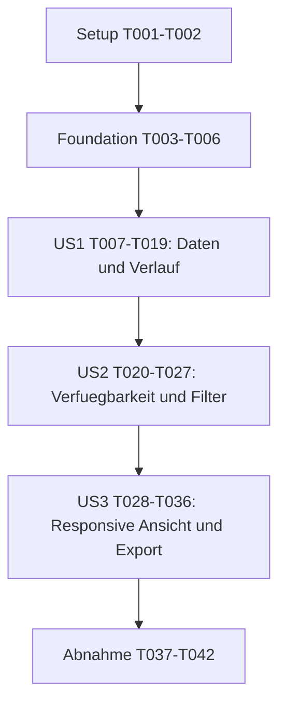

# Tasks: Herzfrequenz-Min-/Max-Entwicklung

**Input**: Designdokumente aus `specs/080-heart-rate-min-max/`.
**Prerequisites**: [plan.md](plan.md), [spec.md](spec.md), [research.md](research.md), [data-model.md](data-model.md), [Importvertrag](contracts/import-fields.md), [Dashboardvertrag](contracts/dashboard-integration.md), [quickstart.md](quickstart.md).
**Status**: Implementierung am 2026-11-04 abgeschlossen. Automatisierte Tests, Browsernachweise und verbleibende optionale Plattformgrenzen sind in `quickstart.md` dokumentiert.
**Tests**: Testaufgaben konkretisieren die pruefbaren Akzeptanz-/Erfolgskriterien und die verpflichtenden engen Tests aus Constitution III. Sie sind vor der jeweiligen Implementierung zu schreiben; erwartete Fehler gezielt bestaetigen, danach dieselben Tests gruen ausfuehren. Ein fehlender Test darf nicht wegen `--passWithNoTests` als Erfolg gelten.
**Organization**: Drei User-Story-Phasen in Prioritaetsreihenfolge; gemeinsame Voraussetzungen davor, uebergreifende Abnahme danach. Keine neue Build-/UI-/API-Infrastruktur.

## Format: `[ID] [P?] [Story] Description`

- Alle Aufgaben verwenden fortlaufende IDs und offene Checkboxen. Nur Story-Phasen enthalten `[US1]`, `[US2]` oder `[US3]`.
- `[P]` bezeichnet ausschliesslich die unten benannten parallelen Wellen mit disjunkten Schreibdateien und erfuellten Voraussetzungen, nicht eine freie Ausfuehrung ueber Phasengrenzen.
- Ausserhalb dieser Wellen gilt die Reihenfolge der IDs. Nach jedem Produktionspatch sofort den engsten betroffenen Test ausfuehren und lokale Fehler beheben, bevor die naechste Aufgabe beginnt.
- Keine Commits, Branchwechsel oder Aenderungen am Service als Bestandteil dieser Aufgaben. Der aktuelle Git-Branch ist `main`; der Feature-Kontext ist `080-heart-rate-min-max`.

## Path Conventions

Statische App: `index.html` und `src/`; Root-Jest: `__tests__/`; separater vorhandener CSV-Reducer: `scripts/relevant-export-extractor.js`. Alle Pfade sind relativ zum Repository-Root. Nur `src/heart-rate-utils.js`, `src/dashboard-heart-rate.js` und ihre beiden Testsuiten sind als neue Code-/Testdateien vorgesehen. Vorhandene Fixture-Helfer wiederverwenden; keine privaten Exporte einchecken.

## Phase 1: Setup (Shared Infrastructure)

**Purpose**: Ausgangsbasis und reproduzierbare Parserpruefung herstellen, ohne die bestehende Projektstruktur umzubauen.

- [X] T001 Die bestehende Root-Testbasis und Implementierungsgrenzen anhand von `package.json`, `jest.config.js`, `AGENTS.md` und `.specify/memory/constitution.md` pruefen; vor Codeaenderungen die vorhandenen fokussierten Import-/Core-/Navigations-/Exporttests aus `specs/080-heart-rate-min-max/quickstart.md` ausfuehren und Ausgangsergebnis samt vorhandenen Fremdfehlern dort protokollieren. Neue noch fehlende Tests nicht als bestanden behandeln.
- [X] T002 Fuer den echten synthetischen FIT-Decodiertest die Verfuegbarkeit exakt von `fit-file-parser@1.10.0` pruefen; nur falls fuer Root-Jest erforderlich diese Version als Dev-Abhaengigkeit in `package.json` mit passender `package-lock.json` bereitstellen. Keine Laufzeitdownloads im Test, kein Browserparserupgrade und keine Abhaengigkeit von `services/api/`; den Parserladeweg fuer `__tests__/zip-importer.test.js` festlegen und mit einer kleinen Decodierprobe pruefen.

**Checkpoint**: Vorhandene Testbasis ist bekannt; ein offline reproduzierbarer Test des bestehenden FIT-Parserformats ist moeglich.

## Phase 2: Foundational (Blocking Prerequisites)

**Purpose**: Gemeinsame Extremvalidierung und unveraenderte globale Trainingsauswahl absichern. Diese Phase blockiert alle Stories.

- [X] T003 In `__tests__/heart-rate-utils.test.js` die gemeinsame Eignungs-/Validitaetsmatrix fuer `hasHeartRateData` anlegen: einzelnes Minimum/Maximum, Gleichheit, umgekehrtes Paar, Null/Leerstring, negative und nicht endliche Werte, Rohstrings, ungueltiges Datum und unbekannter Sport. Unveraenderte Eingaben, CommonJS-/Browser-Bridge und Kurzschluss ohne Sortierung pruefen; ausschliesslich synthetische Trainings verwenden und den erwarteten Fehler vor T004 bestaetigen.
- [X] T004 Die gekapselte Dual-Target-Utility `src/heart-rate-utils.js` mit einer gemeinsamen internen Extremfeldpruefung und `hasHeartRateData(allActivities)` erstellen. Fuer beide Felder gilt wortgleich: "Optional `number` in bpm oder `null`"; fuer Sport: "Keine Umklassifizierung unbekannter Sportarten." Die Regeln "Null/Leerstring darf nicht als Epoch-Datum gelten.", "Jedes Extremfeld wird strikt als endliche positive Zahl bewertet.", "Ein einzeln fehlender/ungueltiger Wert wird zu einem nicht darstellbaren Feld, ohne einen gueltigen Gegenwert zu entwerten.", "Sind beide Zahlen gueltig und `minHeartRate > maxHeartRate`, ist das Paar widerspruechlich: keine Punkte aus diesem Training. Die importierten Felder bleiben unveraendert erhalten." und "Gleichheit ist gueltig und erzeugt einen Punkt pro Reihe; beide muessen einzeln inspizierbar bleiben." einhalten; kein Durchschnittsersatz oder medizinischer Grenzwert. T003 unmittelbar gruen ausfuehren.
- [X] T005 In `__tests__/dashboard-core.test.js` Paritaetstests fuer die bisher in `renderDashboard` verwendete Zeit-/Sportauswahl vorbereiten: All/Run/Bike/Swim, alle vorhandenen Zeitoptionen je Modus, inklusive Grenzen, Zeitanker der gesamten Historie und gleiche Ergebnismengen vor/nach Selektorextraktion. Erwarteten Vertrag eines kleinen `getDashboardFilteredActivities()`-Selektors festhalten, ohne neue Filtersemantik zu definieren.
- [X] T006 In `src/dashboard-core.js` die bestehende Auswahl als `getDashboardFilteredActivities()` gemeinsam nutzbar machen und den Distance-Pfad daran anschliessen: vorhandenes `getActivitiesInTimeframe` und danach die bisherige Sportbedingung. `TIMEFRAME_OPTIONS`, Grenzberechnung, Kalendersemantik, Mittel-/Aggregatberechnung und bestehende Settervertraege unveraendert lassen; T005 sowie die bisherige Core-Suite unmittelbar ausfuehren.

**Checkpoint**: Ein einzelner qualifizierter Extremwert ist erkennbar, und der gemeinsame Selektor liefert nachweislich exakt die bisherige Trainingsmenge. Keine Story beginnt vor T006.

## Phase 3: User Story 1 - Tatsaechliche Extremwerte im Verlauf vergleichen (Priority: P1)

**Goal**: Verlaessliche optionale Quellwerte, getrennte chronologische Punktreihen und eindeutige Trainingsdetails bereitstellen, ohne vorhandene Daten zu veraendern.
**Independent Test**: Eine unsortierte synthetische Historie mit mindestens zwoelf Trainings aus allen drei Sportarten direkt durch Modell und Renderer-VM pruefen. Vollstaendige/einseitige Angaben, identische Tage/Startzeiten, gleiche Extremwerte und fehlende/doppelte IDs liefern exakt die erwarteten Punkt-/Trainingszuordnungen. Dafuer ist die spaetere Dashboardnavigation noch nicht erforderlich.

### Quellvertragstests vor der jeweiligen Implementierung

- [X] T007 [P] [US1] In `__tests__/processing.test.js` und `__tests__/dashboard-import.test.js` die erlaubten DE/EN-Min-/Max-Header aus `specs/080-heart-rate-min-max/contracts/import-fields.md` synthetisch pruefen: einseitige Angaben, lokalisierte Zahlen, ungueltige/mehrdeutige Spalten, unbekannte beziehungsweise widersprechende Einheit und Durchschnitt-only. Browser-`processData` wirklich ausfuehren statt den bisherigen Stub zu verwenden; CommonJS-Paritaet und unveraenderte bisherige Felder/IDs/Distanzpositionen belegen.
- [X] T008 [P] [US1] In `__tests__/zip-importer.test.js` Normalisierungsfaelle sowie einen minimalen synthetischen FIT-Decodiertest fuer Sessionnachricht 18, Feld 64 `min_heart_rate`, Feld 17 `max_heart_rate` und Invalid-Sentinel 255 anlegen. Nur Sessionzusammenfassungen qualifizieren; nur Records/Laps/Durchschnitt ergeben keine Extremwerte. Bestehende IDs, First-wins-Duplikatentscheidungen, Zaehler und Power-/Routenzuordnung als Regressionsbasis vergleichen.
- [X] T009 [P] [US1] In `__tests__/apple-health-import.test.js` mit vorhandenen Helfern aus `__tests__/fixtures/apple-health.js` direkte WorkoutStatistics-Attribute `minimum`/`maximum`, `count/min`, einseitige Angaben, unbekannte Einheit, identische/widerspruechliche Mehrfachstatistiken sowie passende/abweichende/unvollstaendige Statistikzeitgrenzen pruefen. Records/Tageswerte liefern keine Extremwerte; Durchschnittspuls, Rohstatistik-Fingerprint, IDs und Duplikatentscheidungen bleiben gleich.

### Quellnormalisierung

- [X] T010 [P] [US1] In `src/dashboard-utils.js` und `src/dashboard-import.js` beide CSV-Normalisierungen um die enge Header-Allowlist und unabhaengige optionale `minHeartRate`-/`maxHeartRate`-Felder erweitern. Feldregeln wortgleich beachten: "Nur direkte verlaessliche Trainingszusammenfassung gemaess Importvertrag.", "Unabhaengig vom Minimum; gleiche Herkunftsanforderung.", fuer `avgHeartRate` "Unveraendert und niemals Ersatz fuer eines der neuen Felder." und fuer `date` "Quell-/Browser-Kalendertag nach bisherigem Importvertrag, kein neues UTC-Tagesmapping." Unbekannte Semantik nicht raten; T007 unmittelbar ausfuehren.
- [X] T011 [P] [US1] In `src/zip-importer.js` ausschliesslich `normalizeTrainingPeaksSession` um direkte `min_heart_rate`-/`max_heart_rate`-Sessionfelder in bpm ergaenzen; 255/fehlende/ungueltige Werte einzeln ausschliessen. Parser, Sessionidentitaet, Deduplizierung, First-wins, bestehende Mittelwerte und Record-/Powerberechnungen unveraendert lassen; T008 unmittelbar ausfuehren.
- [X] T012 [P] [US1] In `src/apple-health-utils.js` die direkte Extremwertauswertung separat zur bisherigen Durchschnittslogik ergaenzen: nur verschachtelte HeartRate-WorkoutStatistics in `count/min`, vorhandene Statistikzeitgrenzen exakt passend und doppelte Angaben je Extremart eindeutig. Keine Kombination von Teilintervallen, Recordableitung oder Rohstatistik-/Fingerprintaenderung; bestehende SAX-/Workertransporte nicht umbauen und T009 unmittelbar ausfuehren.

### Spaltenerhalt, Punktmodell und Renderer

- [X] T013 [US1] Nach T011 in `__tests__/zip-importer.test.js` und `__tests__/relevant-export-extractor.test.js` den optionalen Erhalt aller erkannten Extremspalten durch `extractRelevantColumns` und `reduceActivitiesRows` pruefen. Spalten am Ende ergaenzen, vorhandene Ausgabereihenfolge und beide Distanzbedeutungen bewahren; ohne Extremspalten bleibt das bisherige Schema exakt gleich. Unveraenderte Original-CSV im produktiven ZIP-Pfad ebenfalls absichern.
- [X] T014 [US1] In `src/zip-importer.js` und `scripts/relevant-export-extractor.js` nur den benoetigten optionalen Spaltenerhalt nach T013 implementieren; keine neue CLI-Funktion, Pfadaenderung, CSV-ID-Verschiebung oder Datenberechnung. Beide Reducertests unmittelbar ausfuehren.
- [X] T015 [US1] In `__tests__/heart-rate-utils.test.js` den `buildHeartRateTimeline`-Vertrag mit der zwoelfteiligen Referenzhistorie aus `specs/080-heart-rate-min-max/quickstart.md` pruefen: separate ungleich lange Reihen, genaue Zuordnung aller Punktfelder, kein Tagesaggregat/Jitter, stabile Ordinale vor Filterung, Startzeit-Tie-Breaking und Nichtmutation. Hoechstens zwei echte Punkte je qualifiziertem Training erwarten; keine per Arrayindex gepaarten Min-/Max-Werte.
- [X] T016 [US1] In `src/heart-rate-utils.js` `buildHeartRateTimeline(filteredActivities, { getActivityKey })` mit kopierten Punktdaten und gemeinsamer Validierung implementieren. Modellregeln wortgleich beachten: `activityCount` ist "Anzahl verschiedener qualifizierter Ursprungstrainings, nicht die Summe der Punkte.", `x`/`dateEpoch` ist "Numerischer Wert des bestehenden Trainingstags fuer die Achse; kein Jitter.", `y` ist "Herzfrequenz in bpm.", `kind` ist "`minimum` oder `maximum`.", `activityKey` ist "Datasetlokaler eindeutiger Schluessel.", `sourceOrdinal` ist "Stabiler Ursprung fuer Tie-Breaking und Ersatzanzeige.", `startTimeEpoch` ist "Gueltige vorhandene Startzeit, sonst `null`." und `startTime` dient "Nur Reihenfolge und Details; kein Ersatz fuer den Trainingstag." Labels erhalten "Darstellungsangaben unter Erhalt bisheriger Kalender-/Quellsemantik."; Sport/Name/Anzeige enthalten "Bestehender Sport, optionaler Originalname und eindeutige Anzeigezuordnung." Sortierung: "`dateEpoch`, dann gueltige Startzeit (fehlende Startzeit nach vorhandenen Zeiten desselben Tages), dann `sourceOrdinal`." Keine Filterengine oder In-place-Sortierung; T015 sofort ausfuehren.
- [X] T017 [US1] Die Renderer-VM-Suite `__tests__/dashboard-heart-rate.test.js` anlegen und vorhandene Tooltiptests in `__tests__/dashboard-tooltips.test.js` eng erweitern: zwei Scatter-Reihen ohne Linien, einzelne Punkte, sichere Textdetails, Registry vor Filterung, gleicher Ort/gleiche Extrema als getrennte Treffer, Tastatur-/Tapauswahl und Chart-Reset. Vorhandene Stub-/Dokumentmuster nutzen, keine neue DOM-Testumgebung.
- [X] T018 [US1] In `src/dashboard-heart-rate.js` gekapselte Orchestrierung mit `window.heartRateDashboard.render()`, `reset()` und datasetlokaler Registry implementieren. `getExportData()` darf bis US3 konservativ `null` liefern. ID-Regel: "Unveraendert; fuer diese Ansicht nicht als allein garantiert eindeutig behandeln." Namensregel: "Nur Anzeige; kein neues Quellfeld oder Wordcloud-Eintrag." Quellstartregel: "Fuer Apple-Details verwenden, falls vorhanden; nicht neu berechnen." Zwei Chart.js-Scatter-Datasets mit `showLine: false`, unterschiedlichen Formen, bpm/Datum, stabilen Ersatznamen und reinen Achsenpaddings erstellen; `dashboardTooltips.attachChart` und eine native fokussierbare Trefferliste fuer jeden ueberlagerten Trainings-/Extremarteintrag nutzen. Keine Quellmutation, kein HTML aus Namen und keine indexbasierte Paarung; T017 unmittelbar ausfuehren.
- [X] T019 [US1] Die fokussierten Utility-/Renderer-/Import-/Reducerpruefungen aus `specs/080-heart-rate-min-max/quickstart.md` mit `--passWithNoTests=false` ausfuehren und Ergebnisse dort protokollieren. Alle erwarteten Werte/Zuordnungen der Referenzhistorie sowie den Vorher-/Nachher-Vergleich bisheriger Felder/IDs/Zaehler bestaetigen; eine nicht bestandene Parserpruefung bleibt ein Blocker, kein durch FIT-Mocks ersetzter Erfolg.

**Checkpoint**: US1 ist auf Modell-/Renderer-Ebene unabhaengig von Navigation und Export pruefbar. Dies ist ein internes Kern-MVP, noch kein freigabefaehiger neuer Tab. SC-001 und SC-002 sind fachlich abgedeckt.

## Phase 4: User Story 2 - Nur nutzbare Daten mit bestehenden Filtern sehen (Priority: P1)

**Goal**: Den Verlauf konsistent in Navigation, importweite Verfuegbarkeit, globale Filter und Ersatzimport-Lebenszyklus einbinden.
**Independent Test**: Durchschnitt-only-, Einwert- und Mehrsport-Historien nacheinander importieren; Sport/alle Zeitoptionen inklusive Grenzen wechseln, einen Filter-Leerzustand erzeugen und einen aktiven Tab durch datenarmen Ersatzimport ungueltig machen. Erreichbarkeit und Punktmenge entsprechen ausschliesslich dem aktuellen Dataset und bestehenden Filtern; diese Pruefung braucht keinen Bilddownload.

### Integrationstests vor Implementierung

- [X] T020 [P] [US2] In `__tests__/tab-navigation.test.js`, `__tests__/tooltip-selection-utils.test.js` und `__tests__/index-script-syntax.test.js` `heartRate` nach `paceMetrics`, alle neuen IDs, versteckte Tabnavigation, Renderdispatch und Script-Abhaengigkeiten absichern. Vorhandene relative Tabreihenfolge/IDs muessen unveraendert sein; CommonJS- und Classic-Script-Bridge pruefen.
- [X] T021 [P] [US2] In `__tests__/visualization-availability.test.js` und `__tests__/dashboard-import.test.js` null/genau ein Minimum/genau ein Maximum, Durchschnitt-only, Quellenlabelunabhaengigkeit und Ersatzimport testen. Chart/Registry/Auswahl/Exportmodell werden bei erfolgreichem Commit erneuert, aktiver ungueltiger Tab erhaelt einen Fallback; fehlgeschlagener Import behaelt alten Stand. Neue Werte duerfen keine anderen Tabs ausblenden.
- [X] T022 [P] [US2] In `__tests__/dashboard-core.test.js` und `__tests__/dashboard-heart-rate.test.js` alle bestehenden Sport-/Zeitoptionen, inklusive Grenzen und gesamten Dataset-Zeitanker fuer den Verlauf pruefen. Synchronisierte Controls/Filteradapter, versteckte Modellinvalidierung und Zustaende `unavailable`, `available-empty`, `available-data` testen; ein Filter-Leerzustand veraendert die importweite Verfuegbarkeit nicht und hinterlaesst keine alten Punkte/Exportdaten.

### Navigation, Filter und Commit

- [X] T023 [US2] In `src/visualization-availability.js` die gekapselte Utility als CommonJS-/Browser-Abhaengigkeit aufnehmen und `heartRate: hasHeartRateData(records)` aus der gesamten Historie bestimmen. Keine Quellenallowlist, keine Mindestzahl vollstaendiger Paare und keine Aenderung bestehender Eignungspraedikate; den betroffenen Teil von T021 sofort ausfuehren.
- [X] T024 [US2] Die Tab-/Scriptintegration gemeinsam in `src/tab-navigation.js`, `src/dashboard-tabs.js`, `src/tooltip-selection-utils.js` und `index.html` ergaenzen: `heartRate` nach `paceMetrics`, `vizTabHeartRate`, `vizPanelHeartRate`, `heartRateChart`, `heartRateChartWrapper`, `heartRateEmptyState`, `heartRateDetails`, explizite Panelumschaltung und Renderdispatch. Utility vor Availability, Renderer nach seinen Grundlagen und vor Export/Tabs laden; den Vertrag `specs/022-modularize-inline-script/contracts/script-load-order.md` passend aktualisieren. T020 sowie Navigation/Availability unmittelbar zusammen pruefen; bestehende IDs nicht umbenennen.
- [X] T025 [US2] In `index.html`, `src/dashboard-core.js`, `src/dashboard-tabs.js` und `src/dashboard-heart-rate.js` kompakte synchronisierte Controls sowie einen vorhandenen Konventionen folgenden Filteradapter fuer denselben Sport-/Zeit-Zustand anbinden. Vorhandene Setter/`TIMEFRAME_OPTIONS` und den Selektor aus T006 verwenden; keine Mehrfachauswahl oder neue Zeitraumengine. Aktive Ansicht neu rendern, verdeckte Modelle sofort invalidieren, Auswahl leeren und lokale Modellrevision erhoehen; Leerzustand ohne Chart/Exportmodell darstellen. T022 und die Core-Paritaetstests sofort ausfuehren.
- [X] T026 [US2] In `src/dashboard-import.js` und `src/dashboard-heart-rate.js` den `reset()`-/Registry-Lebenszyklus in den vorhandenen erfolgreichen `applyImportedDataset`-Commit einbinden. Chart, Details, laufende Renderarbeit und Exportmodell leeren, Verfuegbarkeit/Fallback erneuern; bei fehlgeschlagenem Import nichts committen und bei Filterwechsel keine Import-Verfuegbarkeit neu berechnen. T021/T022 und vorhandene Importtests unmittelbar ausfuehren.
- [X] T027 [US2] Die gesamten Core-/Availability-/Navigations-/Import-/Syntaxpruefungen aus `specs/080-heart-rate-min-max/quickstart.md` ausfuehren und dort Ergebnisse einschliesslich aller drei Sportarten und aller vorhandenen Zeitoptionen festhalten. Browser-Smoke fuer beide neuen `window`-Bruecken und datasetabhaengige Tab-Erreichbarkeit durchfuehren; noch keinen unvollstaendigen Export als fertig deklarieren.

**Checkpoint**: US2 laesst sich mit den beschriebenen Import-/Filterwechseln unabhaengig vom Export pruefen. SC-003 und SC-004 sind abgedeckt; der Tab bleibt bis Abschluss von US3 ein interner Zwischenstand.

## Phase 5: User Story 3 - Verlauf auf verschiedenen Bildschirmen lesen und lokal teilen (Priority: P2)

**Goal**: Responsive und zugaengliche Betrachtung sowie vollstaendigen lokalen PNG-Vorschau-/Downloadpfad bereitstellen.
**Independent Test**: Den bereits integrierten Verlauf schmal/breit betrachten, identische Positionen per Touch/Zeiger/Tastatur inspizieren und beidseitige/einseitige/gefilterte Daten in allen drei PNG-Formaten lokal teilen. Vorschau/Download stimmen ueberein; Filter-Leerstaende und veraltete Aufnahmen bleiben gesperrt.

### Tests vor Implementierung

- [X] T028 [P] [US3] In `__tests__/dashboard-heart-rate.test.js` und `__tests__/dashboard-tooltips.test.js` erreichbare Reihen-/Detailkennzeichnung ohne reine Farbabhaengigkeit, Touch-/Tastatur-Trefferlisten, stabile Chartdimensionen, Reset und ExportSnapshot-Vertrag pruefen. `getExportData()` ist ohne aktuelles nichtleeres Modell `null`; Snapshots kopieren Kontext/Punkte ohne Aktivitaetsreferenzen, live lesende Callbacks oder Pins.
- [X] T029 [P] [US3] In `__tests__/export-utils.test.js` und `__tests__/dashboard-export-download.test.js` alle HeartRate-Exportregistrierungen, Capture-Ziel, Kontext, scatterartige Seitenplanung, Legendenformen und PNG-Abmessungen 1080 x 1080 / 1080 x 1350 / 1080 x 1920 pruefen. Vorschau/Schliessen, Speicherdialog-/Anchorpfad, Filterwechsel waehrend Capture, eingefrorenen Vorschau-Formatwechsel, Leerzustand/Ersatzimport und Ressourcenfreigabe abdecken; bestehende Exportfamilien als unveraenderte Regression behalten.

### Responsive Darstellung und Export

- [X] T030 [US3] In `index.html` und `src/dashboard-heart-rate.js` das vorhandene Dashboarddesign responsiv vervollstaendigen: stabile Charthoehe mit `min-width: 0`, umbrechbare Controls/Legende/Details und einzeln bedienbare Trefferlisten ohne Hover-Pflicht. Minimum/Maximum durch Labels und Punktformen unterscheiden, Share-Aktion mit vorhandenem Lucide-Symbol und zugaenglichem Namen vorbereiten; unmittelbar nur die UI-/Layout-Teiltests aus T028 ausfuehren und gruen bestaetigen. Die Snapshot-/Nichtmutationstests aus T028 werden erst nach T031 gruen verlangt; der vollstaendige gemeinsame Prueflauf bleibt in T035.
- [X] T031 [US3] In `src/dashboard-heart-rate.js` `getExportData()` gemaess Datenmodell implementieren: kopierte Reihen und reine Chart-Eingaben, Dataset-/lokale Modellrevision, Titel, bpm, aktiver Sport, gewaehlter Zeitraum und tatsaechliche Zeitgrenzen. Keine Aktivitaetsobjekte/Callbacks/Pins exportieren; ohne gueltigen Modellstand `null` liefern und Snapshot-/Nichtmutationstests aus T028 sofort ausfuehren.
- [X] T032 [US3] In `src/export-utils.js` Titel/Slug und `planExportPages` fuer `heartRate` als scatterartige Chartfamilie ergaenzen; formatgerechte Legenden mit unterscheidbaren Punktglyphen und den bestehenden Safe Bounds ermoeglichen. Keine Aenderung der Ausgabe bisheriger Familien und keine neuen Bild-/Videoformate; den betroffenen Teil von T029 sofort ausfuehren.
- [X] T033 [US3] In `src/dashboard-export.js` `heartRate -> heartRateChartWrapper`, `getExportableFlags`, `getTabExportTarget`, Control-/Export-/Praesentationskontext, `getStructuredExportData`, Chart-Ressourcenliste und `EXPORT_FAMILY_RENDERERS` konsistent registrieren. Bestehende private Chart-Neuzeichnung und lokalen Vorschau-/Downloadpfad nutzen; in `index.html` die Share-Aktion daran anschliessen und ohne passende sichtbare Daten sperren. Die Registrierungs-/Downloadtests aus T029 sofort ausfuehren.
- [X] T034 [US3] In `src/dashboard-heart-rate.js`, `src/dashboard-core.js`, `src/dashboard-import.js` und `src/dashboard-export.js` die HeartRate-spezifische Revisions-/Leerzustandsabsicherung vervollstaendigen: laufende veraltete Capture-Veroeffentlichung abbrechen, neue Anforderungen stets aktuell aufnehmen, bereits sichtbare Vorschau beim Formatwechsel eingefroren halten und bei Filter-Leerzustand/Ersatzimport Vorschau samt Downloadziel schliessen/invalidieren. Vorhandene Objekt-URL-Ownership und andere Exportfamilien unveraendert lassen; die Race-/Cleanupfaelle aus T028/T029 sofort ausfuehren.
- [X] T035 [US3] Die Utility-/Renderer-/Tooltip-/Exportpruefungen aus `specs/080-heart-rate-min-max/quickstart.md` ausfuehren; dort fuer alle drei PNG-Formate korrekte Kontext-/Punktdaten, Preview/Download, Leerzustandsperre, Ressourcenfreigabe und unveraenderte bestehende Exporttests protokollieren. Keine roten oder fehlenden Tests durch `--passWithNoTests` uebergehen.
- [X] T036 [US3] Die lokale Share-/Exportabnahme nach `specs/080-heart-rate-min-max/quickstart.md` bei 375 und 1440 CSS-Pixeln durchfuehren und Ergebnisse dort protokollieren: beidseitige, einseitige und gefilterte Daten in square/portrait/story, echte PNG-Abmessungen/Lesbarkeit, identischer angeforderter Stand in Vorschau/Download, Schliessen/erneutes Teilen, Revisionswechsel und Downloadfallback soweit im Browser verfuegbar. Nicht verfuegbare Dateidialogpruefung als unverifiziert kennzeichnen.

**Checkpoint**: Alle drei Stories bilden jetzt einen vollstaendigen Kandidaten fuer die uebergreifende Abnahme. SC-005 und SC-006 benoetigen zusaetzlich die vollstaendige Viewportpruefung aus T039; keine Releasefreigabe ohne die restlichen Pflichtnachweise.

## Phase 6: Polish & Cross-Cutting Concerns

**Purpose**: Dokumentation und gesamthaftes Bestehen der spezifizierten Erfolgskriterien sichern, ohne angrenzende Features hinzuzufuegen.

- [X] T037 In `README.md` und `docs/IMPORT_FEATURE.md` den Min-/Max-Verlauf, optionale direkte Quellwerte und die bewusste Abwesenheit bei Durchschnitt-only-Quellen dokumentieren. Grenzen fuer TrainingPeaks/Apple/Strava, keine neue Sampleberechnung und lokale Vorschau/Download praezise beschreiben; keine Behauptung, die gesamte App arbeite netzwerkfrei.
- [X] T038 Die Vorher-/Nachher-Regressionsnachweise in `__tests__/processing.test.js`, `__tests__/zip-importer.test.js`, `__tests__/apple-health-import.test.js` und `__tests__/dashboard-core.test.js` vervollstaendigen, indem ausschliesslich die zwei neuen Extremfelder aus dem Vergleich entfernt werden. Danach `npm test -- --runInBand` vom Root ausfuehren und Ergebnis in `specs/080-heart-rate-min-max/quickstart.md` festhalten: bestehende Trainingsfelder, IDs, Zaehlungen, Filter und Ergebnisse aller bisherigen Visualisierungen bleiben gleich; API-Grenzen unberuehrt lassen und Fremdfehler gesondert berichten.
- [X] T039 Den vollstaendigen Browserpfad fuer `index.html` gemaess `specs/080-heart-rate-min-max/quickstart.md` bei 320/375/768/1440 CSS-Pixeln pruefen und dort Screenshot-/Canvasbefunde protokollieren: keine horizontalen Ueberlaeufe oder Ueberlappungen, sichtbare echte Punkte, Einzelwert-/Ueberlagerungsbedienung per Touch/Zeiger/Tastatur, alle Filter, Filter-Leerzustand und Ersatzimport ohne alte Auswahl/Exportziele. Gemeinsame Classic-Script-Ausfuehrung ohne Namenskollisionen bestaetigen.
- [X] T040 In `__tests__/heart-rate-utils.test.js` eine synthetische Skalierungsprobe mit 10.000 Trainings ohne harte Zeitassertion ergaenzen und unmittelbar ausfuehren; hoechstens 20.000 echte Punkte, vollstaendige qualifizierte Trainingsmenge und Nichtmutation pruefen. Umgebung/Laufzeit und O(n)-Eignung beziehungsweise O(k log k)-Modellbildung in `specs/080-heart-rate-min-max/quickstart.md` dokumentieren, keine neue Benchmarkdatei und kein erfundenes SLA einfuehren.
- [X] T041 Fuer den neuen Import-/Betrachtungs-/Exportpfad in `src/dashboard-heart-rate.js` und `src/dashboard-export.js` die lokale Verarbeitung ueber Codepruefung und Browser-Netzwerkprotokoll nachweisen; in `specs/080-heart-rate-min-max/quickstart.md` null neue Uebertragungen individueller Herzfrequenzwerte sowie ausschliesslich synthetische versionierte Testdaten bestaetigen. Bestehende CDN-/App-Anfragen nicht mit einer netzwerkfreien Gesamt-App verwechseln.
- [X] T042 In `specs/080-heart-rate-min-max/quickstart.md` alle Ergebnisse auf SC-001 bis SC-008 und die untenstehende FR-Matrix zurueckfuehren; offene Browser-/Parser-/Dateidialognachweise explizit als unverifiziert behandeln. Abschliessend in `specs/080-heart-rate-min-max/tasks.md` nur nach tatsaechlicher Erledigung abhaken; keinen fertigen Tab ohne lokale Share-/Exportfunktion, keine Aenderung anderer Trainingsberechnungen und keine Freigabe bei unerfuellten Pflichtkriterien behaupten.

## Dependencies & Execution Order

### Phase Dependencies

### User Story Dependencies

| Phase / Story | Blockierende Voraussetzungen | Unabhaengig pruefbares Ergebnis |
|---------------|-----------------------------|--------------------------------|
| Setup | Keine neue Codeinfrastruktur | Ausgangsbasis und reproduzierbarer FIT-Parsercheck. |
| Foundation | T001-T002 | Gueltige Extremfelder und bisherige globale Selektormenge. |
| US1 | T003-T006 | Quellnormalisierung und Verlauf direkt durch Utility-/Renderer-Tests pruefbar. |
| US2 | US1 bis T019 | Navigation/Filter/Importcommit ohne benoetigten Bilddownload pruefbar. |
| US3 | US2 bis T027 | Responsive Ansicht und Export mit bestehendem Verlauf pruefbar, ohne neue Importregeln. |
| Polish | Alle Stories bis T036 | Vollstaendige Regression, Viewports, Skalierung und Datenschutz. |

Die Stories sind wegen der gemeinsamen UI-/Lebenszyklusdateien bewusst nicht phasenuebergreifend parallel. Unabhaengige Tests bedeuten getrennte Abnahmeszenarien, nicht Abhaengigkeitsfreiheit von Daten-/Navigationsgrundlagen. Ein zwischenzeitlich erreichbarer Tab ist bis zum Ende von US3 nur ein interner Arbeitsstand; Constitution III verlangt den Export im selben fertiggestellten Feature.

### Within Each User Story

Vertragstest vor betroffener Implementierung; erwarteten Fehler beobachten und dann unmittelbar denselben Test gruen ausfuehren. US1 fuehrt nach den drei Quelltests erst alle Normalisierungen fertig, bevor T013 dieselbe FIT-/Reducer-Testdatei erneut bearbeitet. Punktmodell vor Renderer, Renderer vor Navigation, kompletter Filter-/Commitpfad vor Exportsnapshot und Exportintegration. Keine parallele Bearbeitung von `index.html`, `src/dashboard-import.js`, `src/dashboard-core.js`, `src/dashboard-heart-rate.js` oder Exportdateien zwischen Stories.

## Parallel Execution Examples

Es gibt vier konkrete Wellen mit elf `[P]`-Aufgaben. Alle nicht genannten Aufgaben werden sequenziell ausgefuehrt. Innerhalb einer Welle darf jede Aufgabe ihre unmittelbar zugeordneten Tests ausfuehren, aber keine Dateien anderer Aufgaben umschreiben. Wellen werden erst nach ihren Voraussetzungen begonnen; ihr Ergebnis wird vor dem naechsten Schritt zusammengefuehrt.

### User Story 1

| Welle | Voraussetzung | Gleichzeitig ausfuehrbare Aufgaben | Disjunkte Schreibdateien |
|-------|---------------|-----------------------------------|--------------------------|
| W1 | T006 abgeschlossen | T007, T008, T009 | T007: `__tests__/processing.test.js`, `__tests__/dashboard-import.test.js`; T008: `__tests__/zip-importer.test.js`; T009: `__tests__/apple-health-import.test.js`, `__tests__/fixtures/apple-health.js`. |
| W2 | W1 abgeschlossen | T010, T011, T012 | T010: `src/dashboard-utils.js`, `src/dashboard-import.js`; T011: `src/zip-importer.js`; T012: `src/apple-health-utils.js`. |

Beispiel: Nach T006 parallel die drei Quellvertragstests schreiben und erwartete Fehler bestaetigen. Danach die drei voneinander getrennten Normalisierungen parallel umsetzen und ihre jeweiligen Tests ausfuehren. T013 beginnt erst nach allen Aufgaben der W2; `src/zip-importer.js` wird nicht gleichzeitig fuer FIT und Reducer bearbeitet.

### User Story 2

| Welle | Voraussetzung | Gleichzeitig ausfuehrbare Aufgaben | Disjunkte Schreibdateien |
|-------|---------------|-----------------------------------|--------------------------|
| W3 | T019 abgeschlossen | T020, T021, T022 | T020: `__tests__/tab-navigation.test.js`, `__tests__/tooltip-selection-utils.test.js`, `__tests__/index-script-syntax.test.js`; T021: `__tests__/visualization-availability.test.js`, `__tests__/dashboard-import.test.js`; T022: `__tests__/dashboard-core.test.js`, `__tests__/dashboard-heart-rate.test.js`. |

Beispiel: Navigation, Datenverfuegbarkeit und Filterverhalten gleichzeitig spezifizieren. Erst nach allen drei Testaufgaben die Produktionsintegration T023-T026 sequenziell durchfuehren, damit gemeinsam bearbeitete Dateien konsistent bleiben.

### User Story 3

| Welle | Voraussetzung | Gleichzeitig ausfuehrbare Aufgaben | Disjunkte Schreibdateien |
|-------|---------------|-----------------------------------|--------------------------|
| W4 | T027 abgeschlossen | T028, T029 | T028: `__tests__/dashboard-heart-rate.test.js`, `__tests__/dashboard-tooltips.test.js`; T029: `__tests__/export-utils.test.js`, `__tests__/dashboard-export-download.test.js`. |

Beispiel: UI-/Snapshot-Vertrag und Exportfamilienvertrag parallel testen. Danach Layout, Snapshot, Exportplanung, Aufnahme und Revisionsschutz in ID-Reihenfolge integrieren; keine parallelen Patches an Renderer oder Exporter.

## Requirements Traceability

| Anforderung | Aufgaben | Abnahmenachweis |
|-------------|----------|----------------|
| FR-001 | T016, T018, T024 | Modell und eigenstaendiger Tab. |
| FR-002 | T016-T018, T028-T032 | Zwei benannte Punktreihen, bpm/Datum, Formen und Einzelpunkte. |
| FR-003 | T015-T018 | Eindeutige Trainingszuordnung/Details und externe Registry. |
| FR-004 | T015-T016 | Datum/Startzeit/Ordinal ohne Aggregation. |
| FR-005 | T003-T004, T007-T016 | Unabhaengige Teilwerte, keine korrigierten Widerspruchspaare. |
| FR-006 | T004, T010-T012, T016, T018 | Kein Ersatz aus Durchschnitt/Samples und keine Verbindungslinien. |
| FR-007 | T003-T004, T007-T012 | Positive endliche Werte mit Datum/Sport/Quellsemantik. |
| FR-008 | T004, T021, T023-T024, T029, T033 | Importweite Einwertschwelle, keine Leer-/Altziele. |
| FR-009 | T020-T021, T024, T026-T027 | Konsistente Navigation und gueltiger Ersatzimport-Fallback. |
| FR-010 | T005-T006, T022, T025, T034 | Bisherige globale Filter, inklusive Grenzen und Filter-Leerzustand. |
| FR-011 | T017-T018, T028, T030, T036, T039 | Responsive Anzeige und Zeiger-/Touch-/Tastaturbedienung. |
| FR-012 | T028-T036 | Vollstaendiger lokaler PNG-Snapshot/Vorschau/Download, Revisionsschutz. |
| FR-013 | T005-T016, T019, T038 | Identische alte Felder/IDs/Zaehler und bisherige Auswertungen. |
| FR-014 | T007-T014, T021, T023, T037 | Quellvertragsmatrix und robuste optionale Abwesenheit. |
| FR-015 | T031-T034, T037, T041 | Lokale Daten-/Bildverarbeitung und keine neue Werteuebertragung. |
| SC-001 | T015-T019 | Zwoelf Trainings, exakte Punkt-/Trainingszuordnung. |
| SC-002 | T003-T004, T007-T016, T019 | Vollstaendige Validitaetsmatrix aller drei Quellen. |
| SC-003 | T020-T027, T029, T033-T034, T039 | Null-/Einwertschwelle und kein veralteter Navigations-/Exportstand. |
| SC-004 | T005-T006, T022, T025, T027, T039 | Bestehende Sport-/Zeitoptionen und Grenzparitaet. |
| SC-005 | T028, T030, T036, T039 | Vier Breiten sowie ueberlagerte Punkte per Touch/Zeiger. |
| SC-006 | T028-T036 | Alle Bildformate, Datenkonstellationen und Preview-/Downloadguards. |
| SC-007 | T001, T007-T014, T019, T038 | Ausgangsvergleich und Root-Regressionssuite. |
| SC-008 | T037, T041-T042 | Lokaler Fluss mit Netzwerk-/Datenschutznachweis. |

## Implementation Strategy

### MVP First

1. T001-T006 schaffen die gepruefte Basis.
2. US1 bis T019 liefert das kleinste intern sinnvolle Kern-MVP: echte optionale Werte und pruefbarer Verlauf. An diesem Punkt Kernverhalten validieren, aber noch keinen neuen Tab als fertig veroeffentlichen.
3. Fuer ein freigabefaehiges Feature sind wegen der expliziten Akzeptanzkriterien und Constitution III auch US2, US3 und die verpflichtenden uebergreifenden Nachweise erforderlich. Filter/Verfuegbarkeit und lokaler Export sind kein optionaler spaeterer Ausbau.

### Incremental Delivery

US1 als Daten-/Rendererinkrement pruefen, US2 als Navigations-/Filterinkrement integrieren, US3 als vollstaendige responsive Share-/Exportansicht abschliessen. Danach T037-T042 abnehmen. Jede Stufe erhaelt die bestehenden Ansichten und Quellberechnungen; neue Physiologie-, Sample-, Trend- oder Video-Funktionen werden nicht eingeschoben.

### Parallel Team Strategy

Nur W1-W4 parallelisieren; keine generelle Zuteilung einer ganzen Story an gleichzeitig arbeitende Teams, da Renderer, Imports, Core, Markup und Export gemeinsam genutzte Dateien haben. Eine Zusammenfuehrung nach jeder Welle und die unmittelbar fokussierte Validierung sind verpflichtend. Keine separate neue Infrastruktur fuer diese begrenzte Aufgabe aufbauen.

## Notes

42 Aufgaben: Setup 2, Foundation 4, US1 13, US2 8, US3 9, Polish 6. Elf parallel markierte Aufgaben in vier Wellen. Die Abschlussnachweise stehen in `quickstart.md`; ein Marker bedeutet nur die tatsaechlich dokumentierte Erledigung der jeweiligen Aufgabe.

Die Root-Regression, Quellen-/Parserchecks, alle vier Viewports, emulierte Touch- und echte Maus-/Tastaturaktionen sowie PNG-Vorschau/Download sind nachgewiesen. Ein physisches Touch-Geraet und der native Betriebssystem-Speicherdialog wurden nicht manuell bedient; diese optionalen Plattformgrenzen sind explizit dokumentiert. Spezifikation und Plan wurden durch die Implementierung nicht umgeschrieben.