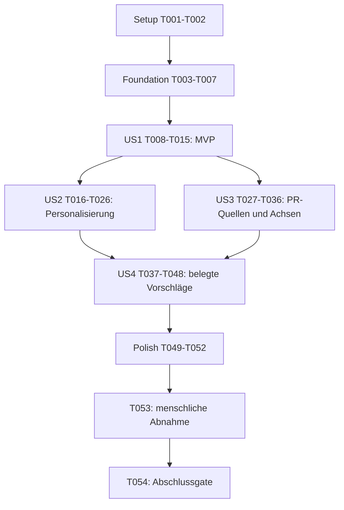

# Tasks: Verständliche und personalisierte Visualisierungs-Exporte

**Input**: [spec.md](spec.md), [plan.md](plan.md), [research.md](research.md), [data-model.md](data-model.md), [Exportvertrag](contracts/export-personalization.md), [quickstart.md](quickstart.md).

**Prerequisites**: Aktives Feature `080-personalize-visualization-exports`; bestehender Branch `TriAnalytica-dev-2`. Keine neue Projektinitialisierung, Abhängigkeit, API oder Datenbank.

**Tests**: Die fokussierten Prüfungen sind durch Verfassung III sowie Plan/Quickstart vorgegeben. Neue Assertions werden vor ihrer Implementierung ausgeführt und ihre erwartete Abweichung wird geprüft. Jede neue Testgruppe trägt im vollständigen Jest-Testnamen das feste Präfix `F080 Tnnn` der zuständigen Implementierungsaufgabe. Nach jeder produktiven Änderung unmittelbar die aktuelle Gruppe und die für diesen Schnitt relevanten bereits implementierten Regressionstests ausführen; diese Prüfungen müssen grün sein, bevor weitere Schnitte bearbeitet werden. Vorab angelegte Gruppen für spätere Aufgaben bleiben ausführbare Tests, zählen aber bis zu ihrer zuständigen Aufgabe nicht zum lokalen Grün-Gate. Keine `.skip`-/`.todo`-Markierungen, gelöschten Assertions oder pauschalen Snapshotaktualisierungen verwenden. An jedem Grundlagen-/Story-Abschluss müssen sämtliche bis dahin betroffenen vollständigen Suiten ohne Testnamenfilter bestehen.

**Organization**: Setup → gemeinsame Grundlagen → US1 (P1) → US2 (P1) → US3 (P1) → US4 (P2) → gemeinsame Abnahme. Eine Aufgabe gilt erst mit ihren fokussierten Prüfungen als erledigt. Alle Kontrollkästchen sind offen; dieses Dokument ist keine Implementierungs- oder Testbestätigung.

## Format und Pfade

Jede Aufgabe verwendet `- [ ] Tnnn [P?] [USn?] Beschreibung mit Dateipfad`. `[USn]` steht nur in der zugehörigen Storyphase. `[P]` bezeichnet ausschließlich eines der vier ausdrücklich unten aufgeführten Paare mit getrennten Schreibzielen und erfüllten Voraussetzungen; keine Freigabe zur parallelen Bearbeitung gemeinsamer Exportdateien.

Alle Dateipfade in Aufgaben sind vom Repositoryroot aus angegeben. Nur `src/export-punchline-utils.js` und dessen Testdatei sind neue produktive/Testmodule. Ein einziges neues Feature-Prüfprotokoll `specs/080-personalize-visualization-exports/acceptance.md` bündelt Matrix, Ist-Ergebnisse, Artefaktverweise und offene menschliche Abnahmen. Keine zusätzlichen Runner oder pro Familie getrennten Testdateien anlegen.

**Lokale Testgruppen und Grün-Kriterien**:

| Testanlage | Gruppenpräfixe nach zuständiger Implementierungsaufgabe |
|------------|-------------------------------------------------------|
| T003, T005, T006 | `F080 T004` neutrale Basis; `F080 T005` Scriptintegration; `F080 T007` Snapshot |
| T008, T009 | `F080 T010` Kontext; `F080 T011` Layout; `F080 T012` Branding; `F080 T013` Layoutstandard |
| T016, T017, T019 | `F080 T018` Text-API; `F080 T019` Darstellbarkeit; `F080 T020` Zustand; `F080 T021` Markup; `F080 T022` Übergänge; `F080 T023` Revisionsschutz |
| T027, T028 | `F080 T029` PB-Adapter; `F080 T030` Quellenfreigabe; `F080 T031` Quellentexte; `F080 T032` Kalenderachse; `F080 T033` Pagination; `F080 T034` Profilgrenzen |
| T037, T038, T040, T042–T045 | `F080 T039` Startanalyse; `F080 T040` Exportmodell; `F080 T041` Vorschlags-API; `F080 T042` quantitative Belege; `F080 T043` Kontextbelege; `F080 T044` Integration; `F080 T045` Auswahlwechsel |

Tests, die mehrere Schritte integrieren, erhalten das Präfix der letzten dafür notwendigen Aufgabe, nicht einer früheren Teilimplementierung. Beispiel: Nach T010 lautet der lokale Befehl `npm test -- --runInBand __tests__/dashboard-export-download.test.js -t 'F080 T010\b'`; Branding-/Standardgruppen werden erst bei T012/T013 grün verlangt. Bereits implementierte relevante Gruppen können mit einer entsprechend erweiterten Testnamenauswahl erneut geprüft werden. Passende vorhandene Regressionstests bleiben unverändert aktiv und werden zusätzlich gezielt ausgeführt; die verwendeten Selektoren und tatsächlich gefundenen Testzahlen werden im Prüfprotokoll festgehalten. Ein Filterlauf ohne passende Tests ist kein Erfolg. Verweise in Aufgaben auf frühere Testanlagen oder fokussierte Suiten meinen für den lokalen Schritt nur die hier zugeordneten Gruppen und betroffenen bereits implementierten Regressionstests, nicht vorgezogene Integrationsgruppen.

**Vollständige Suiten an Grundlagen-/Story-Abschlüssen**:

| Betroffener Schnitt | Befehl ohne Testnamenfilter am Abschlussgate |
|-------------------|---------------------------------|
| Punchline-Utility | `npm test -- --runInBand __tests__/export-punchline-utils.test.js` |
| Workout-Time-Analyse | `npm test -- --runInBand __tests__/workout-time-utils.test.js` |
| Seitenplanung/Textmessung | `npm test -- --runInBand __tests__/export-utils.test.js` |
| Exportorchestrierung, PB-Adapter/-Renderer | `npm test -- --runInBand __tests__/dashboard-export-download.test.js` |
| Workout-Time-Exportmodell | `npm test -- --runInBand __tests__/dashboard-core.test.js` |
| Markup/Scriptintegration | `npm test -- --runInBand __tests__/index-script-syntax.test.js __tests__/dashboard-export-download.test.js` |

Bei einer Aufgabe mit zwei betroffenen Schnitten lokal die zugehörigen Gruppen in beiden Dateien prüfen. Beim Abschluss von T007 sowie vor den Story-Abnahmen T015, T026, T036 und T048 sämtliche bis dahin betroffenen vollständigen Suiten mit den oben aufgeführten Befehlen ohne Testnamenfilter ausführen. Die Ergebnisprüfung in T050 bleibt ein zusätzliches Gesamtintegrationsgate. Syntaxprüfung ersetzt keine Verhaltensprüfung. Die neue Utility-Suite darf erst nach ihrer Erstellung ausgeführt und niemals wegen `--passWithNoTests` ohne tatsächlich gefundene Tests als bestanden protokolliert werden.

## Phase 1: Setup

**Purpose**: Vorhandene Struktur und Referenzstand sichern, ohne fachfremde Einrichtung oder Bereinigung.

- [X] T001 Lege `specs/080-personalize-visualization-exports/acceptance.md` als gemeinsames Prüfprotokoll an: übernimm das vollständige 13-Ziele-/Varianteninventar aus `specs/080-personalize-visualization-exports/contracts/export-personalization.md`, alle drei Formate und SC-001 bis SC-007; erfasse Datenreferenz, Filter, Messgröße, Provenienz, Textquelle/-status, Beleg/Fallbackgrund, Bild-/Schrift-/Logomaße, Dateireferenz, Browser/Version, Ergebnis und prüfende Person zunächst ohne erfundene Pass-Werte.
- [X] T002 Prüfe `package.json`, die vorhandenen Suiten `__tests__/export-utils.test.js`, `__tests__/dashboard-export-download.test.js`, `__tests__/workout-time-utils.test.js` und `__tests__/dashboard-core.test.js` mit `npm test -- --runInBand` und diesen vier Dateipfaden; dokumentiere den Ausgangsstand in `specs/080-personalize-visualization-exports/acceptance.md`. Trenne bekannte Vorfehler von neuen Regressionen; keine API-/CLI-Abhängigkeiten installieren und keine fremden Änderungen zurücksetzen.

**Checkpoint**: Referenzstand und Abnahmematrix sind vorhanden; keine bestehende Fehlerbehebung wurde zum Featureumfang hinzugefügt.

## Phase 2: Foundational

**Purpose**: Kleine gemeinsam genutzte Vorschlags-/Snapshotbasis bereitstellen. Keine fachliche PR- oder Tageszeitanalyse vorziehen.

- [X] T003 Erstelle `__tests__/export-punchline-utils.test.js` mit Tests für CommonJS-/Browserbridge, `buildPunchlineSuggestions(snapshot)` und neutrale Fallbacks aller 13 Familien: „Die Identität wird deterministisch aus Fakt/Variante abgeleitet, nicht bei jedem Render zufällig gewählt“, „Neutraltexte haben keinen vorgetäuschten Befund“ und „Ein Vorschlag → genau ein Snapshot“. Prüfe fehlendes/ungültiges Snapshotmaterial und dass weder Datenmutation noch I/O stattfinden.
- [X] T004 Implementiere die in T003 geprüfte gemeinsame neutrale Basis in `src/export-punchline-utils.js` mit `module.exports` und `window.exportPunchlineUtils`, stabiler Snapshot-/Variantenbindung und `id`, `text`, `kind: 'data' | 'neutral'`; vor US4 nur belegfreie neutrale Standardtexte zurückgeben. Keine DOM-/Browserzugriffe beim Laden, keine Rohdaten und keine zweite Caption; führe unmittelbar die neue Utility-Suite aus.
- [X] T005 Ergänze zuerst Ladereihenfolge-/Verfügbarkeitstests in `__tests__/index-script-syntax.test.js`, binde danach `src/export-punchline-utils.js` direkt nach `src/export-utils.js` in `index.html` ein und ergänze die bestehenden VM-/Loader-Doubles in `__tests__/dashboard-export-download.test.js`; aktualisiere `specs/022-modularize-inline-script/contracts/script-load-order.md`. Erhalte die relative Reihenfolge aller bestehenden Scripts und prüfe Syntax sowie Exportverhalten unmittelbar nach der Integration.
- [X] T006 Ergänze in `__tests__/dashboard-export-download.test.js` Snapshottests für erlaubte kompakte `punchlineEvidence`/`startTimeAnalysis`, Mutationen nach Capture und verbotene Rohaktivitäten, DOM-/Chartobjekte, Orte und verschachtelte Fremdtitel. Prüfe wortgetreu die Invarianten „Rekursiv eingefrorene, endliche, azyklische Daten; keine Rohaktivitäten, DOM-Knoten oder Chartobjekte“ und „Datum nur als gültige Epoch-Millisekunden oder `null`“; PB-Titel werden erst in US3 gezielt erlaubt.
- [X] T007 Erweitere die Top-Level-Allowlist und kompakte Feldvalidierung von `captureExportSelection` in `src/dashboard-export.js` für T006, ohne beliebige Quellen-/Titelpfade freizugeben. Erhalte `selectionId`, `datasetIdentity`, `targetKey`, `targetKind`, `variantKey`, Filter-/Einheitenbedeutung und Herkunft; „Ein laufender Text-/Layoutwechsel liest keine neuen globalen Trainingsdaten“. Stelle sicher, dass ein fehlendes Rohdatum nicht über `Number(null)` zu 1970 wird, und prüfe die Snapshotfälle unmittelbar.

**Checkpoint**: Reines Utility, Scriptverfügbarkeit und restriktiver Snapshot funktionieren. Die folgenden Storyphasen können auf derselben Exportbasis aufbauen.

## Phase 3: User Story 1 - Eine verständliche Trainingsgrafik teilen (Priority: P1, MVP)

**Goal**: Direkte Kontextangaben, Reel / Story als Standardlayout, sichtbar größeres Story-Logo und eine deutlichere vorhandene optionale Punchline, ohne PR-/Importberechnungen zu verändern.

**Independent Test**: Distance und ein Zwei-Achsen-Diagramm mit bekannten Filtern in allen drei Formaten exportieren; direkte Texte, notwendige Einschränkungen, exakte Bildmaße, Story-Vorauswahl und tatsächliche Logo-/Schriftverhältnisse bei 360 Pixeln Bildbreite prüfen. Die bestehende Captionsteuerung kann manuell aktiviert werden; eigene Texte und Standardaktivierung gehören zu US2.

### Tests for User Story 1

- [X] T008 [P] [US1] Ergänze in `__tests__/export-utils.test.js` nach T007 Seitenplantests für semantisch deduplizierten Kontext, maximal zwei Punchlinezeilen vor dem Detailkontext, mindestens 125 Prozent Kontextschrift, mindestens 36 Pixel essentielle Schrift und vollständigen Platzrückgewinn bei deaktivierter Caption; prüfe 1080 × 1920, 1080 × 1080 und 1080 × 1350 sowie die bestehende Story-Sicherheitsfläche.
- [X] T009 [P] [US1] Ergänze nach T007 in `__tests__/dashboard-export-download.test.js` Präsentations-/Rahmentests für `Distance`, `2024–2025`, `km`, `Length vs activities`, das Fehlen technischer Präfixe/`2-hour-blocks`, bedingtes Weglassen von `All sports`, erhaltene Sport-/Teilperioden-/Einheitenhinweise, Story-Vorauswahl je neuer Sitzung und mindestens 150 Prozent tatsächliche Story-Logohöhe gegenüber Square.

### Implementation for User Story 1

- [X] T010 [US1] Verdichte in `src/dashboard-export.js` mit `getSocialExportPresentation` den Kontext familienbezogen und semantisch statt durch Textlöschung: direkte Messgrößen/Perioden/Einheiten, kurzer Zwei-Achsen-Zusammenhang und keine redundanten Standardangaben; erhalte notwendige Einschränkungen, Attribution und synthetische Herkunft. Nutze Kontextfelder nur aus der erfassten Auswahl und führe unmittelbar die Präsentationstests aus.
- [X] T011 [US1] Passe `planExportPages` und den Kontextausgabepfad in `src/export-utils.js` für die einzige bestehende `secondaryLine` als Punchline an: „höchstens zwei lesbare Zeilen, Schriftgröße mindestens das 1,25-Fache des unterstützenden Kontexts und mindestens die bestehende essentielle Mindestgröße“, vor Detailkontext; ausgeschaltet kein Captionblock/Leerraum. Plane Header-/Footerbudget vor der Pagination, erhalte Daten/Legenden und prüfe unmittelbar T008.
- [X] T012 [US1] Ändere `drawStructuredExportFrame` in `src/dashboard-export.js` auf formatbezogenes, proportional eingepasstes Branding; Story nutzt mindestens die 1,5-fache sichtbare Square-Logohöhe bei gleicher Bildbreite innerhalb x=72 bis 960 und y=240 bis 1560. Falls dafür Footerbudget geändert wird, passe es in `src/export-utils.js` konsistent an; miss tatsächliche Zeichenfläche statt nur Logo-Box und führe beide fokussierten Suiten aus.
- [X] T013 [US1] Ordne in `index.html` die Formate `story`, `square`, `portrait` und synchronisiere in `beginExportSession` von `src/dashboard-export.js` Markup und Story-Vorauswahl: „`story`, `square`, `portrait`; neue Sitzung `story`“. Ein Layoutwechsel innerhalb derselben Sitzung bleibt bestehen; keine Tab-ID, Navigation oder Dispatch-Reihenfolge ändern. Prüfe unmittelbar Markup-/Exporttests.
- [X] T014 [US1] Ergänze in `__tests__/fixtures/reel-story-exports/generate.js` die vorhandenen Distance-/Zwei-Achsen-/Branding-Referenzfälle in allen drei Formaten, ohne ein zweites Generatorsystem anzulegen; nutze vorhandene synthetische Fixtures und protokolliere die erzeugten Dateien und messbaren Layoutwerte in `specs/080-personalize-visualization-exports/acceptance.md`.
- [X] T015 [US1] Führe die Storyprüfung aus `specs/080-personalize-visualization-exports/quickstart.md` Abschnitte 2–3 für US1 in aktuellem Chrome und Edge durch und dokumentiere tatsächliche PNGs, nativen/360-Pixel-Vergleich, Browserversionen und Ergebnis in `specs/080-personalize-visualization-exports/acceptance.md`; bestätige SC-002/SC-003 für den MVP und den Story-Layoutteil von SC-001, ohne US2-Standardaktivierung oder ausgeschlossene Reparaturen als erledigt zu behaupten.

**Checkpoint**: US1 liefert das erste unabhängig vorführbare Ergebnis. Eigene Texte, PR-Quellen und datengestützte Gewohnheitsetiketten sind für diesen MVP nicht erforderlich.

## Phase 4: User Story 2 - Die eigene Punchline bestimmen (Priority: P1)

**Goal**: Standardmäßig aktive, frei auswählbare oder eigene Punchline; genau eine bestätigte Textfassung oder bewusst kein Text. Vorschau-/Downloadkonsistenz bei Eingabefehlern und asynchronen Änderungen.

**Independent Test**: Dieselbe Grafik mit Standard, ausgewähltem neutralem Vorschlag, eigenem Text und ausgeschalteter Punchline herunterladen; ungültige Bestätigung, Layout-/Seitenwechsel, rasche Wechsel und neue Sitzung prüfen. Datenbasierte zusätzliche Vorschläge werden in US4 ergänzt.

### Tests for User Story 2

- [X] T016 [P] [US2] Ergänze nach T015 in `__tests__/export-punchline-utils.test.js` Fälle für `validateCustomPunchline(input)` und `resolvePunchline(selection, suggestions)`: „1–120 Unicode-Codepoints nach äußerem Trimmen“, „Innere Leerzeichen/Satzzeichen bleiben erhalten“, ungültige Nicht-Strings, 0/1/120/121 Codepoints, HTML-artiger Text, mehrere Wörter jenseits der alten Zehnwortgrenze, deaktivierter Zustand und veraltete/fremde Vorschlagsidentität statt stillem Textwechsel.
- [X] T017 [P] [US2] Ergänze nach T015 in `__tests__/dashboard-export-download.test.js` Dialog-/Zustands-/Racefälle: Standard an, eigener Entwurf versus Bestätigung, ungültiges Apply sperrt altes PNG, explizite Rückkehr, Ausschalten mit ungültigem Entwurf, Wiederaktivierung, Layout-/Seitenwechsel, Wiederöffnen, Datasetwechsel, Retry, vertauschte Renderfertigstellung und begonnener Save während späterem Textwechsel. Prüfe insbesondere zeichenvaliden Text, der nach Formatwechsel nicht mehr passt: unverändert erhalten, Download sperren und nach Rückkehr zum passenden Format, Korrektur oder Ausschalten erst die erfolgreich vorbereitete gewählte Fassung freigeben; nutze vorhandene DOM-/Canvas-/Deferred-Doubles und die zugeordneten Teilaufgabengruppen.

### Implementation for User Story 2

- [X] T018 [US2] Implementiere in `src/export-punchline-utils.js` die mit T016 geprüften APIs: `{valid, text, length, error}`, äußeres Trimmen und Codepointzählung, genau ein bestätigter Text oder deaktivierter Zustand, explizite Invalidität bei veraltetem Vorschlag; eigener Text wird weder analysiert noch als belegter Befund ausgegeben. Kein HTML/I/O, kein Umschreiben oder zufälliger Vorschlagswechsel; führe unmittelbar die Utility-Suite aus.
- [X] T019 [US2] Ergänze zuerst eigene-Text-/Fitfälle als Gruppe `F080 T019` in `__tests__/export-utils.test.js` und implementiere danach in `src/export-utils.js` einen Textmess-/Umbruchpfad ohne die bisherige Whitespace-/Zehnwortnormalisierung. Zeichenvalidität mit 1–120 Unicode-Codepoints und formatabhängige Darstellbarkeit getrennt prüfen: Bei mehr als zwei ausreichend großen Zeilen verständlicher Fitfehler statt Kürzung, dritter Zeile oder Unterschreitung der Schriftgrenze. Eigene und vorgeschlagene Texte gleich prüfen und unmittelbar die lokale Gruppe sowie relevante bereits implementierte Layoutregressionen ausführen; der Dialog-/Downloadnachweis nach Formatwechsel folgt in den zuständigen US2-Integrationsgruppen.
- [X] T020 [US2] Ergänze in `src/dashboard-export.js` den einen Sitzungszustand `PunchlineSelection`: `enabled` mit „Neuer Sitzungsdefault `true`; unabhängig von Textquelle“, `source` als „`default`, `suggestion` oder `custom`“, `suggestionId` nur im selben Snapshot, bestätigter Text getrennt vom optionalen `draftText`, `hasUnconfirmedDraft` und `blockedAfterApply`. Verwende `validationStatus` genau als „`valid`, `empty`, `too-long` oder `does-not-fit`; Fehler ist benutzersichtbar“; bestehende Humor-/Captionfelder nur als daraus abgeleitete Kompatibilitätsbrücke und sofortige Zustandstests.
- [X] T021 [US2] Erweitere den Exportdialog in `index.html` um standardmäßig aktives `Add a punchline`, Vorschlagsauswahl, klar beschriftete eigene Texteingabe, explizite Bestätigung/Rückkehr, Quellkennzeichnung, Belegbereich und feldbezogene Fehler. Nutze native Auswahl-/Toggleelemente und bestehende Gestaltung; Tastatur-/Fokuszugänglichkeit sowie erreichbare Bild-/Downloadkontrollen in schmaler Vorschau erhalten und unmittelbar Markup-/Exporttests ausführen.
- [X] T022 [US2] Verbinde die Kontrollen in `src/dashboard-export.js` mit bestätigten Zustandstransitionen und Textsicherheit: Standard oder Vorschlag ersetzt genau einen Text, eigener Text über Text- statt HTML-Ausgabe, Ausschalten erhält Auswahl/Entwurf und entfernt Platz, Einschalten übernimmt keine ungültige angewendete Fassung, explizite Rückkehr verwirft den Fehler. Layout-/Seitenwechsel und Retry behalten den bestätigten Text; neue Sitzung setzt Story/Punchline an und verwendet neue Auswahl. Prüfe unmittelbar T017.
- [X] T023 [US2] Erweitere in `src/dashboard-export.js` die vorhandenen Sitzungs-/Capture-/Dataset-/Kompositionsguards um die bestätigte Präsentationsrevision: „Monoton bei bestätigter Textwahl, Aktivierung und Layoutwechsel; schließt Seitenplanfassung ein“ und Status „`pending`, `ready`, `invalid`, `failed` oder `closed`“. Download nur bei passender fertiger Revision und ohne aktiven angewendeten Textfehler; ein alter Blob genügt nicht. Erhalte bytegebundenen Save, Ressourcenbesitz und bestehenden Picker-/Fallback-Sicherheitspfad; führe die Race-/Downloadtests unmittelbar aus.
- [X] T024 [US2] Ergänze in `__tests__/fixtures/reel-story-exports/generate.js` Referenzfälle für bestätigten eigenen Text, neutralen Vorschlag, zweizeilige Punchline, Fitfehler und captionlose Reflow-/Serienausgaben; vergleiche vollständige Dateiinhalte mit der jeweils bestätigten Vorschau und protokolliere erwartete statt erfundener Ergebnisse in `specs/080-personalize-visualization-exports/acceptance.md`.
- [X] T025 [US2] Prüfe Syntax/Ladereihenfolge, unveränderte Tab-IDs/Dispatch und alle US2-Zustands-/Downloadszenarien mit `__tests__/index-script-syntax.test.js`, `__tests__/tab-navigation.test.js` und `__tests__/dashboard-export-download.test.js`; ergänze nur notwendige vorhandene Testdoubles und halte die konkrete Testausgabe in `specs/080-personalize-visualization-exports/acceptance.md` fest.
- [X] T026 [US2] Führe Abschnitt 4 von `specs/080-personalize-visualization-exports/quickstart.md` in Chrome und Edge einschließlich Tastatur, 360-Pixel-Vorschau, Aus-/Einschalten, Textgrenzen, ungültigem Apply und Save während Revision aus; dokumentiere Dateien, Revisionszuordnung und tatsächliche Ergebnisse für SC-001/SC-004 in `specs/080-personalize-visualization-exports/acceptance.md`. Ohne echte Speicherung beziehungsweise explizites dokumentiertes Hindernis keinen Downloadfall als bestanden werten.

**Checkpoint**: Die vollständige Textpersonalisierung funktioniert unabhängig von der späteren zusätzlichen Datenanalyse; neutrale Vorschläge sind keine behaupteten Trainingsbefunde.

## Phase 5: User Story 3 - Einen persönlichen Rekord nachvollziehbar zeigen (Priority: P1)

**Goal**: Echte zugeordnete Workout-Titel und verständliche Quellen; datengerechte Kalenderbeschriftung ohne Veränderung von PB-Berechnungen oder Dauerprofilen.

**Independent Test**: PR-Übersicht und Details mit Einzelpunkt, Gleichtagspunkten, Jahreswechsel, großer Lücke, fehlendem Titel/Datum, geschätzter Quelle und Mehrworkout-Dauerprofil exportieren und Werte/Quellen mit synthetischen Referenzen vergleichen.

### Tests for User Story 3

- [X] T027 [P] [US3] Ergänze nach T026 in `__tests__/dashboard-export-download.test.js` Tests für PB-Adapter, schema-/pfadgebundene Titel-Snapshotfreigabe, gültige und fehlende Quellen-/Recorddaten, verständliche Schätzungslabels, Kalenderextent/Jahresbezug, Einzel-/Gleichtagsfall, Dauerprofil und Quellenmutation nach Capture. Ergänze negative Nicht-PB-/Fremdpfadfälle und erhalte Referenzwerte statt die bisherige Titelunterdrückung pauschal überall aufzuheben.
- [X] T028 [P] [US3] Ergänze nach T026 in `__tests__/export-utils.test.js` Fälle für lange PB-Workout-Titel, Quellen-/Wertzeilen mit gemessenen variablen Höhen, Übersicht/Detail/Fortsetzungen, Vollständigkeit und „identisch auf Fortsetzungsseiten“ geltende Kalenderdomain; prüfe sämtliche drei Formate ohne Verkleinerung unter die essentielle Mindestschrift.

### Implementation for User Story 3

- [X] T029 [US3] Ergänze in `buildPbExportData` von `src/dashboard-power-pb.js` `source` aus demselben bereits zugeordneten Quellrecord: `workoutTitle` „Vorhandener Titel derselben Quelle oder `null`; nie datumsgestütztes Matching“, `activityDate` „Gültiges Recorddatum, sonst gültiges Datum derselben Quelle, sonst `null`“, `kind` „Intern `modeled`, `full-activity`, `fit-rolling` oder `unknown`; im Bild nur verständliche Formulierung“, `estimated` „Kennzeichnet Schätzung unabhängig vom Vorhandensein eines Titels“ und `sourceDistanceKm` „Nur wenn zur Einordnung abweichender Quell-/Zieldistanz erforderlich und vorhanden“. Erhalte Rekordwerte/-anzahl/-reihenfolge und prüfe sofort die Adapterfälle.
- [X] T030 [US3] Erlaube in `captureExportSelection` von `src/dashboard-export.js` ausschließlich die in T029 definierten `source`-Felder an `personalBests.familyData.records[*].source`, `personalBests.familyData.groups[*].records[*].source` und zugehörigen `best`-/`firstRecord`-/`currentRecord`-/`milestones`-Recordspiegeln. „Kein genereller Freibrief für Schlüssel namens `source`, `title`, `name` oder `workoutTitle` in anderen Familien/Objektpfaden“; schema-validieren, kopieren, einfrieren und unmittelbar positive/negative Datenschutztupel prüfen.
- [X] T031 [US3] Rendere in `src/dashboard-export.js` pro PR-Record den tatsächlichen zugeordneten Titel oder eine neutrale Bezeichnung mit verfügbarem Datum und verständlicher Quellenart: aus Aktivitätsdurchschnitt geschätzt, ganze Aktivität, gemessener Abschnitt oder unbekannt. Entferne rohe Quellenarten auch aus zusammengefasster Attribution; Titel ersetzt keine Schätzungs-/Quell-/Zieldistanz-Einschränkung. Keine Titel oder Genauigkeit erfinden; unmittelbare Renderertests ausführen.
- [X] T032 [US3] Berechne in `createPbExportChart` von `src/dashboard-export.js` Kalenderdomain/Ticks aus allen gültigen dargestellten Recorddaten: „Mehr als ein unterschiedlicher Tag: chronologisch und höchstens ein Tickintervall Rand je Seite“, einzelne Tagesbeobachtung ohne suggerierte Linie, Gleichtagspunkte unverändert und Datum immer mit eindeutigem Jahresbezug. Fehlende/ungültige Daten vor numerischer Konvertierung behandeln und als undatierte Wert-/Quellenzeilen erhalten; keine datasetweite Ersatzdomain und keinen 1970-/Heute-Fallback. Unmittelbar die Achsenfälle prüfen.
- [X] T033 [US3] Implementiere in `src/export-utils.js` gemessene variable PB-Record-/Quellenhöhen statt des festen 52-Pixel-Budgets und verwende sie konsistent in `renderPbExportPage` von `src/dashboard-export.js`: Übersicht und Detail paginieren ohne Titel-/Recordverlust; alle Fortsetzungsseiten behalten denselben vollständigen Chartbereich. Werte und natürliche Markpositionen nicht ändern; beide betroffenen fokussierten Suiten ausführen.
- [X] T034 [US3] Sichere in `src/dashboard-export.js` und dem Adapter `src/dashboard-power-pb.js` die Profil-/Grenzfälle: „Ein Dauerpunkt → eigene Quelle; mehrere Dauerpunkte dürfen verschiedene Workouts verwenden“, „Kein profilweiter Einzelworkout-Titel“ und „Dauerprofil: unveränderte Dauerachse“. Bei ausschließlich undatierten Records keine erfundene Kalenderentwicklung und bei Einzel-/Gleichtag keine unbelegte Verbesserungssummary. Führe Exporttests und die unveränderten Referenztests in `__tests__/power-pb-utils.test.js` aus; Dashboardachsen/PB-Berechnungen nicht anfassen.
- [X] T035 [US3] Erhalte in `__tests__/fixtures/reel-story-exports/generate.js` beim Aufbau der PB-Details die neuen Quellenfelder aus den zugeordneten Records; ergänze Übersicht, Schätzung, fehlende Quelle, lange Titel, Jahreswechsel, Gleichtag und aus mehreren Workouts stammendes Dauerprofil. Verwende alle tatsächlich angebotenen Definitionen/Varianten mit synthetischen Daten und erfasse Referenzen in `specs/080-personalize-visualization-exports/acceptance.md`.
- [X] T036 [US3] Führe Abschnitt 6 von `specs/080-personalize-visualization-exports/quickstart.md` für PR-Übersicht/-Details/-Profile in Chrome und Edge aus und protokolliere SC-006 in `specs/080-personalize-visualization-exports/acceptance.md`: Null Titel-/Datumszuordnungsfehler, null unerklärte Quellenarten, vollständige Records/Fortsetzungsseiten und unveränderte Messwerte; nur Exportachsen ändern, keine PB-Neuberechnung oder Geräte-/Importreparatur.

**Checkpoint**: PR-Exporte sind mit Daten und Quellen nachvollziehbar. Diese Story benötigt keine Tageszeitgewohnheiten oder anderen neuen Analysebehauptungen.

## Phase 6: User Story 4 - Eine belegbare Trainingsgewohnheit entdecken (Priority: P2)

**Goal**: Verlässliche Workout-Time-Analyse und kontextbezogene, erklärbare Vorschläge je verfügbarer Familie, mit begründetem neutralem Fallback statt erfundener Erkenntnisse.

**Independent Test**: Synthetische quellenlokale Morgen-/Nachmittag-/Abend-/Nachtstarts, 9/10 gültige Starts, 59/60 Prozent und ausgeschlossene Ortszeiten prüfen; je Familie tatsächlich angebotenen Datenvorschlag oder konkrete neutrale Alternative mit Auswahlbezug nachweisen.

### Tests for User Story 4

- [X] T037 [P] [US4] Ergänze nach T036 in `__tests__/workout-time-utils.test.js` Analysefälle vor der Implementierung: 9/10 gültige Starts, 59/60 von 100, Grenzen 05:00/12:00/18:00/22:00/00:00, vier Fenster, echte Mitternacht versus Datum-ohne-Uhrzeit, fehlendes/widersprüchliches `sourceLocalStart`, gültige Samplezeit, Sport-/Datumsfilter vor Startprüfung und mindestens zwei Zeitzonen. Prüfe Ausschlusszahlen sowie Unabhängigkeit von Count/Dauer/Distanz und unveränderte Legacy-Diagrammtests.
- [X] T038 [P] [US4] Ergänze nach T036 in `__tests__/export-punchline-utils.test.js` Tabellenfälle für alle 13 Familien: belegte Datenvorschläge mit vollständiger Basis, neutrale Gründe bei fehlendem Befund, richtige Messgröße/Teilperiode, gemeinsame Spitze bei Gleichstand und Zurückweisung fremder Auswahl/fehlender Vergleiche. Prüfe `Morning bird` nur morgens, `Night owl` nur nachts, wörtliche Nachmittags-/Abendvorschläge und keine Gesundheits-/Charakter-/Kausalitätsbehauptung.

### Implementation for User Story 4

- [X] T039 [US4] Implementiere `analyzeWorkoutTimeStarts` in `src/workout-time-utils.js` ohne Änderung von `buildWorkoutTimeDataset`/Legacy-Gruppierung: `basis` „Literal `activity-start-count`, unabhängig von Count-/Dauer-/Distanzanzeige“, `selectedCount` als sport-/datumsgefilterte Grundmenge vor Startvalidierung, `validStartCount`, `excludedStartCount` exakt „`selectedCount - validStartCount`“, aggregierte `exclusions` ohne Rohdatensätze und `windows` „Genau vier Einträge `{key, count}`: `morning`, `afternoon`, `evening`, `night`; Summe entspricht `validStartCount`“. Nutze nur validiertes `sourceLocalStart` gegen `startTime` oder gültiges synthetisches Paar `calendarDate`/`localStartTime`; kein Browser-`getHours`-, GPS-, Dauer- oder Datumsfallback. `dominantWindow` „Fensterkennung oder `null`; nur bei mindestens zehn gültigen Starts und mindestens 60 Prozent Anteil“, `status` genau „`supported`, `insufficient-data`, `no-dominance` oder `no-valid-starts`“, `scope` ohne ersatzweise All-time-Auswahl. Fenster exakt Morgen [05:00, 12:00), Nachmittag [12:00, 18:00), Abend [18:00, 22:00), Nacht [22:00, 05:00), Schwelle auf ungerundeten Zählern; O(n) mit begrenztem Zusatzspeicher und sofortige Utility-Prüfung.
- [X] T040 [US4] Ergänze zuerst Modell-/Auswahlwechseltests in `__tests__/dashboard-core.test.js` und integriere danach die kompakte `startTimeAnalysis` vor Capture in den Exportanbieter von `src/dashboard-workout-time.js`. Nutze dieselben ausgewählten Sport-/Datumsgrenzen wie die Ansicht, aber zähle fehlende Startzeiten noch als ausgeschlossene Mitglieder dieser Grundmenge; keine Rohaktivitäten im Snapshot und keine neuen Importzeitheuristiken. Führe unmittelbar Modelltests aus.
- [X] T041 [US4] Erweitere `buildPunchlineSuggestions` in `src/export-punchline-utils.js` um belegte Vorschläge: `factKey`, `kind`, aktives `metric`/`unit`, `value`/`denominator` mit „Vorhandener endlicher Wert; Nenner nur bei sinnvoller Anteilsbildung, niemals null/zero als fehlend kaschieren“, `labels` mit „Nur für diese Familie bereits zur Veröffentlichung bestimmte Kategorien; keine zusätzlichen Aktivitätsnamen oder Orte“ sowie `isTie`/`qualifiers` mit „Gemeinsamer Spitzenplatz, Teilzeitraum, Schätzung und andere notwendige Einschränkungen“. Für `kind: 'data' | 'neutral'` gilt: Datenvorschläge benötigen `basis` mit `selectionId`, fachlichem Auswahlbezug, Messkriterium und belegtem Wert/Anteil; alle Vorschlagstexte durchlaufen dieselbe Längen-/Layoutprüfung wie eigene Texte. Deterministische IDs, klar priorisierter belegter Standard sonst neutral, keine erfundenen Zeit-/Distanzdominanzbehauptungen; sofort T038 ausführen.
- [X] T042 [US4] Erzeuge in den familienbezogenen Projektionen von `src/dashboard-export.js` aus bereits erlaubten Exportwerten Belege für `totalDistance`, `equipment`, `distributions`, `wordcloud`, `pieCharts`, `personalBests` und `lifetimeStatistics`: vorhandene Spitzenkategorie/-periode, Häufigkeit, ausgewiesener Rekord oder bereits exportierter Summenwert nach aktiver Messgröße. Keine neue Analyse aus Gesamtdaten und keine Lifetime-Inhaltsänderung; bei fehlender geeigneter Vergleichsgrundlage präzisen neutralen Grund liefern. Erweitere passende Projektionsfälle in `__tests__/dashboard-export-download.test.js` und prüfe sie unmittelbar.
- [X] T043 [US4] Ergänze in `src/dashboard-export.js` die Beleg-/Fallbackprojektion für `paceMetrics`, `equipmentTimeline`, `heatmap`, `trainingCalendar` und `mediaGallery` anhand vorhandener Punkt-/Nutzungs-/Medienmengen beziehungsweise ausdrücklich ausgewähltem Kontext; verfügbare eindeutige Fakten nicht pauschal ignorieren. Keine Kausalität, lückenlose Nutzung, Länderabdeckung oder Streak aus ungeeigneten Daten ableiten; nicht verfügbare Exporte bleiben nicht verfügbar. Ergänze negative/privacybezogene Fälle in `__tests__/dashboard-export-download.test.js`, prüfe sofort und ändere keinen ausgegrenzten Renderer-/Importdefekt.
- [X] T044 [US4] Verbinde in `src/dashboard-export.js` Snapshot, `buildPunchlineSuggestions` und den bestehenden US2-Dialog mit Vorschlagserklärung: Auswahl, Messkriterium, Wert/Anteil und Einschränkungen sichtbar; für Workout Time gültige/ausgeschlossene Anzahl sowie Startzählung auch bei Dauer-/Distanzgrafik. Standard zuerst belegbar sonst neutral; ein nachträglich berechneter Vorschlag darf bestätigten eigenen Text nicht überschreiben. Nur erforderliche Einschränkungen im Bild, keine zweite Punchline; unmittelbare Integrations-/Racetests ausführen.
- [X] T045 [US4] Ergänze und führe in `__tests__/dashboard-export-download.test.js` und `__tests__/dashboard-core.test.js` Integrationsfälle für alle Granularitäten, Count/Dauer/Distanz, neue/alte Datasetidentität, Sport-/Datumswechsel und fehlende Ortszeitprovenienz aus; prüfe nach Capture eingefrorene Belege, unveränderte Diagrammwerte, richtige Ausschlüsse und die weiterhin enge PB-Titel-/Ortsfreigabe. Bestätige, dass neutrale und eigene Texte keine behauptete Datenanalyse darstellen.
- [X] T046 [US4] Erweitere `__tests__/fixtures/reel-story-exports/generate.js` um die im Quickstart benannten quellenlokalen Tageszeit- und Vorschlagsfälle und erhalte synthetische Kennzeichnung in allen Bildern; ergänze in `specs/080-personalize-visualization-exports/acceptance.md` je Ziel/erreichbarer Variante konkreten Fakt, dessen Beleg und Vorschlag oder den konkreten neutralen Grund. Keine neuen personenbezogenen Rohfixtures veröffentlichen.
- [X] T047 [US4] Führe Abschnitt 5 von `specs/080-personalize-visualization-exports/quickstart.md` für zwei unterschiedliche Browserzeitzonen und beide verbindlichen Desktopbrowser aus; protokolliere in `specs/080-personalize-visualization-exports/acceptance.md` unveränderte startbezogene Ergebnisse, 9/10- und 59/60-Grenzen, Mitternachtsüberlauf und Caption-/Messgrößenwechsel. Konservative CSV-/TrainingPeaks-Ausschlüsse als bekannte Datenabdeckung erklären, nicht durch Importänderungen beseitigen.
- [X] T048 [US4] Schließe den SC-005-Familiennachweis in `specs/080-personalize-visualization-exports/acceptance.md` anhand der Fähigkeitsmatrix von `specs/080-personalize-visualization-exports/research.md` ab: je verfügbarer Familie mindestens ein belegter Vorschlag, sofern ein sinnvoller Befund vorliegt, sonst konkreter neutraler Grund; null erfundene Gewohnheits-/Trend-/Rekordbehauptungen. Blockierte ausgeschlossene Vorfehler kenntlich machen und niemals als erfolgreichen Test zählen.

**Checkpoint**: Vorschläge sind auf dieselbe Auswahl zurückführbar; fehlende Daten, unklare lokale Uhrzeiten und Gleichstände führen nicht zu unbelegten Behauptungen.

## Phase 7: Polish & Cross-Cutting Concerns

**Purpose**: Gemeinsame Bedienungsdokumentation, vollständige Dateiabnahme und ehrlicher Nachweis aller Erfolgskriterien; keine zusätzliche Produktfunktion.

- [X] T049 Aktualisiere `README.md` zu Story-/Punchline-Standards, Aus-/Einschalten, eigener bestätigter Eingabe, lokaler Verarbeitung und sichtbarer PB-Titeloffenlegung mit neutralem Fallback; gleiche nur betroffene Anweisungen in `specs/080-personalize-visualization-exports/quickstart.md` mit den tatsächlichen Controls/Befehlen ab. Keine historischen Feature-077-Dokumente rückwirkend umschreiben und keine pauschale Netzwerkfreiheitsbehauptung ergänzen.
- [X] T050 Führe die fokussierten Integrationsgates aus `specs/080-personalize-visualization-exports/quickstart.md` für `__tests__/export-punchline-utils.test.js`, `__tests__/workout-time-utils.test.js`, `__tests__/export-utils.test.js`, `__tests__/dashboard-core.test.js`, `__tests__/dashboard-export-download.test.js`, `__tests__/power-pb-utils.test.js`, `__tests__/index-script-syntax.test.js` und `__tests__/tab-navigation.test.js` aus; dokumentiere gefundene Testanzahlen/Ergebnisse und Regressionen gegenüber T002 in `specs/080-personalize-visualization-exports/acceptance.md`. Keine Tests anderer Repositoryoberflächen als Ersatz verwenden.
- [ ] T051 Führe die vollständige PNG-/Vorschauabnahme aus `specs/080-personalize-visualization-exports/quickstart.md` und dem Zielinventar in aktuellem Chrome/Edge aus: alle verfügbaren 13 Familien, alle erreichbaren PB-/Medienvarianten, alle drei Formate, aktivierte/deaktivierte Caption sowie repräsentative eigene Texte, dünne/dichte Daten, lange Titel und erste/mittlere/letzte Fortsetzungsseiten. Protokolliere tatsächliche Dateimaße, 360-Pixel-Lesbarkeit, sichtbare Logohöhen, Schriftverhältnisse, Inhaltsvollständigkeit und bestätigte Revision in `specs/080-personalize-visualization-exports/acceptance.md`; vorhandene blockierende Nichtziele getrennt behandeln.
- [X] T052 Prüfe in `src/dashboard-export.js`, `src/export-punchline-utils.js` und anhand der tatsächlich ausgelösten Netzwerkzugriffe, dass keine Trainingsdaten, eigenen Texte oder Exportbilder für Vorschläge/Komposition übertragen werden; bestehende CDN-/Kartenabhängigkeiten nicht fälschlich als neue Datenübertragung einstufen. Prüfe weiterhin verbotene Fremdtitel/Orte und erhaltene synthetische Herkunft/Attribution; erfasse konkrete Befunde zu FR-022/FR-023 in `specs/080-personalize-visualization-exports/acceptance.md`.
- [ ] T053 Führe mit mindestens fünf echten Freizeitausdauersportlerinnen/-sportlern den in `specs/080-personalize-visualization-exports/quickstart.md` definierten Nutzertest durch und protokolliere anonymisierte Ist-Ergebnisse in `specs/080-personalize-visualization-exports/acceptance.md`: pro Grafikfamilie mindestens vier korrekte Antworten nach fünf Sekunden bei 360 Pixeln Breite und mindestens vier erfolgreiche Bedienungsabläufe innerhalb von 60 Sekunden. Fehlende Teilnehmende oder verfehlte Quote ausdrücklich als offenes menschliches Abnahmegate behandeln; Aufgabe nicht allein aufgrund synthetischer Antworten oder Screenshots abhaken.
- [ ] T054 Prüfe die endgültige FR-001–FR-024-/SC-001–SC-007-Zuordnung in `specs/080-personalize-visualization-exports/acceptance.md` gegen `specs/080-personalize-visualization-exports/spec.md`, `specs/080-personalize-visualization-exports/data-model.md` und `specs/080-personalize-visualization-exports/contracts/export-personalization.md`; führe `git diff --check` aus und dokumentiere Freigabe oder verbleibende Gatefehler. Keine Calendar-Reparatur, Lifetime-Statistics-Inhaltslöschung/Abschneidekorrektur oder Apple-Health-Heatmap-`geoPoint`-Reparatur hineinziehen; neue Exportregressionen bleiben zu beheben. Kein automatischer Commit oder Branchwechsel.

**Final Checkpoint**: Erledigte Implementierungsaufgaben und bestandene automatische Prüfungen sind nicht gleichbedeutend mit vollständig bestandener Bild-/Nutzerabnahme. T053 und jede tatsächlich blockierte Pflichtabnahme bleiben bis zum echten Nachweis offen.

## Dependencies & Execution Order

### Phasen und Storyabhängigkeiten

1. T001 → T002 → Foundation T003–T007. Innerhalb der Foundation gilt T003 → T004 → T005 → T006 → T007; die neue Utility-Suite existiert vor dem ersten Utility-Lauf.
2. US1 beginnt nach T007 und endet mit T015. US1 allein ist der empfohlene MVP, mit manuell ein-/ausschaltbarer bereits vorhandener Caption und ohne eigene Texte/Analyse.
3. US2 verwendet US1-Layout und Foundation. Empfohlener nächster Schritt T016–T026; zusätzliche datenbezogene Vorschläge sind kein US2-Abnahmekriterium.
4. US3 benötigt fachlich Foundation/US1, nicht die US2-Textbearbeitung. Die empfohlene Bearbeitung nach T026 vermeidet parallele Änderungen an `src/dashboard-export.js`, `src/export-utils.js`, denselben Tests und dem Fixturegenerator. Getrenntes Vorgehen erfordert dieselbe Serialisierung beim Zusammenführen.
5. US4 nutzt den US2-Dialog und die US3-Quellen für die vollständige familienübergreifende Integration. Seine reine Startzeitanalyse könnte isoliert früher entwickelt werden; als vollständige Story erfolgt die Abnahme erst nach US2/US3. Empfohlene Folge T037–T048.
6. Gemeinsame Abnahme T049–T054 beginnt nach den vier Storycheckpoints. T050 vor umfassender Browserabnahme T051; T051 vor tatsächlichem Nutzertest T053. T054 benötigt die Ist-Ergebnisse sämtlicher Gates, nicht bloß eine Codefertigmeldung.

Das Diagramm beschreibt fachliche Voraussetzungen; die empfohlenen Storyphasen werden wegen geteilter Schreibziele dennoch nacheinander integriert. Kein pauschales „alle Stories parallel“.

### Innerhalb jeder Story

- Die beiden markierten Tests können nach dem angegebenen Gate parallel erstellt und gegen den bisherigen Stand geprüft werden. Danach Implementierung in der angegebenen Reihenfolge; gemeinsame Dateien immer exklusiv.
- Nach jeder Codeänderung unmittelbar die zugeordnete lokale Testgruppe und relevante bereits implementierte Regressionstests ausführen. Fehler dieses lokalen Grün-Gates zunächst im selben Schnitt beheben und dieselbe Prüfung wiederholen; vorab angelegte Gruppen für spätere Aufgaben sind keine vorgezogene Implementierungspflicht. Vor dem Grundlagen-/Story-Abschluss müssen sämtliche bis dahin betroffenen vollständigen Suiten ohne Testnamenfilter bestehen.
- Reine Modelle/Adapter vor Renderer-/UI-Integration, danach vorhandene Fixturefälle und tatsächliche Dateiprüfung. Bei US3 werden sämtliche ursprünglichen Records erhalten; bei US4 werden keine Zeitdaten geraten.
- Fehler aus ausdrücklich ausgeschlossenen Themen werden mit Ursache und blockiertem Matrixeintrag protokolliert. Sie gelten weder als implizite Reparaturaufgabe noch als bestandene Pflichtprüfung. Neue Regressionen dieses Features sind keine Ausnahme.

## Parallel Execution Examples

| Story | Erforderlich abgeschlossen | Zulässiges Paar | Getrennte Schreibziele |
|-------|----------------------------|-----------------|-----------------------|
| US1 | T001–T007 | T008 und T009 | `__tests__/export-utils.test.js` / `__tests__/dashboard-export-download.test.js` |
| US2 | T001–T015 | T016 und T017 | `__tests__/export-punchline-utils.test.js` / `__tests__/dashboard-export-download.test.js` |
| US3 | Empfohlener Integrationsstand T001–T026 | T027 und T028 | `__tests__/dashboard-export-download.test.js` / `__tests__/export-utils.test.js` |
| US4 | T001–T036 | T037 und T038 | `__tests__/workout-time-utils.test.js` / `__tests__/export-punchline-utils.test.js` |

Jedes Paar schreibt ausschließlich seine eigene Testdatei. Das gleichzeitige Ausführen passender lesender Prüfungen ist zulässig; eine automatische Delegation oder ein zusätzlicher Agent ist dadurch nicht vorgeschrieben. Kein weiterer Task erhält `[P]`, insbesondere keine überlappende Arbeit an Exportorchestrierung, Fixturegenerator oder Prüfprotokoll.

## Implementation Strategy

### MVP First

1. Setup und Foundation vollständig abschließen, ohne Import-/PB-Rechenlogik zu ändern.
2. US1 implementieren und unmittelbar prüfen: Kontext, Story-Standard, sichtbares Logo und prominentere optionale Kernaussage.
3. An T015 unabhängig demonstrieren. Das ist eine MVP-Vorführung, keine Erfüllung sämtlicher SC-001–SC-007; die Gesamtfunktion bleibt bis zu den weiteren Stories und Gates unvollständig.

### Inkrementelle Lieferung

1. US2 ergänzt Standardaktivierung, eigene Texte und revisionssichere Vorschau/Downloads.
2. US3 ergänzt die ausdrücklich beauftragten persönlichen PR-Quellen und korrekte Exportachsen.
3. US4 ergänzt nur aus vorhandenen Daten tragfähige Vorschläge und erklärt fehlende lokale Uhrzeitabdeckung.
4. Nach jeder Story deren Independent Test bestehen; anschließend die gemeinsame Matrix, Datenschutzprüfung und echte Nutzerabnahme abschließen. Keine Bilder, Personen oder bestandenen Resultate erfinden.

## Requirement Coverage

| Anforderung / Ergebnis | Zuständige Aufgaben |
|------------------------|---------------------|
| FR-001 | T001, T014, T024, T035, T046, T051 |
| FR-002, FR-003 / SC-002 | T008–T011, T015, T051 |
| FR-004 / SC-001 Layout | T009, T013, T015 |
| FR-005, FR-006 / SC-003 | T008, T009, T011, T012, T015, T019, T051 |
| FR-007 / SC-001 Aktivierung | T017, T020–T023, T026 |
| FR-008, FR-009, FR-010 | T003, T004, T016–T022, T026 |
| FR-011 / SC-004 | T017, T022–T026, T051 |
| FR-012, FR-013 | T006, T007, T038, T041–T045, T048 |
| FR-014, FR-015, FR-016 / SC-005 Workout Time | T037, T039, T040, T044–T047 |
| FR-017 / SC-005 weitere Familien | T038, T041–T043, T046, T048, T051 |
| FR-018, FR-019 | T027, T029–T031, T034–T036 |
| FR-020, FR-021 / SC-006 | T027–T029, T032–T036 |
| FR-022, FR-023 | T003–T007, T018, T027, T030, T045, T049, T052 |
| FR-024 | T001, T002, T048, T051, T054 und verbindliche Ausschlüsse |
| SC-007 | T053; menschliches Gate vor Abschluss T054 |

## Verbindliche Ausschlüsse und Abschlussregeln

Der nicht funktionierende Training-Calendar-Export, bestehendes Lifetime-Statistics-Abschneiden sowie die gewünschten Löschungen von KPIs, besuchten Ländern und Texten zur Zahl aufgezeichneter Aktivitäten im Höhenbereich bleiben außerhalb des Features. Dasselbe gilt für `Cannot read properties of undefined (reading 'geoPoint')` beim Apple-Health-Import. Keine entsprechenden Reparatur-/Inhaltsänderungsaufgaben wurden erzeugt. Gemeinsame Regeln gelten für diese Ziele, sobald sie regulär verfügbar sind.

Keine neue Tab-ID oder Navigation, kein Upload persönlicher Daten/Texte, keine neue Zeitquellenheuristik, keine Rekordneuberechnung, keine Backend-/CLI-Änderung. Vorhandene Sicherheitsabstände, Herkunftshinweise, Medien-/Blob-Eigentumsregeln und Picker-/Download-Sicherheitsprüfungen bleiben gültig. Bereits vorliegende Änderungen aus anderen Features nicht zurücksetzen. Nur tatsächlich ausgeführte Aufgaben und bestandene zugehörige Prüfungen abhaken; keinen Commit oder neuen Branch ohne ausdrücklichen Auftrag erstellen.