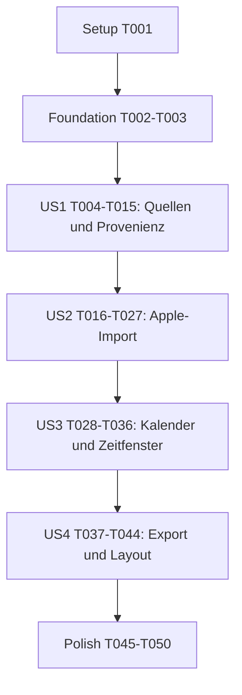

# Tasks: Herzfrequenz- und Importkorrekturen

**Input**: Designdokumente aus `specs/081-heart-rate-import-fixes/`.
**Prerequisites**: [spec.md](spec.md), [plan.md](plan.md), [research.md](research.md), [data-model.md](data-model.md), [Importvertrag](contracts/heart-rate-import.md), [Apple-Laufzeitvertrag](contracts/apple-health-runtime.md), [Perioden-/Exportvertrag](contracts/period-view-export.md), [quickstart.md](quickstart.md).
**Status**: Teilumsetzung. T001-T024, T026-T045 und T047-T049 ausgefuehrt und geprueft; T025, T050 bleiben offen. T046 wurde mit der finalen Root-Regression geprueft. Nachweise stehen in Abschnitt 7 von `quickstart.md`.
**Genehmigte Ablaufabweichung**: Der Nutzer stimmte zu, die Umsetzung nach drei bestandenen lokalen HTTP-Browserfaellen trotz der noch fehlenden drei HTTPS-Faelle fortzusetzen. Dies hebt weder T025/SC-005 noch die Freigabeschwelle auf. Keine Bereitstellung oder Zertifikatsumgehung ohne zusaetzliche Freigabe.
**Tests**: Testaufgaben konkretisieren die ausdruecklichen Quellen-, Browser- und Exportnachweise der Spezifikation und die verpflichtenden engen Tests aus Constitution III. Vor betroffener Produktionsaenderung erwarteten Ausgangsfehler bestaetigen, danach denselben Schnitt gruen pruefen. `--passWithNoTests=false` verhindert falsch gruene fehlende Tests.
**Organization**: Vier Story-Phasen in Spezifikationsreihenfolge, mit getrennten Abnahmeszenarien. Gemeinsame Voraussetzungen davor, uebergreifende Freigabe danach. Die vorhandene Feature-080-Implementierung ist die Basis, kein Neuaufbau.

## Format: `[ID] [P?] [Story] Description`

- Alle Aufgaben haben fortlaufende IDs, offene Checkboxen und konkrete repositoryrelative Dateipfade.
- `[US1]` bis `[US4]` stehen ausschliesslich bei Aufgaben der jeweiligen Storyphase, einschliesslich ihrer Tests. Setup, Foundation und Polish haben keine Storylabels.
- `[P]` gilt nur innerhalb der benannten Wellen W1-W4 nach deren Voraussetzungen. Keine parallelen Patches an derselben Datei und keine stillschweigende Parallelisierung ganzer Stories.
- Nach jeder Produktionsaenderung zuerst den angegebenen engsten Teiltest ausfuehren. Ein bewusst vorab geschriebener Vertragstest fuer eine spaetere Schnittstufe wird erst an seinem angegebenen Gate gruen verlangt; keine pauschalen Skip-/PassWithNoTests-Ausnahmen.
- Keine Commits, Branchwechsel, Deployments, Zertifikatsinstallationen oder Aenderungen am API-Service ohne gesonderten Auftrag. Git bleibt auf dem bestehenden Branch; Feature-Kontext ist `081-heart-rate-import-fixes`.

## Path Conventions

Produktiv: vorhandene Module unter `src/`, Markup in `index.html`, vorhandener CLI-Reducer unter `scripts/`. Tests: bestehende Root-Jest-Suiten unter `__tests__/`, vorhandene synthetische Helfer unter `__tests__/fixtures/`. Keine neue Produktionsbibliothek, kein Parserupgrade und keine neue dauerhafte Code-/Testdatei vorgesehen. Browserhilfen und synthetische Downloadartefakte duerfen temporaer ausserhalb des Repositories liegen.

## Phase 1: Setup (Shared Infrastructure)

**Purpose**: Aktuellen Stand, Abhaengigkeiten und verfuegbare Abnahmeumgebungen erfassen, ohne bestehende Arbeit zu ueberschreiben.

- [X] T001 Den aktuellen Arbeitsstand und die Vorgaben anhand von `AGENTS.md`, `.specify/memory/constitution.md`, `package.json`, `jest.config.js` und `specs/081-heart-rate-import-fixes/plan.md` pruefen. Die vorhandenen fokussierten Suiten aus `specs/081-heart-rate-import-fixes/quickstart.md` vor Codeaenderungen ausfuehren; Baseline, Fremdfehler, Parserfassung und Verfuegbarkeit von Chrome/Edge/VS Code sowie lokaler HTTP-/vertrauenswuerdiger HTTPS-Abnahme desselben Kandidaten dort protokollieren. Fehlende Umgebungen nicht als bestanden behandeln und keine Bereitstellung oder Zertifikate ohne Freigabe einrichten.

## Phase 2: Foundational (Blocking Prerequisites)

**Purpose**: Wiederverwendbare synthetische Belege fuer Datenintegritaet und unabhaengige Kalendererwartungen schaffen. T001-T003 blockieren alle Storyphasen.

- [X] T002 In `__tests__/zip-importer.test.js` die vorhandenen synthetischen FIT-Hilfen um gueltige Laengen/CRC sowie kontrolliert defekte CRC-/Trunkierungsvarianten erweitern. Mit exakt `fit-file-parser@1.10.0` dessen tatsaechliche synchrone Callback-/Rueckkehrbehandlung und die Unterschiede toleranter/strikter Ausgabe pruefen; eine Rueckkehr ohne Callback darf keinen haengenden Test erzeugen. Noch keinen positiven HR-Vollstaendigkeitsbeleg erfinden. Decoderprobe sofort ausfuehren und die beobachteten Grenzen in `specs/081-heart-rate-import-fixes/quickstart.md` festhalten.
- [X] T003 In `__tests__/heart-rate-utils.test.js` die vorhandenen synthetischen Referenzhilfen um mindestens zwoelf unveraenderliche Trainings aus Run/Bike/Swim ueber mehrere Wochen, drei Monate und zwei Kalenderjahre erweitern. Direkte/einseitige Extrema, gleicher Wert aus mehreren Trainings, Wochen-/Jahreswechsel, DST, Randperioden, Tage ohne Extrema und stabile Ursprungsordinale vorsehen. Erwartete Trainings- und Periodenwerte unabhaengig von der kuenftigen Aggregationsfunktion festlegen und die Oracle-Beschreibung in `specs/081-heart-rate-import-fixes/quickstart.md` dokumentieren; bestehende Timeline-Tests bleiben gruen.

**Checkpoint**: Baseline und verfuegbare Umgebungen sind bekannt; Parserverhalten und synthetischer Kalender-Oracle sind belastbar. Keine neue Parserengine oder Testinfrastruktur angelegt.

## Phase 3: User Story 1 - Vorhandene Herzfrequenzen verlaesslich nutzen (Priority: P1)

**Goal**: Beobachteten Strava-Alias erkennen, direkte Werte erhalten, fehlende TrainingPeaks-Felder nur aus qualifizierten Originalrecordreihen ergaenzen und Herkunft/Abwesenheit nachvollziehbar machen.
**Independent Test**: Synthetische Strava-CSV ueber echte Browsernormalisierung, CommonJS und beide Reducer pruefen; echte FIT-Bytes mit fehlendem Minimum, gueltiger Recordreihe und gezielten Integritaets-/Eigentuemerfehlern importieren. Ergebnis, Provenienz und bisherige IDs/Zaehlungen/Werte stimmen, ohne dass Kalenderaggregation oder Apple-Handshake benoetigt werden.

### Vertragstests vor Implementierung

- [X] T004 [P] [US1] In `__tests__/processing.test.js`, `__tests__/dashboard-import.test.js` und `__tests__/relevant-export-extractor.test.js` den exakten Alias `Max. Herzfrequenz` neben bisherigen DE/EN-Headern pruefen: leer/belegt, identisch, Konflikt, nichtleere ungueltige Kandidaten, unbekannte Einheit und Durchschnitt-only. Echte Browser-`processData` statt Stub verwenden, CommonJS-Paritaet und optionalen CLI-Spaltenerhalt absichern. Alias-/Zahlen-Teiltests werden nach T007, Provenienz-Teiltests nach T011 gruen verlangt.
- [X] T005 [P] [US1] In `__tests__/heart-rate-utils.test.js` reine Vertrage fuer `inspectCsvHeartRateExtrema`, `deriveTimedHeartRateExtrema` und `resolveHeartRateExtrema` testen: feldweise Status/Provenienz, positive qualifizierte Records, direkter Vorrang, nur fehlende Felder ergaenzen, Widerspruch gegen Summary verwerfen, FIT-255/ungueltige Werte, keine Mindestabdeckungsheuristik, Altaktivitaeten ohne Provenienz und Nichtmutation. Diese Utilitytests muessen nach T007 vollstaendig gruen sein.
- [X] T006 [P] [US1] In `__tests__/zip-importer.test.js` auf T002 aufbauend echte FIT-End-to-End-Faelle fuer Integritaet/Lesebeleg, originale Sessiongrenzen, HR-Eigentuemer und numerisches Ergebnis vorbereiten. Pausenfall mit Minimum nach Timerende, aber vor Originalende, Ueberlappungen, gemeinsame inklusive Grenzrecords, uebersprungene Sportarten, ungueltige Grenzen/Zeitstempel, Fremdrecords, Limits und fehlenden Callback abdecken. Original-CSV und ZIP-Reducer fuer den Alias ebenfalls pruefen. Gates trennen: Lesebeleg nach T008, Zuordnung nach T009, Ergebnis/Provenienz nach T010.

### Implementierung und Integration

- [X] T007 [US1] In `src/heart-rate-utils.js` den Alias sowie die drei reinen Funktionen aus T005 implementieren, bestehende `getCsvHeartRateKind`-/`parseCsvHeartRateExtrema`-/Timeline-Signaturen und Browser-/CommonJS-Bruecke erhalten. `HeartRateFieldEvidence` wortgleich beachten: `value` = "Endliche positive bpm-Zahl oder `null`; niemals Durchschnittsersatz.", `status` = "`valid`, `missing`, `invalid`, `conflict` oder `unqualified`.", `source` = "`summary`, `records` oder `null`.", `reason` = "Fester Code aus dem Importvertrag oder `null`, keine persoenlichen Inhalte.", `sampleCount` = "Nichtnegative ganze Zahl bei Records, sonst `null`; keine Mindestmenge als medizinische Heuristik.", `readComplete` = "Bei Records `true` nur mit positivem Lesebeleg; bei direkter Zusammenfassung `null`." Nur `missing` ergaenzen; direkte umgekehrte Paare nicht reparieren und gegen Summary widersprechende Ergaenzung verwerfen. T005 und Alias-/Zahlen-Teiltests aus T004 sofort gruen pruefen.
- [X] T008 [US1] In `src/zip-importer.js` `readTrainingPeaksFitWithHeartRateEvidence(entry, dependencies)` im TP-eigenen Kandidatenpfad mit Rueckgabe `{ fitData, heartRateReadEvidence }` ergaenzen. Dieselben bereits entpackten Bytes mit festgelegtem Parser strikt qualifizieren, ohne tolerante Altdaten zu ersetzen oder erneut zu extrahieren. Lesebelegregeln wortgleich: `readStatus` = "`complete`, `incomplete` oder `unknown`; nur `complete` erlaubt Ableitung.", Pruefbooleans = "Alle `true` erforderlich. Ein fehlender strikter Callback ist kein Abschluss.", `resourceLimited` = "Muss `false` sein; Limits, Downsampling oder Trunkierung sperren die Ableitung.", `unit` = "Nachgewiesenes `bpm` des FIT-Herzfrequenzfelds, sonst `null`.", `reason` = "Begrenzter sicherer Grundcode, keine Dateinamen oder Parser-Rohmeldungen." Fehlenden Callback ohne Haenger als unbekannt/unvollstaendig behandeln; Laenge, Integritaet und vollstaendige Recorduebernahme belegen. T006-Lesebelegfaelle und vorhandene Parser-/Power-/GPS-Tests sofort ausfuehren.
- [X] T009 [US1] In `src/zip-importer.js` `qualifyFitHeartRateSessions(rawSessions, records, readEvidence)` auf alle Originalsessionindizes derselben Datei anwenden, einschliesslich uebersprungener Sportarten. Nur originale gueltige `start_time`/`timestamp` mit `start < end`, inklusive Grenzen und unverkuerzte Records zulassen; keine Timer-/Folgestart-/GPX-/Naehegrenzen. Fehlende Grenzen oder unzuordenbare HR-Zeitstempel sperren den Aufzeichnungsfallback, Ueberlappungen und mehrdeutige Grenzrecords die betroffenen Sessions. Nur numerische ganzzahlige `heart_rate`-Werte `1..254` bpm, nie 255, verwenden. T006-Zuordnungsfaelle sofort ausfuehren und bestehende Segmentierung unangetastet lassen.
- [X] T010 [US1] In `src/zip-importer.js` die qualifizierte Ableitung vor Trackvereinfachung/Leistungsnormalisierung in `importTrainingPeaksZips` integrieren. Fehlende direkte Felder mit der reinen Aufloesung aus T007 ergaenzen; valide Summaryfelder, First-wins-Duplikatentscheidungen, bisherige Identitaetsschluessel, Durchschnitt, Power und GPS unveraendert lassen. Optionale `heartRateProvenance.minimum`/`.maximum` und lokale `heartRateCoverage` erfassen, Rohlisten danach nicht dauerhaft kopieren. T006-Ergebnis-/Provenienzfaelle einschliesslich echter Decoderpfade und vorhandene TP-Regressionen sofort gruen pruefen.
- [X] T011 [US1] In `src/dashboard-utils.js` und `src/dashboard-import.js` CSV-Evidenz/Provenienz kompatibel uebernehmen; im bestehenden direkten Apple-Zusammenfassungspfad von `src/apple-health-utils.js` nur belegte direkte Herkunft zusaetzlich kennzeichnen. Durchschnittswerte und rohe Fingerprintdaten nicht aendern, keinen neuen Strava-/Apple-Recordfallback einfuehren. Lokale `heartRateCoverage` nach vorhandenen Importdiagnosekonventionen je Extremart und getrennt vom Durchschnitt erfassen; keine Rohwerte/Dateinamen/Quell-IDs. Provenienz-/Paritaetsteile aus T004 sowie vorhandene Apple-Importtests sofort ausfuehren.
- [X] T012 [US1] In `src/dashboard-import.js` und `src/dashboard-heart-rate.js` bestehende Import-/Datenhinweise und Wertdetails um direkte beziehungsweise "aus aufgezeichneten Messungen" stammende Werte und feste Abwesenheitsgruende ergaenzen. Vorhandener Durchschnitt wird nicht als fehlende Herzfrequenz bezeichnet; keine neue Diagnoseansicht, medizinische Vollstaendigkeitsgarantie oder Telemetrie. Entsprechende Erwartungen in `__tests__/dashboard-import.test.js` und `__tests__/dashboard-heart-rate.test.js` zuerst ergaenzen und danach unmittelbar ausfuehren; Hinweise muessen auch ohne verfuegbaren Min-/Max-Tab erreichbar sein.
- [X] T013 [US1] In `__tests__/visualization-availability.test.js` importweite Eignung fuer einzelne direkte oder qualifiziert beobachtete Extremfelder, Durchschnitt-only, Konflikt und unqualifizierte Reihe pruefen. Andere durch Durchschnitt oder sonstige Felder unterstuetzte Ansichten bleiben gleich; numerische Altaktivitaeten ohne Provenienz bleiben kompatibel. `src/visualization-availability.js` nur bei einem konkret nachgewiesenen Integrationsbedarf ergaenzen, Quellenlabel-/Paarpflicht bleibt ausgeschlossen; fokussierte Availability-Tests sofort ausfuehren.
- [X] T014 [US1] Die belegten lokalen Referenzquellen auf korrigierten Strava-Alias, doppelte Spalten, TP-Summary-/Recordabdeckung und fachlich qualifizierte Fallbacks vergleichen; nur synthetische Beispiele versionieren. Ergebnisse als aggregierte Abdeckungs-/Regressionsnachweise in `specs/081-heart-rate-import-fixes/quickstart.md` dokumentieren, keine Dateinamen, Einzelwerte oder Rohdateien uebernehmen. Fehlende Referenzen oder nicht positiv qualifizierte Records nicht als erfolgreiche Quellenkorrektur ausgeben.
- [X] T015 [US1] Alle US1-Fokusbefehle aus `specs/081-heart-rate-import-fixes/quickstart.md` ausfuehren und dort Resultate sowie verbleibende Einschraenkungen protokollieren. Alle bisher roten Stufen aus T004-T006 muessen jetzt gruen sein; Altwerte/IDs/Zaehler/Reducer und echte FIT-Laengen-/CRC-/Callbackbelege zusammen pruefen. Ohne sicheren Vollstaendigkeitsnachweis bleibt Ableitung gesperrt und die positive Fallbackabnahme offen, nicht durch Mocks ersetzt.

**Checkpoint / MVP**: US1 liefert das kleinste eigenstaendig nutzbare Korrekturinkrement: vorhandene Strava-Maxima, konservative TP-Minima mit Herkunft und ehrliche Abwesenheit. SC-001/SC-002 sind nur bei den tatsaechlichen Quellen-/Parsernachweisen bestanden. Apple- und Kalenderkorrekturen sind dadurch noch nicht erledigt.

## Phase 4: User Story 2 - Apple Health in unterstuetzten Browsern importieren (Priority: P1)

**Goal**: Echte Browser-/Bereitstellungsfaehigkeiten korrekt pruefen, sichere Ursachen melden und Initialisierung/Retry/Commit ohne Datenverlust steuern.
**Independent Test**: Derselbe synthetische Originalexport durch echten Dateiauswahl-/Worker-/Library-/SHA-256-Pfad in Chrome, Edge und VS Code ueber lokales HTTP sowie HTTPS. Negative Ursachen getrennt ausloesen; alter Dashboardstand bleibt erhalten und Retry funktioniert. Kein Kalender-/Periodenexport fuer diesen Nachweis erforderlich.

### Vertragstests vor Implementierung

- [X] T016 [P] [US2] In `__tests__/apple-health-import.test.js` den sicheren Diagnose-/Fehlervertrag testen: Deployment/unsicherer Kontext, fehlende benoetigte Funktionen im Arbeitskontext, Libraryladung versus falscher Export, Worker-/Hash-/Inputfehler, erhaltener XML-/Archiv-/Limit-/Abbruchschutz und keine persoenlichen Inhalte. SHA-256 und alte Identitaeten duerfen keinen Ersatz erhalten. Helper-/Diagnoseteile nach T018, Importer-/Hashpfade nach T019 gruen verlangen.
- [X] T017 [P] [US2] In `__tests__/dashboard-import.test.js` Fenstercontroller und reale Workerdatei in bestehenden VM-Helfern fuer `init -> ready -> start`, Generation/version, Constructor-/Clone-/`messageerror`-/Runtimefehler, 30-Sekunden-Ready-Timeout, Abbruch, spaete Ergebnisse, genau einmaligen Cleanup und bewussten Retry absichern. Keine Datei vor Ready senden. Worker-seitige Teiltests nach T020, Fenstercontroller-/Committeile nach T021-T022 gruen verlangen; Fake-Worker bleiben reine Vertragstests, kein Browserkompatibilitaetsnachweis.

### Fehlerdiagnose und Laufzeit

- [X] T018 [US2] In `src/apple-health-utils.js` kompatible sichere Fehler-/Diagnosehelfer und Capabilitypruefungen nach `specs/081-heart-rate-import-fixes/contracts/apple-health-runtime.md` bereitstellen. Modellregeln wortgleich: `v: 1`, "festen `code`, `phase`, `component`, `generation`, `environment`, `missingCapabilities[]` und `action`"; Environment enthaelt "ausschliesslich `scheme`, `hostClass`, `secureContext` und `realm`; Werte sind Enums/Booleans, keine freien Browser-/URL-/Dateitexte." `generation` bleibt nichtnegativ; alle Codes/Enums exakt aus dem Vertrag, fehlende Funktionen als eindeutiges begrenztes Allowlist-Array. Keine Rohmeldungen/Stacks/URLs/Dateinamen oder automatischen Uploads, bestehende `failure`-Signatur ohne global riskanten Defaultwechsel erhalten. T016-Helper-/Validierungsteile sofort ausfuehren.
- [X] T019 [US2] In `src/apple-health-importer.js` und `src/apple-health-utils.js` die spezifischen Fehler am Entstehungsort aufloesen: fehlendes SAX/ZIP nicht als Browserveraltung, fehlende Text-/Stream-/Cryptofunktion nicht als Archivfehler, fehlgeschlagenes SHA-256 als `HASH_FAILED`, unerwartete Typ-/Programmierfehler als `INTERNAL_ERROR`. Echte CRC-/XML-/Encoding-/Limit-Ablehnungen behalten ihre Inputcodes. Sichere Identitaeten, bestehende Streaming-/Deduplizierungsregeln und direkte HeartRate-Provenienz nicht veraendern; T016 und bestehende Import-/Hashregressionen unmittelbar gruen pruefen.
- [X] T020 [US2] In `src/apple-health-worker.js` versioniertes Init/Ready/Start implementieren: Abbruch-/Initialisierung im gesicherten Fehlerpfad, Libraries und alle tatsaechlich verwendeten Exports/Funktionen vor Ready pruefen, konstante lokale SHA-256-Probe ohne Nutzerdaten. Erst Start verarbeitet die Datei; Progress-/Ergebnis-/Transfersemantik bleibt erhalten. Sichere Fehler statt pauschaler Runtime-/Archivbehauptungen senden und Workerabschluss genau einmal durchfuehren. Worker-seitige T017-Teiltests sowie Script-/Syntaxpruefungen sofort ausfuehren.
- [X] T021 [US2] In `src/dashboard-import.js` `importAppleHealthInWorker` an Preflight und versionierten Handshake anschliessen: HTTPS beziehungsweise sicheres HTTP auf localhost/IPv4-/IPv6-Loopback, konkrete Ablehnung von `file:`/unsicherem Remote-HTTP, tatsaechliche Faehigkeiten statt Browsername. Konstruktor und jeden `postMessage` abfangen; `messageerror`, Runtimefehler, ungueltige Nachrichten und fremde Generationen sicher behandeln. 30-Sekunden-Watchdog nur bis Ready, danach kein neues Grossimportzeitlimit; Worker/Heartbeat/Watchdog/Handler idempotent beenden. T017-Fenstercontrollerfaelle unmittelbar ausfuehren.
- [X] T022 [US2] In `src/dashboard-import.js` spezifische sichere Diagnose und passende Abhilfe in den bestehenden Fehler-/Retry-UI-Pfad integrieren; keine neue Diagnoseansicht oder rohen Exceptions. Erfolg erst nach gueltigem vorbereitetem Ergebnis durch vorhandenen atomaren Commit, Failure/Cancel ohne Daten-/Filter-/Vorschauverlust. Neuer Versuch erhaelt neuen Worker und neue Generation; keine automatische Wiederholung grosser Dateien. T017-Commit-/Retryteile und vorhandene Importoperationstests unmittelbar gruen pruefen.
- [X] T023 [US2] In `__tests__/apple-health-import.test.js` und `__tests__/dashboard-import.test.js` die integrierten Negativfaelle vervollstaendigen: fehlende Utilities, Library-/Export-/Worker-/Transport-/Hashfehler, kein Ready, Abbruch waehrend Initialisierung/Verarbeitung und spaetes altes Ergebnis. Festen Code, Abhilfe, fehlenden Datenabfluss, genau einmaligen Cleanup, alten Dashboardstand und erfolgreichen anschliessenden Retry jeweils pruefen; vorhandene IDs und Archiv-/XML-/Ressourcenvertraege direkt vergleichen.
- [X] T024 [US2] Die vollstaendigen Apple-/Dashboard-Importsuiten aus `specs/081-heart-rate-import-fixes/quickstart.md` ausfuehren und Ergebnisse dort protokollieren. Keine Stufe aus T016/T017 darf offen rot bleiben. Zwischenstand als automatisiert geprueft, nicht als Nachweis aller Browser melden; der historische Nutzerfehler wird nicht ohne reproduzierten konkreten Kontext als behoben erklaert.
- [ ] T025 [US2] Die sechs positiven Browser-/Bereitstellungsfaelle aus `specs/081-heart-rate-import-fixes/quickstart.md` auf demselben Kandidatenstand durchfuehren: Chrome, Edge und integrierter VS-Code-Browser jeweils lokales HTTP und vertrauenswuerdiges HTTPS. Echte Dateiauswahl, Original-ZIP-Struktur, echter Worker/CDN/SHA-256-Pfad, Fortschritt, erwartete Trainings, stabile Wiederimport-IDs und Retry nachweisen. Versionen/Kontextklassen/Ergebnisse ohne personenbezogene Daten dort dokumentieren. Diese Aufgabe erst nach allen sechs Erfolgen abschliessen; fehlende Umgebung offen lassen und erforderliche Freigabe fuer Bereitstellung gesondert einholen, nicht deployen oder Zertifikate umgehen.
- [X] T026 [US2] Reale negative Umgebungsfaelle nach `specs/081-heart-rate-import-fixes/quickstart.md` pruefen: lokale Datei, unsicheres Remote-HTTP, gezielt fehlende notwendige Funktion, blockierte Library, falscher Export, Workerfehler und defektes Archiv. Tatsaechlichen Grund, konkrete Abhilfe, unveraenderten Altstand und erfolgreichen bewussten Retry dokumentieren. Nutzerumgebung nur mit tatsaechlicher Adresse/Kontextklasse als reproduziert einstufen; keine persoenliche URL oder freie Rohdiagnose versionieren und keinen Browsername als Ursache raten.
- [X] T027 [US2] Bestehende grosse synthetische Apple-Export-, Streaming-, Fortschritts-, Abbruch- und Limitfaelle in `__tests__/apple-health-import.test.js` und `__tests__/dashboard-import.test.js` gegen die Baseline erneut ausfuehren. In `specs/081-heart-rate-import-fixes/quickstart.md` belegen, dass die Ready-Frist nur Initialisierung betrifft und kein neues Zeitlimit/unsicherer Hash-/Main-Thread-Fallback oder unkontrolliertes Voll-Laden eingefuehrt wurde. SC-005 bleibt offen, solange T025 oder erforderliche negative Nachweise fehlen.

**Checkpoint**: Sichere Diagnose und Lifecycle sind automatisiert pruefbar; Browserkompatibilitaet ist erst durch T025/T026 belegt. Ein einzelner Edge-/Loopback-Erfolg ersetzt keinen der anderen Faelle. Fehlende externe Voraussetzungen werden als Blocker behandelt, nicht durch pauschale Abnahmeausnahmen verdeckt.

## Phase 5: User Story 3 - Zeitliche Entwicklung sinnvoll gruppieren und eingrenzen (Priority: P1)

**Goal**: Echte Kalenderextrema und angeforderte sichtbare Zeitfenster mit unveraenderter gemeinsamer Filtersemantik bereitstellen.
**Independent Test**: Die synthetische Kalenderreferenz durch die reale Renderer-/Filterkette pruefen. Periodenzahl, feldweise Werte, Gleichstaende/Ursprungstrainings, Randperioden und Achsengrenzen stimmen. Ein laengeres begrenztes Fenster zeigt andere Grenzen auch bei gleicher Trainingsmenge. Dafuer ist kein Apple-Import und kein Bilddownload erforderlich.

### Vertragstests vor Implementierung

- [X] T028 [P] [US3] In `__tests__/heart-rate-utils.test.js` mit dem Oracle aus T003 den neuen `buildHeartRatePeriodModel` testen: Daily/Weekly/Monthly/Yearly, min(Minima)/max(Maxima), alle Contributors und Extremgleichstaende, einseitige/ungueltige Angaben, ISO-/Kalenderjahreswechsel, DST, Teilperioden, stabile Schluessel und Nichtmutation. Bisheriger `buildHeartRateTimeline` bleibt kompatibel. Nach T030 muessen diese reinen Periodentests gruen sein.
- [X] T029 [P] [US3] In `__tests__/dashboard-heart-rate.test.js` lokale `getHeartRateViewRange`, ungeklemmte begrenzte Fenster, All-Historie einschliesslich Trainings ohne Extrema, Einzelpunktpadding, Filter-vor-Aggregation, Controls, Contributor-/Quellenanzeige und Filter-Leerzustand testen. Keine Aenderung gemeinsamer Core-Grenzen. Gates trennen: Bereich nach T031, Modell/Controls nach T032, alle Trainingsdetails nach T033. Bestehende Regressionen fuer die beabsichtigte Kalenderdarstellung korrekt weiterfuehren; neue Snapshot-/Datenprovider-Assertions einschliesslich des kopierten RenderContext werden ausschliesslich in T038 angelegt, nicht in dieser Aufgabe.

### Kalender, Achse und Details

- [X] T030 [US3] In `src/heart-rate-utils.js` den reinen `buildHeartRatePeriodModel(filteredActivities, { aggregation, getActivityKey, rangeStart, rangeEnd })` ergaenzen. Modellregeln wortgleich: `aggregation` = "`daily`, `weekly`, `monthly` oder `yearly`.", `periods` = "Chronologisch sortierte belegte Perioden mit mindestens einer gueltigen Extremart; keine erfundenen Leerperiodenwerte.", Reihen = "Getrennte Punktarrays, hoechstens ein Punkt je Extremart und Periode.", `activityCount` = "Zahl verschiedener qualifizierter Trainings, nicht Punkt-/Periodenzahl.", `periodCount` = "Zahl belegter Perioden." Tag-/Montag-/Monats-/Jahresschluessel, lokale Kalenderfortschaltung, alle Contributors und gleichwertige `sources` sowie getrennte Extremarten verwenden. Nur bereits gefilterte Trainings auswerten, keine Mittelwerte/Nullen/Jitter/Verbindungslinien; T028 und bestehende Timeline-/Validierungstests sofort gruen pruefen.
- [X] T031 [US3] In `src/dashboard-heart-rate.js` `getHeartRateViewRange(filteredActivities)` lokal implementieren: vorhandene `getCurrentTimeframeOption`, `shiftDateByUnit` und Gesamtimport-Endtermin wiederverwenden, begrenzten Anfang fuer Anzeige nicht an Historie klemmen. All nutzt alle ausgewaehlten gueltig datierten unterstuetzten Trainings, auch ohne Extrema. `HeartRateViewRange` enthaelt `{ rangeStart, rangeEnd, displayStart, displayEnd, timeframeKey, aggregation }` in Epoch-Millisekunden; nur degeneriertes All darf optisches Padding bei getrennt erhaltenen echten Grenzen nutzen. Punktposition mittig in der Schnittmenge mit `endExclusiveMs - 1`; T029-Bereichsfaelle sofort ausfuehren, `src/dashboard-core.js` semantisch unveraendert lassen.
- [X] T032 [US3] In `src/dashboard-heart-rate.js` den bestehenden globalen Selektor vor das neue Periodenmodell schalten, gewaehlte Gruppierung sichtbar korrekt benennen und die X-Achse auf den angeforderten Bereich setzen. Beim Rendern Sport, Aggregation, Timeframe, ViewRange, Datasetrevision und lokale Modellrevision kopieren; keine neue Filterengine oder Mehrfachauswahl. Controls/Keyboardadapter sowie Tab-/Importwechsel konsistent aktualisieren und leere Stande ohne alte Chart-/Exportdaten behandeln. T029-Modell-/Controlfaelle sowie bestehende Core-Paritaetstests sofort ausfuehren.
- [X] T033 [US3] In `src/dashboard-heart-rate.js` Periodendetails und vorhandene Trefferauswahl auf `contributors[]` beziehungsweise alle `minimum.sources[]`/`maximum.sources[]` erweitern. Bestehende datasetlokale Schluessel, kopierte Datums-/Startzeit-/Sportangaben und direkte/beobachtete Herkunft erhalten; keine Aktivitaetsreferenzen oder Rohsamples. Ein Aggregat nicht als zufaelliges Einzeltraining anzeigen, Gleichstaende per Touch/Maus/Tastatur einzeln erreichbar halten und Namen als Text behandeln. Die T029-Detailfaelle in `__tests__/dashboard-heart-rate.test.js` unmittelbar gruen pruefen.
- [X] T034 [US3] In `__tests__/dashboard-core.test.js`, `__tests__/visualization-availability.test.js`, `__tests__/tab-navigation.test.js` und `__tests__/index-script-syntax.test.js` bestaetigen, dass gemeinsame inklusive Grenzen/Gesamtimportanker, Sport-Einzelauswahl, bestehende IDs/Reihenfolge/Script-Bruecken und andere Ansichten unveraendert bleiben. Filter-Leerzustand nicht mit importweiter Datenabwesenheit verwechseln und alte Inhalte nach Ersatzimport ausschliessen; die betroffenen bestehenden Suiten sofort ausfuehren.
- [X] T035 [US3] Die vorhandenen Sport-/Zeitoptionen je Kalenderaggregation nach `specs/081-heart-rate-import-fixes/quickstart.md` im echten Browser manuell und per Keyboardadapter pruefen. Zwei unterschiedliche begrenzte Fenster mit identischer Trainingsmenge, ein Fenster mit entfernten Trainings, teilweise eingeschlossene Perioden, All ohne/mit Extrema und Leerzustand gezielt nachweisen. Angeforderte Achsengrenzen, sichtbare Controls, Periodenwerte und Herkunft stimmen; Ergebnisse dort dokumentieren, keine veralteten Cached-Scripts als Nachweis verwenden.
- [X] T036 [US3] Alle US3-Fokusbefehle aus `specs/081-heart-rate-import-fixes/quickstart.md` ausfuehren und dort exakte Oracle-/Kalender-/Range-/Regressionsnachweise festhalten. Quellenwerte/Altidentitaeten bleiben gleich; belegte Perioden liefern hoechstens zwei Punkte. Die Periodenansicht ist separat pruefbar, aber das Gesamtfeature bleibt bis zur Anpassung und Abnahme seines vorhandenen Exports in US4 unvollstaendig.

**Checkpoint**: SC-003/SC-004 sind mit exakten Kalender- und angeforderten Rangebelegen pruefbar. Vorhandene Navigation und andere Filter wurden nicht neu interpretiert; der neue Exportsnapshot wird noch nicht als fertig ausgegeben.

## Phase 6: User Story 4 - Eine konsistente Exportaktion verwenden (Priority: P2)

**Goal**: Etabliertes Exportbuttonlayout und exakten lokalen Perioden-/Zeitfenstersnapshot in allen vorhandenen PNG-Formaten bereitstellen.
**Independent Test**: HeartRate mit benachbarter Kopfzeile bei vier Breiten vergleichen. Weekly/Monthly/Yearly je als square/portrait/story vorbereiten und tatsaechlich speichern; Periodenwerte und angeforderter Stand stimmen mit Vorschau/PNG ueberein. Livewechsel und veroeffentlichter Snapshot folgen den bereits festgelegten Regeln.

### Vertragstests vor Implementierung

- [X] T037 [P] [US4] In `__tests__/index-script-syntax.test.js` bestehenden Button-/Headervertrag fuer `heartRateShareBtn` pruefen: Strava-Logo, `Export for Insta / Strava`, Instagram-Logo, bestehende `viz-export-button`-Klasse, bekannte IDs/Handler, genau eine Aktion und gemeinsame responsive Kopf-/Bedienleiste. Bestehende Tab- und Scriptreihenfolge erhalten; Layoutnachweis bleibt zusaetzlich T043. Diese Markuptests muessen nach T041 gruen sein.
- [X] T038 [P] [US4] In `__tests__/dashboard-heart-rate.test.js`, `__tests__/dashboard-export-download.test.js` und `__tests__/export-utils.test.js` saemtliche neuen Snapshot-/Datenprovider-Tests anlegen: kopierter RenderContext ohne erneutes Lesen von Livefiltern, Nichtmutation, aggregierte Punktreihen, Periodenlabels, Gruppierung, angeforderte Grenzen versus `viewBounds`, beide Reihenglyphen und unveraenderliche Snapshots fuer alle drei Formate. Gruppenfelder duerfen nicht in der Allowlist verloren gehen. Bestehende Familien sowie pending/published/Filter-Leerzustand/Ersatzimport/Objekt-URL-Vertraege behalten. Gates trennen: Renderer-Datenprovider-/Snapshot-/Nichtmutationsteile nach T039, komplette Snapshot-/Kontextintegration nach T040; gemeinsame Regression in T042.

### Layout und strukturierter Export

- [X] T039 [US4] In `src/dashboard-heart-rate.js` `getExportData()` ausschliesslich aus dem kopierten RenderContext/Periodenmodell erzeugen, nicht aus neu gelesenen Livefiltern. `aggregation`, Periodenlabels, getrennte numerische Reihen, `activityCount`/`periodCount`, angeforderte `periodStart`/`periodEnd` und sichtbare `viewBounds` erhalten. Snapshotregel wortgleich: "Keine rohen Recordreihen, Trainingsobjekte, persoenlichen Namen oder live lesenden Zustandsfunktionen in der Bildfamilie." Keine Pins, medizinischen Schaetzungen oder Rohsamples. Die Renderer-Datenprovider-/Snapshot-/Nichtmutationsteile aus T038 in `__tests__/dashboard-heart-rate.test.js` sofort gruen pruefen; die Exportadapter-/Kontextintegration aus T038 wird erst nach T040 gruen verlangt.
- [X] T040 [US4] In `src/dashboard-export.js` den bestehenden HeartRate-Snapshot-/Praesentationskontext um sichtbare Gruppierung und angeforderte Grenzen vervollstaendigen; `periodCount` bei Bedarf gezielt in der Allowlist aufnehmen, keine beliebige Datendurchleitung. Vorhandenen strukturierten Scatter-/Chartressourcenpfad, capture IDs und drei PNG-Formate nutzen. Laufende veraltete Aufnahmen verwerfen, veroeffentlichte Stande bei Formatwechsel/Download erhalten, leere Filter/Ersatzimport schliessen alte Ziele. Ressourcen-/Objekt-URL-Ownership und andere Familien unveraendert lassen; T038 sowie die bestehenden Exporttests unmittelbar ausfuehren.
- [X] T041 [US4] In `index.html` die HeartRate-Kopfzeile nach dem etablierten Nachbarmuster angleichen: Strava-Logo -> `Export for Insta / Strava` -> Instagram-Logo, bestehende Klassen, Hoehe/Abstaende/Disabled-Zustand und genau ein `heartRateShareBtn` mit bisherigem Handler. Titel, kompakte Filter und Export in dieselbe responsive Bedienleiste aufnehmen; alle bestehenden Tab-/Filter-/Capture-IDs und relative Reihenfolge behalten. T037 sowie vorhandene Markup-/Navigationspruefungen sofort gruen pruefen.
- [X] T042 [US4] Alle US4-Fokusbefehle aus `specs/081-heart-rate-import-fixes/quickstart.md` ausfuehren und dort den gemeinsamen Snapshot-/Layoutvertrag protokollieren. Jetzt muessen alle Stufen aus T037/T038 gruen sein, einschliesslich genauer Bildabmessungen, Revisions-/Published-/Leerzustandsregeln und unveraenderter Bestandsfamilien. Ein bloss vorhandener Button oder Ziel-ID ist kein funktionierender Exportnachweis.
- [X] T043 [US4] Die visuelle Layout-/Interaktionsabnahme aus `specs/081-heart-rate-import-fixes/quickstart.md` bei stabilen 320/375/768/1440 CSS-Pixeln durchfuehren: Nachbarkopfzeile, Text/Symbolfolge, Position/Abstaende, Umbruch und genau eine erreichbare Exportaktion, ohne horizontalen Ueberlauf oder Diagrammueberlagerung. Tatsaechliche Viewportgroesse und sichtbare Canvasmarker pruefen, Screenshots visuell kontrollieren; Contributor-Gleichstaende bei 375 per Touch und 1440 per Maus plus Tastatur pruefen. Ergebnisse dort dokumentieren; Editor-Pane-Artefakte nicht als Viewportnachweis akzeptieren.
- [X] T044 [US4] Neun echte Weekly/Monthly/Yearly-x-square/portrait/story-Vorschau-/Downloadfaelle nach `specs/081-heart-rate-import-fixes/quickstart.md` ausfuehren. Gespeicherte PNG-Dateien dekodieren und visuell auf 1080 x 1080 / 1080 x 1350 / 1080 x 1920, Werte, Periodenzahl, Gruppierung, Sport, angeforderte Grenzen, bpm und Legende pruefen. Live-/Formatwechsel, pending/published, Filter-Leerzustand und Ersatzimport ohne veraltete neue Bilder nachweisen. Native Picker-/Anchorvarianten nach Unterstuetzung pruefen; nicht beobachteter oder nur ausgeloester Download ist kein Dateisystemnachweis, OS-Dialoggrenzen offen dokumentieren.

**Checkpoint**: Die korrigierte Ansicht bietet wieder den vollstaendigen bestehenden lokalen Export. SC-006/SC-007 erfordern T043/T044; automatisierte Layout-/Snapshotpruefungen allein genuegen nicht.

## Phase 7: Polish & Cross-Cutting Concerns

**Purpose**: Alle sechs gemeldeten Probleme, Altverhalten, Ressourcen und Datenschutz gemeinsam freigabefaehig nachweisen.

- [X] T045 In `README.md` und `docs/IMPORT_FEATURE.md` den belegten Strava-Alias, direkte/beobachtete TP-Extrema und konservative Abwesenheit, echte Kalendergruppen, angeforderte Zeitfenster, korrektes Exportlayout und konkrete Apple-Bereitstellungs-/Fehlerhinweise dokumentieren. Keine medizinischen Garantien, generelle Datenabwesenheit trotz Durchschnitt oder pauschale Browser-/Netzwerkfreiheitsbehauptungen; Grenzen und Snapshotregel praezise erhalten.
- [X] T046 Die Vorher-/Nachher-Regressionsnachweise fuer dieselben Referenzeingaben in `__tests__/processing.test.js`, `__tests__/zip-importer.test.js`, `__tests__/apple-health-import.test.js`, `__tests__/dashboard-core.test.js` und `__tests__/dashboard-export-download.test.js` abschliessen. Nur vorgesehene HR-Extrem-/Provenienzfelder und korrigierte HeartRate-Ausgabe duerfen differieren; alte IDs, Durchschnittswerte, Zaehlungen, Deduplizierung, Power/GPS und andere Visualisierungen bleiben gleich. Gesamte Root-Suite mit `npm test -- --runInBand` ausfuehren und Ergebnis in `specs/081-heart-rate-import-fixes/quickstart.md` festhalten; keine API-Aenderung oder fremde Fehlerreparatur.
- [X] T047 Die synthetische Ressourcenprobe in den bestehenden `__tests__/heart-rate-utils.test.js`, `__tests__/zip-importer.test.js` und `__tests__/apple-health-import.test.js` auf dem gleichen Ausgangsstand ausfuehren/eng ergaenzen. Periodenbildung O(n + p log p), hoechstens zwei Punkte je Periode, strikter FIT-Parse nur fuer Kandidatendateien ohne neue Extraktion/dauerhafte Rohkopien und bisherige Apple-Grossimport-/Limit-/Fortschrittsregeln pruefen. Umgebung, Laufzeit und Speicherbeobachtung in `specs/081-heart-rate-import-fixes/quickstart.md` dokumentieren; kein neues SLA, Recordabdeckungsheuristik oder Benchmarkframework einfuehren.
- [X] T048 Statisch und per Browser-Netzwerkbeobachtung den neuen Daten-/Diagnosefluss in `src/heart-rate-utils.js`, `src/zip-importer.js`, `src/apple-health-utils.js`, `src/apple-health-worker.js`, `src/dashboard-import.js` und `src/dashboard-export.js` pruefen. Null neue Uebertragungen individueller Gesundheitswerte, sichere lokale Enums/Booleans statt Rohfehlern/URLs/Dateinamen und ausschliesslich synthetische versionierte Daten bestaetigen; Nachweis in `specs/081-heart-rate-import-fixes/quickstart.md` festhalten. Bestehende CDN-/App-Anfragen nicht als netzwerkfreie Gesamt-App umdeuten.
- [X] T049 In `specs/081-heart-rate-import-fixes/quickstart.md` die tatsaechlichen Ergebnisse von Quellenmatrix, sechs Apple-Importen, Kalender-/Rangepruefungen, vier Viewports, neun PNGs, Gesamtregression und Datenschutz auf SC-001 bis SC-008 sowie die FR-Matrix unten zurueckfuehren. Kandidatenstand und Browser-/Bereitstellungsumgebungen nennen, keine privaten Werte/Dateinamen. Fehlende sichere FIT-Belege, Browser/HTTPS-Faelle oder gespeicherte Downloads bleiben offen; Vorwissen von Feature 080 ersetzt keine Feature-081-Abnahme.
- [ ] T050 Abschliessend in `specs/081-heart-rate-import-fixes/tasks.md` nur nach tatsaechlicher Erledigung abhaken und mit `specs/081-heart-rate-import-fixes/quickstart.md` abgleichen. Pflichtnachweise muessen vorliegen, Editor-/Syntax-/Whitespacefehler behoben und IDs/relative Tabreihenfolge unveraendert sein. Keine fertige Korrektur behaupten, wenn eines der sechs Nutzerprobleme oder erforderlichen Erfolgskriterien offen ist; optionale physische Touch-/OS-Dialoggrenzen separat benennen statt Pflichtnachweise zu ersetzen. Keine Commits oder Branchwechsel ausfuehren.

## Dependencies & Execution Order

### Phase Dependencies

Die Grafik zeigt die geplante konfliktfreie Ausfuehrungsreihenfolge, nicht eine behauptete fachliche Abhaengigkeit des Apple-Imports von Kalender- oder TP-Logik.

| Phase / Story | Fachliche Voraussetzung | Geplanter Start / Testbarkeit |
|---------------|--------------------------|-------------------------------|
| Setup | Bestehendes Projekt und Designartefakte | Sofort; keine Neuinitialisierung. |
| Foundation | T001 | Parserbelege und gemeinsamer synthetischer Oracle. |
| US1 | Foundation | Nach T003; direkte Quellen-/Fallbackabnahme ohne Apple-/Kalenderumbau. |
| US2 | Foundation, bestehender Feature-080-Apple-Pfad | Sequenziell nach T015 wegen geteilter Importdateien; eigene Browser-/Fehlerszenarien. |
| US3 | Foundation, fuer Provenienzdetails abgeschlossene US1-Vertraege | Nach T027; mit synthetischen Trainings ohne Apple-Import und ohne PNG-Download pruefbar. |
| US4 | US3-Periodenmodell und kopierter RenderContext | Nach T036; vorhandenen Export an korrigierte Ansicht anschliessen. |
| Polish | Alle vier Stories und ihre Pflichtnachweise | Nach T044; Freigabe nur bei vollstaendiger Evidenz. |

Nicht bestandene Pflichtgates beziehungsweise fehlende Browser-/HTTPS-Bereitstellung werden gemeldet und offen gehalten. Keine automatische Scopeerweiterung durch Deployment/Installationen. Ein notwendiger Umgebungszugang ist gesondert mit dem Nutzer zu klaeren, nicht durch Mocks zu ersetzen.

### Within Each User Story

Test zuerst, dann engster Besitzer der Berechnung oder Zustandsaenderung. Eine Testaufgabe kann mehrere kuenftige Stufen beschreiben; jeder Produktionsschritt prueft nur seine zuvor definierte Teilgruppe und die betroffenen Bestandsregressionen. Alle offenen roten Stufen muessen spaetestens am Story-Checkpoint gruen sein. Keine Features ueberspringen, Tests dauerhaft deaktivieren oder globale `passWithNoTests`-Ausnahmen nutzen.

Kein phasenuebergreifendes Parallelpatching an `src/heart-rate-utils.js`, `src/dashboard-import.js`, `src/apple-health-utils.js`, `src/dashboard-heart-rate.js`, `src/dashboard-export.js`, `index.html` oder ihren gemeinsam genutzten Tests. Die Quellenlesebelege muessen vor Freischaltung des Fallbacks bestehen; Periodenmodell vor Renderer, kopierter Renderkontext vor Exportintegration, echte Browser-/Downloadnachweise vor Freigabe.

## Parallel Execution Examples

Neun `[P]`-Aufgaben in vier Wellen. Nur die angegebenen Aufgaben duerfen innerhalb ihrer Welle parallel laufen, nachdem alle Voraussetzungen abgeschlossen sind. Alle Produktionsaufgaben bleiben bewusst sequenziell. Keine Schreibueberschneidung zwischen Aufgaben einer Welle; bei Bedarf dieselben Testbefehle lesen, aber keine Fremddateien bearbeiten.

### User Story 1

| Welle | Voraussetzung | Aufgaben | Disjunkte Schreibdateien |
|-------|---------------|----------|--------------------------|
| W1 | T003 abgeschlossen | T004, T005, T006 | T004: `__tests__/processing.test.js`, `__tests__/dashboard-import.test.js`, `__tests__/relevant-export-extractor.test.js`; T005: `__tests__/heart-rate-utils.test.js`; T006: `__tests__/zip-importer.test.js`. |

Beispiel: CSV-/Browser-/CLI-Vertraege, reine Evidenzlogik und echte FIT-Vertraege gleichzeitig vorbereiten. Erst nach Zusammenfuehrung T007-T013 sequenziell implementieren/pruefen; niemand schreibt gleichzeitig FIT- und Reducerfaelle in verschiedene Kopien derselben ZIP-Testsuite.

### User Story 2

| Welle | Voraussetzung | Aufgaben | Disjunkte Schreibdateien |
|-------|---------------|----------|--------------------------|
| W2 | T015 abgeschlossen | T016, T017 | T016: `__tests__/apple-health-import.test.js`; T017: `__tests__/dashboard-import.test.js`. |

Beispiel: Sichere Diagnose-/Importerfehler und Worker-/Fensterprotokoll getrennt vorbereiten. Danach T018-T024 geordnet zusammenfuehren; der neue Handshake wird nicht teilweise gegen alte Controller als fertig ausgegeben. T025/T026 sind echte Browsernachweise, keine parallele Codewelle.

### User Story 3

| Welle | Voraussetzung | Aufgaben | Disjunkte Schreibdateien |
|-------|---------------|----------|--------------------------|
| W3 | T027 abgeschlossen | T028, T029 | T028: `__tests__/heart-rate-utils.test.js`; T029: `__tests__/dashboard-heart-rate.test.js`. |

Beispiel: Reine Kalendererwartungen und lokale Range-/Renderervertraege parallel testen. Produktiv dann T030 vor T031-T033; keine gemeinsame Perioden-/View-Datei gleichzeitig umschreiben.

### User Story 4

| Welle | Voraussetzung | Aufgaben | Disjunkte Schreibdateien |
|-------|---------------|----------|--------------------------|
| W4 | T036 abgeschlossen | T037, T038 | T037: `__tests__/index-script-syntax.test.js`; T038: `__tests__/dashboard-heart-rate.test.js`, `__tests__/dashboard-export-download.test.js`, `__tests__/export-utils.test.js`. |

Beispiel: Markup-/Buttonreferenz und Snapshot-/PNG-Vertrag parallel vorbereiten. Danach Datenprovider, Exportadapter und Headerlayout nacheinander integrieren; Screenshots und gespeicherte Downloads erst auf dem zusammengefuehrten Kandidaten aufnehmen.

## Requirements Traceability

| Anforderung | Aufgaben | Entscheidender Nachweis |
|-------------|----------|--------------------------|
| FR-001 | T004, T006-T007, T011, T014-T015 | Beobachteter Alias in beiden Normalisierern und Reducern. |
| FR-002 | T004-T007, T011 | Leere/identische/konfliktbehaftete Duplikate feldweise korrekt. |
| FR-003 | T005-T011, T014-T015 | Direkter Vorrang und qualifizierter Recordfallback. |
| FR-004 | T002, T006, T008-T010 | Integritaet, Vollstaendigkeit und Originalsession-Eigentuemer. |
| FR-005 | T007, T010-T012 | Direkte/beobachtete Herkunft und ehrliche lokale Datenhinweise. |
| FR-006 | T003, T028, T030, T032, T036 | Echte Kalenderperioden und getrennte Extrema. |
| FR-007 | T028-T032, T034-T035 | Bestehender Filter vor Aggregation, inklusive Randperioden. |
| FR-008 | T029, T031-T032, T035 | Angeforderte ungeklemmte Achse und passende All-Historie. |
| FR-009 | T029, T032-T036, T039-T040 | Konsistente Controls/Details/Revisionen und Quellenzuordnung. |
| FR-010 | T001, T017-T022, T025 | Sechs echte Browser-/Bereitstellungsimporte. |
| FR-011 | T016-T026 | Konkrete sichere Fehlercodes und passende Abhilfe. |
| FR-012 | T017, T019-T023, T026-T027 | Atomarer Commit, Cleanup, Retry und Grossimportschutz. |
| FR-013 | T037, T041-T043 | Bestehendes Buttonmuster, vier Breiten und unveraenderte IDs. |
| FR-014 | T038-T044 | Kopierter Perioden-/Rangeexport und PNG-/Revisionsregeln. |
| FR-015 | T007, T010-T013, T034 | Importweite Eignung ohne Durchschnitts-/Quellenlabelersatz. |
| FR-016 | T001, T007-T015, T019, T023, T046-T048 | Altwerteparitaet, lokale Daten und keine neue Telemetrie. |
| SC-001 | T004, T006-T007, T011, T014-T015 | Strava-Alias-/Duplikat-/Paritaets- und lokale Referenzmatrix. |
| SC-002 | T002, T005-T010, T014-T015 | Echte FIT-/Integrity-/Owner-/Provenienzfaelle. |
| SC-003 | T003, T028-T030, T032-T036 | Zwoelf Trainings, drei Monate, zwei Jahre und exakte Perioden. |
| SC-004 | T029, T031-T036, T039-T040 | Alle Auswahloptionen und gleiche Punkte bei verschiedenen Achsenfenstern. |
| SC-005 | T016-T027 | Sechs echte Apple-Importe plus negative Ursachen-/Altstand-/Retryfaelle. |
| SC-006 | T037, T041, T043 | Vier stabile Viewports, visuelle Nachbarreferenz und genau eine Aktion. |
| SC-007 | T038-T044 | Neun Perioden-/PNG-Kombinationen und echte gespeicherte Dateien. |
| SC-008 | T001, T011, T023, T046-T049 | Altwerte-/Identitaets-/Root-Regression und Datenschutz. |

## Implementation Strategy

### MVP First

1. T001-T003 schaffen Baseline, Umgebungsuebersicht, Parserbelege und synthetischen Oracle.
2. US1 bis T015 ist das kleinste eigenstaendig nutzbare Korrekturinkrement: erkannte Strava-Werte, konservative TrainingPeaks-Ergaenzung und nachvollziehbare Herkunft. Es nutzt die bestehende Ansicht samt Export, fuehrt keinen neuen unvollstaendigen Tab ein und ersetzt keine Apple-/Kalenderabnahme.
3. Ein Abschluss des gesamten sechs-Punkte-Auftrags erfordert alle vier Stories und T045-T050. Ein interner Teilstand darf weder die Apple-Ursache als geloest noch das vollstaendige Feature als abgenommen ausgeben.

### Incremental Delivery

Quellenkorrektur unabhaengig pruefen, Apple-Fehler-/Initialisierungsvertrag mit realer Browsermatrix abschliessen, Kalender-/Zeitachseninkrement integrieren, dann Exportlayout und Periodensnapshot samt echten PNGs nachziehen. Gemeinsame Produktionsdateien werden nur in geplanter Reihenfolge bearbeitet. Private Referenzdaten bleiben lokal; neue Gesundheits-, Trend-, Video- oder allgemeine Import-/Exportfeatures werden nicht eingeschoben.

### Parallel Team Strategy

Nur W1-W4 parallelisieren; nach jeder Welle zusammenfuehren und stufenweise validieren. Ganze Stories wegen gemeinsamer Utilities, Importcontroller und Renderer nicht ohne eigene gesonderte Koordination gleichzeitig implementieren. Fehlende externe Browser-/HTTPS-Voraussetzungen offen kommunizieren; keine Sicherheitspruefung oder Erfolgskriterium fuer einen vermeintlich gruenen Abschluss abschwaechen.

## Notes

50 Aufgaben: Setup 1, Foundation 2, US1 12, US2 12, US3 9, US4 8, Polish 6. Davon 46 abgeschlossen und vier offen (T025, T046, T049, T050). Neun parallel markierte Testaufgaben in vier disjunkten Wellen.

Die urspruengliche Taskgenerierung hat keinen Anwendungscode veraendert. Die anschliessende Umsetzung und ihre tatsaechlichen Nachweise werden in Abschnitt 7 von `quickstart.md` festgehalten. Offene Quellen-/Browser-/Screenshot-/Downloadnachweise werden nicht durch bestandene Teiltests ersetzt; Feature-080-Aufgaben bleiben unveraendert.